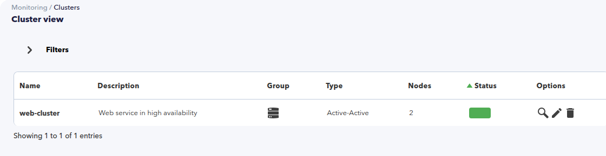
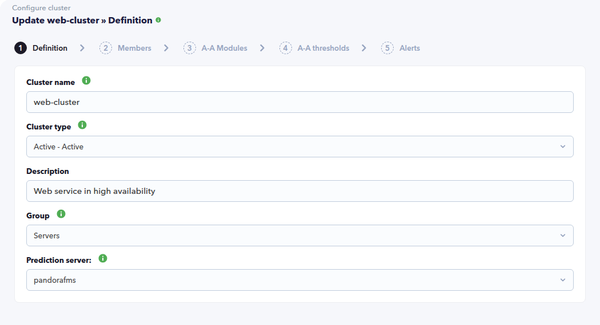
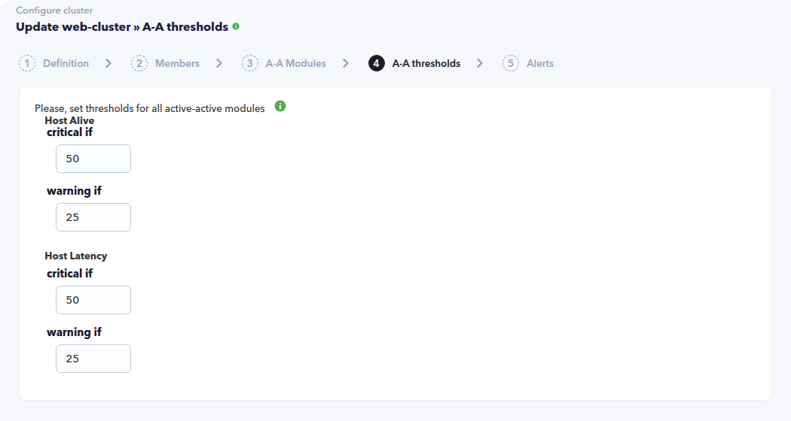
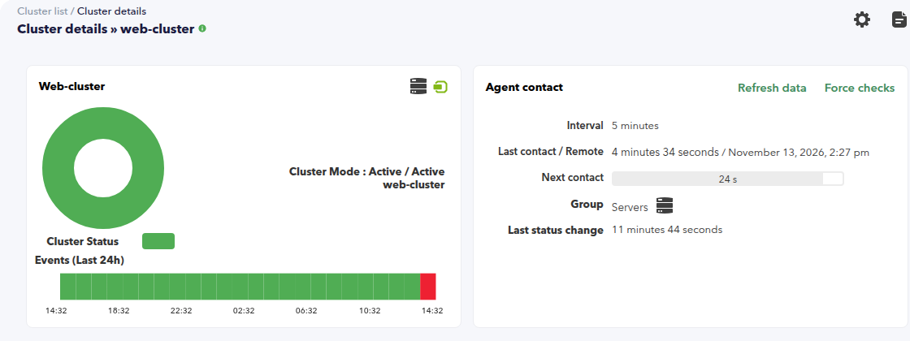

# Supervision des clusters

Superviser un cluster ne consiste pas à surveiller chaque nœud séparément : c'est surveiller le service qu'ils rendent ensemble. La vue des clusters de Pandora FMS regroupe plusieurs agents sous un même état, de sorte qu'une défaillance partielle est vue pour ce qu'elle est, un problème du service, et non une collection de modules isolés qui racontent chacun leur version.

## Ce que c'est et quand l'utiliser

La fonctionnalité permet de regrouper des agents qui rendent un même service et de résumer leur état dans un seul élément. Elle ne dépend ni du système d'exploitation ni de l'application : elle s'appuie sur les modules qui existent déjà sur les agents.

Il existe deux types de cluster :

| Type | Fonctionnement | Ce qui est surveillé |
|---|---|---|
| Actif-actif (AA) | Tous les nœuds sont en service et le travail est réparti entre eux. | Modules communs présents sur tous les nœuds. |
| Actif-passif (AP) | Un seul nœud est en service ; les autres restent en réserve. | Modules communs sur tous les nœuds et modules répartis sur le nœud actif. |

Un cluster contient deux catégories d'éléments :

- **Éléments communs :** modules qui doivent rester actifs sur tous les nœuds. Ils constituent la base du clustering.
- **Éléments répartis :** modules qui ne s'exécutent que sur le nœud actif et passent d'un nœud à l'autre. Ils n'ont de sens que dans les clusters actif-passif.

Lors de la création du cluster, l'assistant génère un agent propre, portant le nom du cluster, et un module appelé « Cluster status » qui résume l'état de l'ensemble. C'est cet agent qui apparaît dans la vue et qui sert aux alertes.

## Exigences

| Exigence | Détail |
|---|---|
| Serveur réseau | Un serveur réseau (type Network) doit être opérationnel. Le champ de l'assistant s'appelle **Prediction server**, mais il ne liste que des serveurs réseau, et c'est ce serveur qui effectue les calculs du cluster. |
| Agents | Un ou plusieurs agents avec les modules à évaluer ; au moins deux sont recommandés. |
| Noms des modules | Les modules communs doivent porter le même nom sur tous les nœuds. |
| Permissions | `AR` pour voir la liste ; `AW` global et sur le groupe du cluster pour ouvrir le détail et pour créer ou modifier. Les options de modification et de suppression ne s'affichent qu'avec `AW` sur le groupe. |

## Planifier la supervision

Dans un cluster actif-actif, les modules communs doivent exister sur tous les agents et porter le même nom. Si un module manque sur un nœud, il n'apparaît pas dans la liste des modules communs et ne peut pas être sélectionné. Si un module qui fait déjà partie du cluster disparaît ensuite d'un nœud, ce nœud compte comme indisponible. Créez des moniteurs identiques sur tous les agents avant de monter le cluster.

Dans un cluster actif-passif, les modules communs suivent la même règle. Les modules répartis sont configurés uniquement sur le nœud actif et ajoutés au cluster à l'étape correspondante de l'assistant. Pour surveiller « le nœud actif » sans dupliquer les modules, utilisez la supervision conditionnée : le module ne remonte que lorsque les préconditions définies sont remplies.

Les modules du nœud passif ne sont pas créés automatiquement. Si le nœud de secours doit avoir ses propres moniteurs, créez-les manuellement et ajoutez-les ensuite au cluster.

## Créer un cluster

Le chemin est **Operation → Monitoring → Cluster View**. Dans la liste, cliquez sur **New cluster** pour ouvrir l'assistant.

### Définition

La première étape recueille les données du cluster :

| Champ | Ce qu'il indique |
|---|---|
| Cluster name | Nom du cluster et de l'agent créé avec lui. |
| Cluster type | Actif-actif ou actif-passif. |
| Description | Texte libre pour identifier le service. |
| Group | Groupe auquel appartiendra l'agent du cluster. |
| Prediction server | Serveur réseau (type Network) qui effectuera les calculs. Bien que le champ soit intitulé « Prediction server », l'assistant ne propose que des serveurs réseau. |

Cliquez sur **Next** pour passer aux membres.

### Membres et modules communs

Dans **Members**, sélectionnez les agents qui composent le cluster. Dans **A-A Modules**, l'assistant n'affiche que les modules partagés par tous les membres ; choisissez ceux qui sont critiques pour le service. Si un module n'apparaît pas, vérifiez qu'il existe avec le même nom sur tous les agents.

### Seuils des modules actif-actif

Dans **A-A thresholds**, définissez pour chaque module commun le pourcentage de nœuds dans un état autre que normal qui déclenche l'avertissement et le critique. La condition est « égal ou supérieur » : si le cluster compte six nœuds et que vous voulez un avertissement lorsque trois tombent, réglez le seuil à 50 %.

La valeur par défaut est 0 %. Dans Pandora FMS, un seuil à 0 équivaut à ne pas le configurer : le module ne changera pas d'état de lui-même. Définissez l'avertissement et le critique avant de terminer ; sinon, le cluster ne reflétera pas les défaillances.

### Modules actif-passif

Dans **A-P module**, sélectionnez les modules répartis que vous souhaitez suivre. La liste affiche les modules de tous les agents du cluster, pas seulement les modules communs. Dans **Critical A-P modules**, l'assistant permet de marquer les modules répartis comme critiques.

L'assistant ne configure pas de seuils pour les modules répartis : il les crée avec un seuil à 0, ce qui équivaut à ne pas fixer de seuil.

### Alertes et clôture

Dans **Alerts**, vous pouvez ajouter des alertes sur les éléments du cluster afin qu'une action s'exécute lorsqu'ils passent à un état donné. Ce sont les alertes standard de Pandora FMS, expliquées en détail au chapitre 5.5.

Cliquez sur **Finish**. L'assistant marque le cluster pour que le serveur réseau le recalcule et ouvre la vue. Le calcul est asynchrone : tant que le serveur ne l'a pas traité, la vue peut afficher l'état précédent.

## Vue et état du cluster

La liste affiche le nom, la description, le groupe, le type, le nombre de nœuds, l'état et les options de chaque cluster. L'état provient du module « Cluster status ».

La vue de détail réunit l'état du cluster, le mode (actif-actif ou actif-passif), un graphique des événements des dernières 24 heures, la liste des modules avec leur état et les alertes associées. Le bouton **Reload** recharge les informations.

L'état est calculé à deux niveaux :

| Élément | Calcul |
|---|---|
| Module actif-actif | Pourcentage de nœuds dans un état autre que normal. Un module du cluster absent sur un nœud compte comme indisponible. |
| Module actif-passif | Valeur la plus récente parmi les nœuds, en ignorant les valeurs inconnues. |
| État du cluster | Le pire état de tous ses éléments : normal, avertissement ou critique. |

La donnée du module « Cluster status » utilise trois valeurs : 0 pour normal, 1 pour avertissement et 2 pour critique ; ses seuils fixes sont 1 et 2, et l'utilisateur ne les configure pas. Les modules dans un état inconnu comptent également comme critiques pour l'état du cluster. S'il n'y a de données pour aucun élément, le module ne met pas à jour son état.

## Modifier et supprimer

L'icône de modification de la liste ouvre le même assistant avec les données actuelles. Vous pouvez modifier la définition, les membres, les modules, les seuils et les alertes. Les boutons **Update and continue** et **Go back** permettent d'avancer et de reculer sans perdre ce qui a été saisi.

L'icône de corbeille supprime le cluster. L'opération supprime son agent, ses modules et ses relations avec les nœuds, et elle ne demande pas de confirmation : vérifiez qu'il s'agit du bon cluster avant de cliquer.

## Alertes

Les alertes du cluster sont les alertes standard de Pandora FMS. Vous pouvez les appliquer au module « Cluster status » pour surveiller l'état de l'ensemble, ou à des modules précis pour surveiller un élément. L'étape **Alerts** de l'assistant permet de les créer pendant la configuration ; ensuite, elles se gèrent comme toute autre alerte.

## Bonnes pratiques et problèmes courants

- **Noms identiques.** Un module commun doit porter le même nom sur tous les nœuds. Si deux modules partagent un nom sur le même agent, l'assistant ne peut pas décider lequel utiliser et affiche une erreur.
- **Seuils à 0 %.** C'est la valeur par défaut et elle équivaut à ne pas fixer de seuil : le module ne change pas d'état. Définissez les deux seuils sur chaque module avant de considérer le cluster comme terminé.
- **Modules du nœud passif.** Ils ne sont pas créés automatiquement. Si le nœud de secours doit avoir ses propres moniteurs, créez-les manuellement et ajoutez-les au cluster.
- **Nœud sans un module du cluster.** Si un module qui fait partie du cluster manque sur un nœud, il compte comme indisponible, pas comme inconnu. Un agent mal provisionné augmente le pourcentage de défaillance du cluster.
- **Serveur réseau.** Si le serveur réseau choisi (champ **Prediction server**) n'est pas opérationnel, l'état du cluster n'est pas mis à jour. Vérifiez-le avant de chercher le problème sur les agents.
- **Permissions.** `AR` permet de voir la liste ; ouvrir le détail et créer ou modifier exigent `AW` global et sur le groupe du cluster. Les options de modification et de suppression ne s'affichent qu'avec `AW` sur le groupe.
