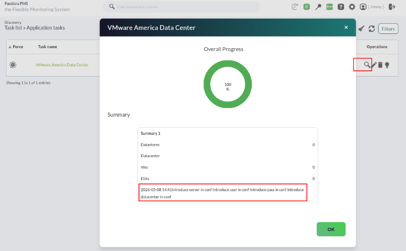
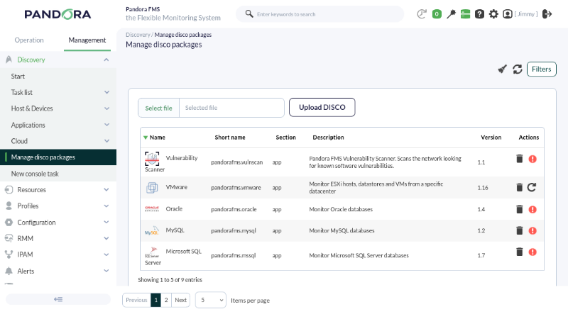

# Création de plugins de discovery

Un plugin de Discovery est un paquet `.disco` : un ZIP avec un formulaire et les exécutables qui se trouvent derrière. La console affiche le formulaire, le serveur exécute les commandes et, si le script renvoie des données, des agents et des modules apparaissent comme si quelqu'un les avait créés à la main. Le difficile n'est pas le ZIP, mais le contrat : quels champs sont déclarés, ce que reçoit le script et quel JSON il doit renvoyer. C'est ce que documente ce chapitre.

Ce chapitre est la référence de création des paquets `.disco`. L'utilisation de Discovery, la création des tâches et leur cycle de vie sont couvertes dans [2.3 · Supervision et découverte automatique avec Discovery](../parte-2/2.3-monitorizacion-y-descubrimiento-automatico-con-discovery.md). Les plugins de serveur locaux et distants, qui n'ont rien à voir avec cela, sont couverts dans [9.8 · Création de plugins locaux](9.8-creacion-de-plugins-locales.md) et [9.9 · Création de plugins distants](9.9-creacion-de-plugins-remotos.md).

## Ce qu'est un paquet `.disco` et ce qu'il n'est pas

Un paquet `.disco` est un fichier ZIP renommé. Il contient, au minimum, un `discovery_definition.ini` ; éventuellement, un `logo.png` et tous les scripts, exécutables et bibliothèques dont le plugin a besoin. La console lit l'INI, valide la définition, enregistre les métadonnées et affiche l'assistant de création de tâches. Le serveur Discovery reçoit les exécutables et lance les commandes déclarées par le paquet avec les valeurs saisies par l'utilisateur dans le formulaire.

La différence avec les autres extensions de Pandora FMS mérite d'être claire avant de commencer :

| Extension | Ce qu'elle ajoute | Documentée dans |
|---|---|---|
| Paquet `.disco` | Un assistant de Discovery : formulaire et exécutables qui créent des agents et des modules. | Ce chapitre. |
| Plugin local | Une commande que le serveur de plugins exécute sur la machine où il est installé. | 9.8. |
| Plugin distant | Une commande que le serveur de plugins exécute contre un système distant. | 9.9. |
| Extension de console | Une nouvelle page ou action dans la console web. | 9.10. |

Un paquet `.disco` n'installe rien sur la machine supervisée. Il ne déploie pas d'EndPoint et n'y laisse pas de fichiers : il interroge ce qui existe (une API, une base de données, un hyperviseur) et ramène les données dans Pandora FMS. La création de la tâche, son intervalle, son serveur et ses alertes relèvent de [2.3](../parte-2/2.3-monitorizacion-y-descubrimiento-automatico-con-discovery.md) ; ici, vous construisez seulement le paquet que cette tâche exécute.

## Exigences

| Exigence | Détail |
|---|---|
| Format | Fichier ZIP avec l'extension `.disco`. La console refuse toute autre extension. |
| Définition | `discovery_definition.ini` à la racine du ZIP, pas dans un dossier. |
| Syntaxe | Format INI de PHP : sections entre crochets, tableaux avec clés et commentaires avec `;`. |
| `short_name` | Unique, avec des lettres, des chiffres, des points, des traits d'union et des traits de soulignement. Le préfixe `pandorafms.` est réservé aux paquets officiels. |
| Section | `app`, `cloud` ou `custom`. C'est l'onglet de Discovery où l'assistant apparaîtra. |
| Exécution | Au moins un `exec`. Les exécutables propres au paquet sont déclarés dans `execution_file`. |
| Environnement | L'interpréteur et les bibliothèques utilisés par le script doivent exister sur le serveur Discovery ; le paquet ne les installe pas. |
| Permissions | Utilisateur administrateur pour téléverser et gérer les paquets dans **Discovery → Manage disco packages**. |
| Serveur | Un serveur Discovery actif pour exécuter les tâches, avec ses jetons configurés (voir [9.3](9.3-referencia-completa-de-configuracion-del-servidor.md)). |
| Version | Chaîne de version déclarée et visible dans la console ; il convient de l'incrémenter à chaque changement. |

Rien de tout cela ne dépend d'une licence Enterprise. La création de paquets `.disco` fonctionne de la même manière dans toutes les éditions ; les paquets officiels qui ont leurs propres conditions, comme celui de SAP, les appliquent à l'exécution, pas à l'empaquetage.

## Anatomie du paquet

Un paquet minimal ressemble à ceci :

```text
example.http.disco
├── discovery_definition.ini
├── logo.png                  (facultatif)
└── demo_http.py
```

Le `discovery_definition.ini` est le contrat. Le `logo.png` est facultatif : s'il manque, la console utilise une icône générique. Les scripts et les bibliothèques sont référencés par des chemins relatifs à la racine du paquet. Évitez les chemins absolus : le paquet est copié dans un autre répertoire et cesserait de fonctionner.

La console conserve la définition et le logo, et copie les exécutables vers les serveurs Discovery. Sur le serveur, les fichiers déclarés dans `execution_file` sont résolus sous `<incomingdir>/discovery/<short_name>/`, et la console leur donne le droit d'exécution. C'est pourquoi tout ce que vous allez exécuter doit être déclaré dans `execution_file` ou dans les scripts de mot de passe ; un script qui n'y figure pas peut être copié, mais il ne recevra pas le droit d'exécution.

L'INI et le logo ne sont pas copiés sur le serveur : la définition passe par la base de données de la console et le serveur n'a besoin que des exécutables. Si un paquet apparaît dans la liste mais que ses fichiers ne sont pas sur le serveur, le bouton de synchronisation de **Manage disco packages** les copie à nouveau (voir [2.3](../parte-2/2.3-monitorizacion-y-descubrimiento-automatico-con-discovery.md)).

## Le fichier `discovery_definition.ini`

L'INI est organisé en blocs. Trois sont fixes et les autres sont des blocs de champs, de sélecteurs ou d'arborescences portant le nom choisi par l'auteur :

| Bloc | Obligatoire | À quoi il sert |
|---|---|---|
| `discovery_extension_definition` | Oui | Métadonnées, exécutables et exécutions du plugin. |
| `config_steps` | Non | Étapes du formulaire de la tâche. |
| `tempfile_confs` | Non | Fichiers de configuration temporaires pour les exécutions. |
| Blocs de champs (`custom_fields`) | S'ils sont référencés | Champs de chaque étape. |
| Blocs `custom_select` et `custom_tree_data` | S'ils sont référencés | Options et arborescences personnalisées. |

L'INI utilise des **macros** : des clés de texte qui commencent et se terminent par un trait de soulignement et ne contiennent que des lettres et des chiffres, par exemple `_url_` ou `_param1_`. Une macro valide suit `_…_` ; les traits d'union, les points ou les espaces ne sont pas autorisés dans le nom. À l'exécution, la macro est remplacée par sa valeur.

Les valeurs acceptent les types habituels de l'INI de PHP : `STRING` pour le texte, `NUMBER` pour les nombres, `BOOL` pour `true`/`false`, `1`/`0` ou `yes`/`no`, et `VALUE` pour l'un ou l'autre. Dans les tableaux, `VALUE_N` indique que la valeur peut être répétée. Les chaînes contenant des espaces ou des caractères spéciaux sont mises entre guillemets.

### Bloc `discovery_extension_definition`

| Paramètre | Obligatoire | Ce qu'il fait |
|---|---|---|
| `short_name` | Oui | Identifiant unique du paquet. Uniquement des lettres, des chiffres, des points, des traits d'union et des traits de soulignement. Le préfixe `pandorafms.` est réservé aux paquets officiels. |
| `section` | Oui | Section de la console : `app` (Applications), `cloud` (Cloud) ou `custom` (Custom). |
| `name` | Oui | Nom visible de l'assistant. |
| `version` | Oui | Version visible. Il est recommandé de la changer à chaque modification, même mineure. |
| `description` | Non | Description visible dans la liste des paquets. |
| `execution_file` | Non | Tableau de scripts et d'exécutables du paquet. La clé est une macro valide et la valeur un chemin relatif. La console accorde le droit d'exécution. |
| `exec` | Oui | Tableau de commandes exécutées par le serveur. Au moins une. Elles s'exécutent dans l'ordre et chacune produit son propre résumé. |
| `passencrypt_script` | Non | Chemin relatif du script qui chiffre les mots de passe depuis la console. |
| `passencrypt_exec` | Non | Commande de chiffrement. Elle n'accepte que les macros `_passencrypt_script_` et `_password_`. |
| `passdecrypt_script` | Non | Chemin relatif du script qui déchiffre les mots de passe depuis la console. |
| `passdecrypt_exec` | Non | Commande de déchiffrement. Elle n'accepte que les macros `_passdecrypt_script_` et `_password_`. |
| `default_value` | Non | Valeurs par défaut des macros du formulaire. La clé est la macro et la valeur dépend du type de champ. |

Un squelette minimal :

```ini
[discovery_extension_definition]
short_name = example.http
section = custom
name = Example HTTP
version = "1.0"
description = "Checks an HTTP endpoint and creates an agent with two modules"

execution_file[_exec1_] = "demo_http.py"
exec[] = "'_exec1_' --conf '_tempConf_'"
```

`execution_file` et `exec` sont des tableaux : vous pouvez déclarer plusieurs entrées avec des clés différentes, et `exec` les utilise dans l'ordre où elles apparaissent. Les chemins de `execution_file` sont remplacés par le chemin réel du fichier sur le serveur ; c'est pourquoi il vaut mieux les entourer de guillemets dans `exec`, surtout si le chemin peut contenir des espaces.

`default_value` accepte une valeur par type de champ :

| Type de champ | Valeur par défaut |
|---|---|
| `string` | Texte. |
| `number` | Nombre. |
| `password` | Texte. |
| `textarea` | Texte. |
| `checkbox` | `true` ou `false`. |
| `select` | Une valeur de la liste. |
| `multiselect` | Tableau JSON avec les valeurs sélectionnées, par exemple `["a","b"]`. |
| `tree` | Tableau JSON avec les valeurs sélectionnées. |

Ne mettez pas de mots de passe réels dans `default_value` : la valeur par défaut est enregistrée comme une valeur de plus de la tâche et ne passe pas par le chiffrement du formulaire. Pour les secrets, utilisez un champ `password` avec `encrypt_on_true` ou un sélecteur d'identifiants.

Les paramètres `passencrypt_*` et `passdecrypt_*` sont utilisés par la console, pas par le serveur. `passencrypt_exec` s'exécute à l'enregistrement du formulaire pour transformer le texte en valeur chiffrée ; `passdecrypt_exec` s'exécute à l'affichage du champ pour récupérer le texte. Le serveur reçoit la valeur enregistrée, c'est-à-dire la valeur chiffrée si le champ a été chiffré ; le plugin doit donc savoir la déchiffrer. Si le paquet n'inclut pas cette logique, ne marquez pas le champ pour le chiffrement.

### Macros du serveur

En plus des macros du formulaire, le serveur remplace ces clés dans les exécutions :

| Macro | Valeur |
|---|---|
| `__taskMD5__` | MD5 de l'identifiant de la tâche. Utile pour générer des noms de fichiers uniques. |
| `__taskInterval__` | Intervalle d'exécution de la tâche, en secondes. |
| `__taskCron__` | Expression cron de la tâche, ou vide si elle n'utilise pas cron. |
| `__taskGroup__` | Nom du groupe de la tâche. |
| `__taskGroupID__` | Identifiant du groupe de la tâche. |
| `__temp__` | Répertoire temporaire configuré sur le serveur. |
| `__incomingDir__` | Répertoire d'entrée des données du serveur. |
| `__consoleAPIURL__` | URL de l'API de la console. |
| `__consoleAPIPass__` | Mot de passe de l'API de la console. |
| `__consoleUser__` | Utilisateur de la console configuré sur le serveur. |
| `__consolePass__` | Mot de passe de cet utilisateur. |
| `__pandoraServerConf__` | Chemin complet du fichier `pandora_server.conf`. |

Ces macros ne sont remplacées que dans les exécutions du serveur. Les commandes de `script_data_fields`, que la console exécute pour construire des formulaires dynamiques, ne les reçoivent pas.

## Étapes de configuration (`config_steps`)

Le bloc `config_steps` définit les étapes que l'utilisateur voit après la première étape commune de la tâche. Chaque étape a un nom et une source de champs :

| Paramètre | Obligatoire | Ce qu'il fait |
|---|---|---|
| `name` | Oui | Nom de l'étape. |
| `script_data_fields` | Oui, si l'étape n'a pas de `custom_fields` | Commande que la console exécute pour obtenir les champs de l'étape en JSON. |
| `custom_fields` | Oui, si l'étape n'a pas de `script_data_fields` | Nom du bloc de champs affiché dans l'étape. |
| `fields_columns` | Non | Nombre de colonnes du formulaire : `1` ou `2`. Par défaut, `2`. |

Les clés de ce bloc sont positionnelles : si elles sont indiquées, elles doivent être numériques et différentes de 0 ; en pratique, numérotez-les à partir de 1. Si une étape déclare les deux sources, la console affiche d'abord les champs renvoyés par `script_data_fields`, puis ceux de `custom_fields`.

```ini
[config_steps]
name[1] = Endpoint
custom_fields[1] = endpoint
fields_columns[1] = 1

name[2] = Options
script_data_fields[2] = "'_exec1_' --fields '_url_'"
```

La commande de `script_data_fields` s'exécute dans la console, pas sur le serveur. La console remplace les macros de `execution_file` par leur chemin réel, transmet les valeurs déjà saisies aux étapes précédentes et attend un **tableau JSON d'objets**, même s'il n'y a qu'un seul champ :

```json
[
  {
    "macro": "_mode_",
    "name": "Mode",
    "type": "select",
    "mandatory_field": false,
    "select_data": {
      "basic": "Basic",
      "full": "Full"
    }
  }
]
```

Les clés de chaque objet sont les mêmes que celles d'un champ statique, avec deux différences : `select_data` est un objet `valeur : texte` et `tree_data` est un tableau de nœuds, pas le nom d'un bloc. Si la commande échoue ou renvoie autre chose que du JSON, l'étape affiche l'erreur du script à la place des champs. Si elle renvoie un objet avec une seule clé `error`, la console affiche ce message comme une erreur.

## Champs du formulaire (`custom_fields`)

Chaque bloc de champs est référencé depuis une étape avec `custom_fields`. Son nom est libre, à condition qu'il corresponde à la référence :

```ini
[endpoint]
macro[1] = _url_
name[1] = URL
type[1] = string
placeholder[1] = "http://192.0.2.10/"
```

| Paramètre | Obligatoire | Ce qu'il fait |
|---|---|---|
| `macro` | Oui | Macro où la valeur est enregistrée. Format `_…_`, lettres et chiffres uniquement. |
| `mandatory_field` | Non | `false` pour rendre le champ facultatif. S'il est omis, le champ est obligatoire. |
| `name` | Oui | Libellé visible du champ. |
| `tip` | Non | Texte d'aide affiché à côté du libellé. |
| `type` | Oui | Type de contrôle : `string`, `number`, `password`, `textarea`, `checkbox`, `select`, `multiselect` ou `tree`. |
| `placeholder` | Non | Texte d'exemple dans le champ, pour `string` et `textarea`. |
| `show_on_true` | Non | Macro d'une case à cocher ; le champ n'est affiché que lorsque cette case est active. |
| `encrypt_on_true` | Non | Macro d'une case à cocher ; le champ de mot de passe est chiffré à l'enregistrement lorsque cette case est active. |
| `select_data` | Oui pour `select` et `multiselect` | Nom d'un bloc `custom_select` ou l'un des sélecteurs de Pandora. |
| `tree_data` | Oui pour `tree` | Nom d'un bloc `custom_tree_data`. |

Les huit types et ce que chacun génère :

| `type` | Contrôle | Valeur enregistrée |
|---|---|---|
| `string` | Zone de texte d'une ligne. | Texte. |
| `number` | Zone numérique. | Nombre. |
| `password` | Zone masquée. | Texte ; il peut être chiffré. |
| `textarea` | Zone de plusieurs lignes. | Texte, avec retours à la ligne. |
| `checkbox` | Interrupteur oui/non. | Booléen (`1` ou `0`). |
| `select` | Liste déroulante à une option. | Une valeur. |
| `multiselect` | Sélecteur multiple. | Tableau JSON avec les valeurs choisies. |
| `tree` | Arborescence à plusieurs niveaux. | Tableau JSON avec les valeurs choisies. |

Deux avertissements qui évitent des ennuis. Premier : la clé lue par la console est `mandatory_field` ; `required_field`, qui apparaît dans les exemples anciens, est ignoré et le champ reste obligatoire. Deuxième : même si `mandatory_field` vaut `true`, les champs `multiselect` et `tree` acceptent que rien ne soit sélectionné ; la vérification du caractère obligatoire ne s'applique pas aux listes vides.

`show_on_true` et `encrypt_on_true` pointent vers la macro d'une case à cocher du même formulaire. La case peut se trouver dans une autre étape, mais elle doit exister. Si la macro n'existe pas ou n'est pas une case à cocher, le champ ne se comportera pas comme prévu.

## Sélecteurs avec des données de Pandora

Les champs `select` et `multiselect` peuvent utiliser les données de la console elle-même. La valeur enregistrée dans la tâche et celle que reçoit le script ne sont pas toujours les mêmes :

| `select_data` | Le sélecteur affiche | Enregistre | Le script reçoit |
|---|---|---|---|
| `agent_groups` | Noms des groupes d'agents. | ID du groupe. | Nom du groupe, ou vide s'il n'existe pas. |
| `agents` | Alias des agents. | Nom de l'agent. | Nom de l'agent, ou vide s'il n'existe pas. |
| `module_groups` | Noms des groupes de modules. | ID du groupe. | Nom du groupe, ou vide. |
| `modules` | Noms des modules. | Nom du module. | Nom du module, ou vide. |
| `module_types` | Descriptions des types de module. | Nom du type. | Nom du type. |
| `status` | Noms des états. | Constante de l'état. | Constante de l'état. |
| `tags` | Étiquettes. | ID de l'étiquette. | Nom de l'étiquette, ou vide. |
| `alert_templates` | Modèles d'alerte. | ID du modèle. | Nom du modèle, ou vide. |
| `alert_actions` | Actions d'alerte. | ID de l'action. | Nom de l'action, ou vide. |
| `interval` | Sélecteur d'intervalle. | Secondes. | Secondes. |
| `credentials.custom` | Identifiants personnalisés. | ID de l'identifiant. | JSON en base64 avec `user` et `password`. |
| `credentials.aws` | Identifiants AWS. | ID de l'identifiant. | JSON en base64 avec `access_key_id` et `secret_access_key`. |
| `credentials.azure` | Identifiants Azure. | ID de l'identifiant. | JSON en base64 avec `client_id`, `application_secret`, `tenant_domain` et `subscription_id`. |
| `credentials.gcp` | Identifiants Google Cloud. | ID de l'identifiant. | JSON en base64 avec les champs du document de service. |
| `credentials.sap` | Identifiants SAP. | ID de l'identifiant. | JSON en base64 avec `user` et `password`. |
| `credentials.snmp` | Identifiants SNMP. | ID de l'identifiant. | JSON en base64 avec `community`, `version`, `securityLevelV3`, `authUserV3`, `authMethodV3`, `authPassV3`, `privacyMethodV3` et `privacyPassV3`. |
| `credentials.wmi` | Identifiants WMI. | ID de l'identifiant. | JSON en base64 avec `user`, `password` et `namespace`. |
| `os` | Noms des systèmes d'exploitation. | ID du système. | Nom du système, ou vide. |

Les constantes de `status` sont les habituelles : `0` normal, `1` critique, `2` avertissement, `3` inconnu et `5` non initialisé. Le sélecteur affiche les noms, mais le script reçoit le nombre.

Le cas `agent_groups` mérite une ligne à part. Le script reçoit le **nom** du groupe, pas son ID. Si le paquet doit renvoyer `monitoring_data`, le champ `id_group` de l'agent a besoin d'un ID numérique ; soit le script le résout lui-même, soit il est omis et l'agent est créé dans le groupe d'autocréation du serveur (`autocreate_group`, 10 par défaut), à condition que ce groupe soit configuré. Pour la plupart des paquets, la seconde option suffit ; si le groupe fait partie du contrat, résolvez-le explicitement.

Les identifiants sont stockés dans le [Gestionnaire d'identifiants](../parte-2/2.2-gestor-de-credenciales.md) et le script reçoit le JSON déjà résolu et encodé en base64. Le champ du formulaire n'affiche que l'identifiant de l'identifiant ; l'utilisateur et le mot de passe ne sont pas copiés dans la définition de la tâche. Les clés de chaque type d'identifiant sont décrites dans [2.3](../parte-2/2.3-monitorizacion-y-descubrimiento-automatico-con-discovery.md).

## Sélecteurs et arborescences personnalisés

Lorsque les options ne viennent pas de Pandora, elles sont déclarées dans un bloc `custom_select` et référencées depuis `select_data` :

```ini
[modes]
option[basic] = Basic
option[full] = Full
```

La clé de `option` est la valeur enregistrée et le texte est ce que voit l'utilisateur. Le bloc peut porter n'importe quel nom ; celui qui compte est celui écrit dans `select_data`.

Pour une arborescence, on utilise un bloc `custom_tree_data`. Chaque niveau déclare ses éléments et, s'il a des enfants, le bloc qui les contient :

| Paramètre | Obligatoire | Ce qu'il fait |
|---|---|---|
| `name` | Oui | Texte de l'élément. |
| `selectable` | Oui dans la validation actuelle | `true` ou `false`. Si l'élément peut être sélectionné, il faut l'indiquer ; la validation refuse une arborescence sans ce paramètre. |
| `macro` | Non si l'élément n'est pas sélectionnable | Macro où la valeur de l'élément est enregistrée. Si elle est omise sur un élément sélectionnable, la valeur va dans la macro de l'arborescence. |
| `value` | Oui si l'élément est sélectionnable | Valeur enregistrée. |
| `children` | Non | Nom du bloc contenant les éléments enfants. Il ne peut pas pointer vers un bloc déjà situé au-dessus dans la même arborescence. |

Une arborescence à deux niveaux :

```ini
[resources]
name[1] = Servers
selectable[1] = false
children[1] = resources_servers

name[2] = Databases
selectable[2] = false
children[2] = resources_databases

[resources_servers]
name[1] = web01
selectable[1] = true
macro[1] = _targets_
value[1] = web01

name[2] = web02
selectable[2] = true
macro[2] = _targets_
value[2] = web02

[resources_databases]
name[1] = db01
selectable[1] = true
macro[1] = _targets_
value[1] = db01
```

Les valeurs sélectionnées sont enregistrées sous forme de tableau JSON, par exemple `["web01","db01"]`, et sont remplacées dans les exécutions comme n'importe quelle autre macro. Deux règles supplémentaires : une macro d'arborescence ne peut pas coïncider avec celle d'un champ extérieur à l'arborescence, et un bloc ne peut pas être enfant de lui-même ni de l'un de ses ancêtres.

## Fichiers temporaires (`tempfile_confs`)

De nombreux plugins ont besoin d'un fichier de configuration plutôt que de vingt arguments sur la ligne de commande. `tempfile_confs` le génère :

```ini
[tempfile_confs]
file[_tempConf_] = "
[CONF]
url = _url_
timeout = _timeout_
mode = _mode_
log = __temp__/__taskMD5__.log
"
```

La clé est une macro valide et la valeur est le contenu du fichier. Lorsque cette macro apparaît dans une exécution, le serveur crée un fichier temporaire avec ce contenu, remplace les macros qu'il contient par leurs valeurs et remplace la macro par le chemin du fichier. Le fichier est réécrit à chaque exécution de la tâche ; il n'est pas supprimé automatiquement.

Le contenu peut utiliser n'importe quelle macro du formulaire et les macros du serveur : `__temp__`, `__taskMD5__`, `__taskInterval__`, etc. C'est la manière pratique de transmettre une configuration multiligne à un script sans se battre avec les guillemets du shell.

## Sortie des scripts

Le serveur exécute chaque commande de `exec` avec le délai d'attente de la tâche et capture sa sortie standard et sa sortie d'erreur. Le code de sortie décide : si une commande se termine avec un code différent de `0`, la tâche est laissée en échec. Si le délai est atteint, la tâche échoue aussi et le résumé enregistre `The execution timed out.`.

La sortie standard doit être du JSON. Le serveur l'interprète ainsi :

- La clé `summary` est affichée sous forme de tableau à deux colonnes : ses clés à gauche et ses valeurs à droite.
- La clé `info` ajoute une ligne supplémentaire à ce tableau.
- Toute autre clé est également ajoutée au résumé.
- Si la sortie n'est pas du JSON, elle est enregistrée comme texte dans le résumé.
- Si la sortie est vide et qu'il y a une sortie d'erreur, l'erreur est enregistrée ; s'il n'y a pas d'erreur non plus, `The execution returned no output. Is the server out of memory?` est enregistré.

Chaque commande produit son propre tableau : `Summary 1`, `Summary 2`, etc. Le résumé est enregistré avec la tâche et se consulte depuis l'icône de résumé de la liste des tâches. Une exécution en échec laisse aussi son résumé ; c'est d'ailleurs la première chose à regarder quand quelque chose ne fonctionne pas.



Pour créer des agents et des modules, le JSON ajoute la clé `monitoring_data`. Sa structure complète est la suivante :

```json
{
  "summary": {
    "SUMMARY_FIELD_1": "SUMMARY_VALUE_1",
    "SUMMARY_FIELD_N": "SUMMARY_VALUE_N"
  },
  "info": "ADDITIONAL_INFO",
  "monitoring_data": [
    {
      "agent_data": {
        "agent_name": "AGENT_NAME",
        "agent_alias": "AGENT_ALIAS",
        "os": "OS",
        "os_version": "OS_VERSION",
        "interval": "INTERVAL",
        "id_group": "ID_GROUP",
        "address": "ADDRESS",
        "description": "DESCRIPTION",
        "agent_version": "AGENT_VERSION",
        "parent_agent_name": "PARENT_AGENT_NAME",
        "timezone_offset": "TIMEZONE_OFFSET"
      },
      "module_data": [
        {
          "name": "NAME",
          "data": "DATA",
          "type": "TYPE",
          "description": "DESCRIPTION",
          "max": "MAX",
          "min": "MIN",
          "post_process": "POST_PROCESS",
          "module_interval": "MODULE_INTERVAL",
          "min_critical": "MIN_CRITICAL",
          "max_critical": "MAX_CRITICAL",
          "min_warning": "MIN_WARNING",
          "max_warning": "MAX_WARNING",
          "disabled": "DISABLED",
          "min_ff_event": "MIN_FF_EVENT",
          "datalist": "DATALIST",
          "status": "STATUS",
          "unit": "UNIT",
          "timestamp": "TIMESTAMP",
          "module_group": "MODULE_GROUP",
          "custom_id": "CUSTOM_ID",
          "str_warning": "STR_WARNING",
          "str_critical": "STR_CRITICAL",
          "critical_instructions": "CRITICAL_INSTRUCTIONS",
          "warning_instructions": "WARNING_INSTRUCTIONS",
          "unknown_instructions": "UNKNOWN_INSTRUCTIONS",
          "tags": "TAGS",
          "critical_inverse": "CRITICAL_INVERSE",
          "warning_inverse": "WARNING_INVERSE",
          "quiet": "QUIET",
          "module_ff_interval": "MODULE_FF_INTERVAL",
          "alert_template": "ALERT_TEMPLATE",
          "crontab": "CRONTAB",
          "min_ff_event_normal": "MIN_FF_EVENT_NORMAL",
          "min_ff_event_warning": "MIN_FF_EVENT_WARNING",
          "min_ff_event_critical": "MIN_FF_EVENT_CRITICAL",
          "ff_timeout": "FF_TIMEOUT",
          "each_ff": "EACH_FF",
          "module_parent": "MODULE_PARENT",
          "module_parent_unlink": "MODULE_PARENT_UNLINK",
          "cron_interval": "CRON_INTERVAL",
          "ff_type": "FF_TYPE",
          "min_warning_forced": "MIN_WARNING_FORCED",
          "max_warning_forced": "MAX_WARNING_FORCED",
          "min_critical_forced": "MIN_CRITICAL_FORCED",
          "max_critical_forced": "MAX_CRITICAL_FORCED",
          "str_warning_forced": "STR_WARNING_FORCED",
          "str_critical_forced": "STR_CRITICAL_FORCED"
        }
      ]
    }
  ]
}
```

Dans `agent_data`, `agent_name` est obligatoire et doit être unique et stable : s'il change à chaque exécution, de nouveaux agents seront créés au lieu de mettre à jour l'agent existant. `agent_alias` est le nom lisible ; s'il manque, `agent_name` est utilisé. `address` est l'adresse de l'agent et `os` ou `id_os`, le système d'exploitation ; si le nom n'est pas reconnu, `Other` est utilisé. `id_group` doit être un ID de groupe numérique ; s'il est omis, le groupe d'autocréation du serveur est utilisé. `id_parent`, `longitude`, `latitude`, `altitude`, `position_description`, `custom_id`, `url_address`, `agent_mode` et `extra_data` sont également acceptés, même s'ils n'apparaissent pas dans le squelette.

Dans `module_data`, les clés indispensables sont `name`, `type` et `data`. `type` est l'identifiant du type de module (`generic_data`, `generic_data_string`, `generic_proc`, etc. ; la liste complète se trouve dans [2.20](../parte-2/2.20-configuracion-comun-de-los-modulos.md)). `module_interval` est un multiplicateur de l'intervalle de l'agent ; si `cron_interval` est indiqué, il prend le dessus. Les seuils (`min_warning`, `max_warning`, `min_critical`, `max_critical`) et leurs versions texte (`str_warning`, `str_critical`) sont appliqués à la création du module. Les clés non reconnues ne cassent rien : elles sont enregistrées comme informations étendues du module. En plus du squelette, le processeur accepte `extra_data`, `dynamic_interval`, `dynamic_min`, `dynamic_max` et `dynamic_two_tailed`.

Un détail qui explique beaucoup de « mon module n'apparaît pas » : les nouveaux modules ne sont créés que sur des agents nouveaux ou sur des agents en mode apprentissage. Sur un agent qui existe déjà et qui n'est pas en apprentissage, le plugin met à jour les modules qu'il possède déjà, mais n'en ajoute pas de nouveaux. Si le paquet doit ajouter des modules à des agents préexistants, ces agents doivent être en mode apprentissage, ou doivent être créés par le paquet lui-même.

Le contrat ci-dessus est la voie directe : le script écrit le JSON sur la sortie standard et le serveur crée les agents. Les paquets officiels utilisent généralement la bibliothèque `pandoraPlugintools` et envoient les données par Tentacle, que le serveur de données traite par sa voie habituelle ; cette voie sort du cadre de cette référence. Pour un paquet propre, le JSON est plus simple et ne nécessite aucune dépendance supplémentaire.

## Exemple complet

Le paquet `example.http` vérifie une URL et crée un agent avec deux modules : le code HTTP et le temps de réponse. Il comporte une seule étape et utilise un fichier temporaire pour transmettre la configuration au script.

```text
example.http.disco
├── discovery_definition.ini
└── demo_http.py
```

L'INI :

```ini
[discovery_extension_definition]
short_name = example.http
section = custom
name = Example HTTP
version = "1.0"
description = "Checks an HTTP endpoint and creates an agent with two modules"

execution_file[_exec1_] = "demo_http.py"
exec[] = "'_exec1_' --conf '_tempConf_'"

default_value[_url_] = "http://127.0.0.1/"
default_value[_timeout_] = 5
default_value[_mode_] = "basic"
default_value[_notify_] = 0
default_value[_label_] = ""

[config_steps]
name[1] = Endpoint
custom_fields[1] = endpoint
fields_columns[1] = 1

[endpoint]
macro[1] = _url_
name[1] = URL
type[1] = string
placeholder[1] = "http://192.0.2.10/"
tip[1] = "URL to check. The agent is created with its host as address."

macro[2] = _timeout_
name[2] = "Timeout (s)"
type[2] = number
mandatory_field[2] = false

macro[3] = _mode_
name[3] = Mode
type[3] = select
select_data[3] = modes
mandatory_field[3] = false

macro[4] = _notify_
name[4] = Add a label
type[4] = checkbox

macro[5] = _label_
name[5] = Label
type[5] = string
show_on_true[5] = _notify_
mandatory_field[5] = false

[modes]
option[basic] = Basic
option[full] = Full

[tempfile_confs]
file[_tempConf_] = "
[CONF]
url = _url_
timeout = _timeout_
mode = _mode_
notify = _notify_
label = _label_
"
```

Le script :

```python
#!/usr/bin/env python3
import argparse
import configparser
import hashlib
import json
import sys
import time
import urllib.parse
import urllib.request


def main():
    parser = argparse.ArgumentParser()
    parser.add_argument("--conf", required=True)
    args = parser.parse_args()

    config = configparser.ConfigParser()
    config.read(args.conf)

    url = config.get("CONF", "url", fallback="")
    timeout = config.getint("CONF", "timeout", fallback=5)
    mode = config.get("CONF", "mode", fallback="basic")
    notify = config.getboolean("CONF", "notify", fallback=False)
    label = config.get("CONF", "label", fallback="")

    if not url:
        print("url is required", file=sys.stderr)
        return 2

    start = time.time()
    try:
        with urllib.request.urlopen(url, timeout=timeout) as response:
            status = response.getcode()
        elapsed = round((time.time() - start) * 1000, 2)
    except Exception as error:
        print(f"request failed: {error}", file=sys.stderr)
        return 1

    host = urllib.parse.urlsplit(url).hostname or url
    agent_name = "example_http_" + hashlib.md5(url.encode()).hexdigest()[:12]
    info = f"Mode: {mode}"
    if notify and label:
        info += f". Label: {label}"

    output = {
        "summary": {
            "URL": url,
            "HTTP status": status,
            "Response time (ms)": elapsed,
        },
        "info": info,
        "monitoring_data": [
            {
                "agent_data": {
                    "agent_name": agent_name,
                    "agent_alias": f"Example HTTP {host}",
                    "address": host,
                    "os": "Other",
                    "interval": 300,
                    "description": "Created by the example .disco package",
                },
                "module_data": [
                    {
                        "name": "HTTP status",
                        "type": "generic_data",
                        "data": status,
                        "description": "Last HTTP status code",
                        "min_warning": 400,
                        "max_warning": 499,
                        "min_critical": 500,
                        "max_critical": 599,
                    },
                    {
                        "name": "Response time",
                        "type": "generic_data",
                        "data": elapsed,
                        "unit": "ms",
                        "description": "Time to first byte",
                        "min_warning": 1000,
                        "min_critical": 3000,
                    },
                ],
            }
        ],
    }

    json.dump(output, sys.stdout)
    return 0


if __name__ == "__main__":
    sys.exit(main())
```

Le formulaire affiche l'URL, le délai d'attente, le mode et la case à cocher ; le champ « Label » n'apparaît que lorsque la case est active. À l'exécution de la tâche, le serveur crée le fichier temporaire, lance `demo_http.py --conf <fichier>`, reçoit le JSON et crée l'agent `Example HTTP <host>` avec les modules « HTTP status » et « Response time ». Le résumé de l'exécution affiche l'URL, le code et le temps ; les exécutions suivantes mettent à jour les mêmes modules.

L'agent ne porte pas `id_group` : il est créé dans le groupe d'autocréation du serveur. Si le paquet doit respecter le groupe de la tâche ou celui choisi par l'utilisateur, ajoutez `id_group` avec l'ID numérique correspondant.

## Installer, tester et déboguer

Le paquet se construit comme un ZIP normal et se renomme en `.disco` :

```sh
zip -r example.http.disco discovery_definition.ini demo_http.py
```

Le ZIP doit avoir les fichiers à sa racine ; si le dossier qui les contient est compressé, la console ne trouvera pas l'INI. Ensuite, dans **Discovery → Manage disco packages**, cliquez sur **Select file**, choisissez le `.disco` et téléversez-le avec **Upload DISCO**. La console valide l'INI, installe le paquet et copie les exécutables.



La validation refuse le paquet sans dire « presque » : s'il manque le bloc `discovery_extension_definition` ou le `short_name`, si le `short_name` contient des caractères non autorisés, s'il manque `section` ou `name`, si la section n'est pas `app`, `cloud` ou `custom`, s'il n'y a aucun `exec` ou si l'un d'eux est vide, si une clé de `default_value`, `execution_file` ou `tempfile_confs` n'a pas le format d'une macro, si une étape de `config_steps` utilise une clé qui n'est pas numérique ou qui vaut 0 ou n'a pas de `name` et de source de champs, si un champ n'a pas de `macro`, de `name` ou de `type`, si le type n'est pas l'un des huit, si un `select` ou un `multiselect` n'a pas de `select_data` ou si la référence n'existe pas, si une arborescence n'a pas de `tree_data` ou pointe vers un bloc inexistant ou vers un ancêtre, ou si un `custom_select` n'a pas d'`option`.

Si le `short_name` commence par `pandorafms.`, la console avertit que le préfixe est réservé aux paquets officiels et demande confirmation ; elle ne l'empêche pas. Si un autre paquet avec le même `short_name` existe déjà, elle avertit et propose de l'écraser avec tout son contenu. Il n'y a pas de comparaison de versions : téléverser le même `short_name` remplace le paquet, alors changez la version pour savoir ce qui est installé.

Après l'installation, l'assistant apparaît dans sa section (Applications, Cloud ou Custom). Créez une tâche comme n'importe quelle autre (voir [2.3](../parte-2/2.3-monitorizacion-y-descubrimiento-automatico-con-discovery.md)), forcez la première exécution et consultez le résumé. Si le paquet crée des agents, ils apparaissent dans la console avec leurs modules ; s'ils n'apparaissent pas, le résumé indique généralement pourquoi.

Pour itérer, modifiez le fichier, téléversez le paquet avec le même `short_name` et la nouvelle version. Les tâches existantes conservent leurs valeurs ; les nouvelles valeurs par défaut s'appliquent aux macros manquantes. Si vous avez touché des fichiers en dehors du paquet ou si la copie vers les serveurs est restée à moitié faite, le bouton de synchronisation de **Manage disco packages** les copie à nouveau.

Quand quelque chose échoue, l'ordre de vérification est le suivant :

1. Exécutez le script à la main avec un fichier de configuration d'exemple et vérifiez le code de sortie. S'il échoue là, arrêtez-vous : le problème vient du script.
2. Vérifiez que la sortie est un seul JSON valide : `python3 -m json.tool sortie.json`, ou passez la sortie par `jq` si vous l'avez.
3. Vérifiez les permissions et l'interpréteur. Le script doit être dans `execution_file` et avoir un `#!` valide ou un interpréteur disponible sur le serveur.
4. Vérifiez les chemins. Le serveur résout les exécutables du paquet sous `<incomingdir>/discovery/<short_name>/` ; ne comptez pas sur le fait que le répertoire de travail de la tâche soit celui-là, utilisez donc des chemins absolus ou résolvez-les depuis le script lui-même.
5. Vérifiez le délai d'attente de la tâche. Le délai s'applique à chaque commande ; un script qui prend plus de temps est coupé et la tâche échoue.
6. Regardez le journal du serveur (`log_file`, `/var/log/pandora_server.log` par défaut ; voir [9.3](9.3-referencia-completa-de-configuracion-del-servidor.md)). Le serveur y note la commande qu'il lance et les erreurs d'exécution.

Il n'est pas nécessaire de redémarrer le serveur Discovery après avoir téléversé un paquet : la console met à jour la définition et les fichiers, et le serveur les lit à l'exécution de la tâche.

## Bonnes pratiques et erreurs courantes

- **`short_name` stable.** Le changer crée une autre application et laisse orphelines les tâches de la précédente. Si le paquet est une évolution, conservez le `short_name` et augmentez la version.
- **Version à jour.** La console ne compare pas les versions, mais la liste affiche celle qui est présente. Une version qui ne change jamais invite à douter de ce qui est installé.
- **Chemins relatifs.** Tout ce qui se trouve dans le paquet est référencé depuis sa racine. Les chemins absolus fonctionnent sur votre machine et échouent sur le serveur.
- **Exécutables déclarés.** Si un script n'est pas dans `execution_file`, il ne recevra pas le droit d'exécution. Il en va de même pour les scripts de mot de passe.
- **Dépendances incluses ou documentées.** Le paquet n'installe pas de bibliothèques. Si le script a besoin de `requests`, `paramiko` ou d'un client de base de données, incluez-le ou vérifiez qu'il existe sur le serveur et documentez-le.
- **Secrets hors de l'INI.** Ne mettez pas de mots de passe dans `default_value` ni dans le fichier temporaire. Utilisez un champ `password` avec chiffrement ou un identifiant du Gestionnaire d'identifiants.
- **Mots de passe chiffrés, avec déchiffrement.** Si vous utilisez `encrypt_on_true`, le serveur reçoit la valeur chiffrée. Le plugin doit la déchiffrer ; les scripts `passencrypt_*` et `passdecrypt_*` sont destinés à la console.
- **`agent_name` stable.** Un nom différent à chaque exécution crée un nouvel agent à chaque fois. Utilisez un identifiant dérivé de la ressource, pas un nombre aléatoire.
- **Noms de modules stables.** Changer le nom d'un module crée un autre module ; le précédent conserve ses données et ses alertes.
- **JSON uniquement sur STDOUT.** Les messages de débogage vont sur STDERR ou dans un fichier. Un `print` de trop transforme la sortie en non-JSON et le résumé en texte.
- **Échouer avec un code différent de 0.** Si le script ne peut pas faire son travail, sortez avec une erreur. Un JSON vide avec le code 0 laisse la tâche comme réussie et le problème se découvre plus tard.
- **Résumés lisibles.** Les clés de `summary` sont lues par une personne. `status_code`, `URL` ou `Response time` se comprennent ; `res` et `v1` non.
- **Fichiers temporaires uniques.** Utilisez `__taskMD5__` dans les noms de fichiers pour que deux tâches ne se chevauchent pas. Nettoyez ce que vous créez : les fichiers de `tempfile_confs` sont réécrits à chaque exécution, mais ne sont pas supprimés seuls, et les fichiers créés par votre script vous appartiennent.
- **`mandatory_field`, pas `required_field`.** La console lit `mandatory_field` ; les exemples anciens avec `required_field` laissent le champ obligatoire même si vous ne le voulez pas.
- **`selectable` dans les arborescences.** La validation actuelle refuse un élément d'arborescence sans `selectable`. Déclarez-le toujours, que ce soit `true` ou `false`.
- **Testez l'échec.** Une URL qui ne répond pas, un JSON mal formé, un délai d'attente et un fichier temporaire avec des retours à la ligne. Si le paquet n'a été testé que sur le cas favorable, il n'a pas été testé.
