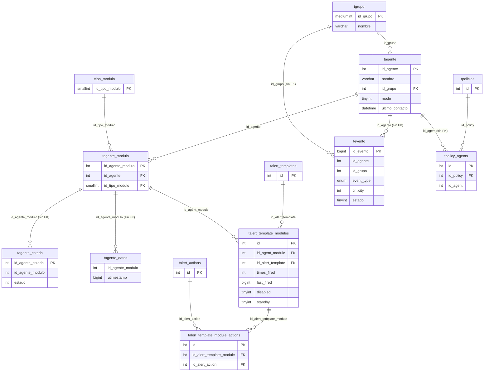

# Esquema de la base de datos

Toda la información de Pandora FMS —agentes, módulos, alertas, eventos,
usuarios, políticas— vive, al final, en unas cuantas tablas MySQL. Es tentador
mirar directamente ahí cuando la interfaz no da la respuesta rápida que hace
falta: un informe con SQL personalizado, un `SELECT` de diagnóstico a las tres
de la madrugada, un script que necesita saber en qué columna guarda el
servidor el último contacto de un agente. Este capítulo es el mapa de ese
territorio: qué tablas existen, para qué sirve cada una y cómo se relacionan.

!!! warning "Antes de tocar la base de datos"
    El esquema cambia entre versiones —columnas nuevas, tablas que aparecen o
    desaparecen, tipos que se ajustan— sin más aviso que el changelog de cada
    build. Esta página documenta la versión indicada en la cabecera de la
    [referencia de tablas](10.2-referencia-de-tablas.md), que siempre va
    alineada con el código real. Para leer o escribir datos de Pandora FMS
    desde fuera, la vía recomendada es la
    API REST:
    es estable entre versiones y no exige conocer el esquema interno. Acceder
    directamente a la base de datos es un último recurso, sin garantía de
    compatibilidad, y **nunca debe escribirse directamente** sobre tablas
    gestionadas por el producto: el servidor y la consola web dan por hecho
    que son los únicos que escriben ahí, y una fila tocada a mano puede dejar
    el agregado de datos, un contador o una cola de tareas en un estado que
    ellos mismos no saben interpretar. Para consultas de solo lectura,
    preferir siempre una réplica o la base de datos de histórico antes que la
    base principal en producción.

Un detalle que sorprende la primera vez: la consola web guarda los textos
(nombres de agente y de módulo, descripciones…) con los caracteres
especiales convertidos a entidades HTML, así que `Router & Firewall` aparece
en la tabla como `Router &amp; Firewall`. Hay que tenerlo en cuenta al
filtrar por nombre. Y los módulos borrados desde la consola no desaparecen
al instante: quedan marcados con `delete_pending = 1` hasta que el servidor
los elimina, por eso las consultas de módulos los excluyen.

Este capítulo cubre la base de datos principal, la de histórico y la del
Command Center. No cubre bases de datos de terceros con las que
Pandora FMS se integra (SIEM externos, CMDB, etc.): esas tienen su propio
esquema y quedan fuera del alcance de esta documentación.

## Visión general: bases de datos, motor, ficheros y versión

Una instalación de Pandora FMS puede llegar a tener hasta tres bases de datos
distintas, todas con el mismo motor:

- **Base de datos principal** (`pandora`): la única obligatoria. Guarda la
  configuración completa y los datos recientes de monitorización.
- **Base de datos de histórico** (opcional, activada con
  `history_db_enabled`): mismo esquema que las tablas de datos de la
  principal, pensada para retener series temporales más allá de lo que la
  principal purga. Ver [Base de datos de histórico](#base-de-datos-de-historico-que-se-mueve-cuando-y-como-se-purga).
- **Base de datos del Command Center**: en instalaciones con Command Center, cada
  nodo conserva su propia base principal y el Command Center añade una base
  propia con tablas `tmetaconsole_*`. Ver [Command Center](#command-center-tablas-propias-y-sincronizacion).

El motor soportado es Percona Server for MySQL 8 —recomendado, sobre todo por
encima de 4.000 agentes— o MySQL 8 / MySQL 8.4 desde la build 785; la tabla de
requisitos completa está en
[Instalación](../parte-1/1.1-instalacion.md).

El esquema se define en dos ficheros que se cargan una sola vez, en la
instalación: `pandoradb.sql` (estructura: las 271 tablas) y
`pandoradb_data.sql` (datos de semilla: tipos de módulo, configuración por
defecto, catálogos). A partir de ahí, dos tokens de la tabla `tconfig` —
`db_scheme_version` (por ejemplo `8.0NG`) y `db_scheme_build` (por ejemplo
`PD260915`)— identifican la versión de esquema instalada, y la consola los
compara con la versión del paquete para avisar de bases de datos
desactualizadas.

Entre versiones mayores, los cambios de esquema llegan como ficheros
`extras/mr/<número>.sql`, uno por *build*. La consola guarda en `tconfig` el
token `MR` con el número más alto ya aplicado y, en cada comprobación de
actualizaciones, ofrece como pendientes los ficheros con número superior; al
aplicarse, el fichero se mueve a `extras/mr/updated/` y el token `MR` se
actualiza. No se ejecutan a mano salvo que el procedimiento de actualización
lo indique explícitamente.

## Mapa por área funcional

Las 271 tablas del esquema no están organizadas en distintos `SCHEMA` ni
bases de datos separadas —todas viven en la misma base de datos—, pero sí
responden a un reparto funcional claro. La tabla siguiente agrupa las tablas
por el área que cubren; es una construcción de esta documentación para
facilitar la navegación, no una estructura declarada en el motor.

| Área funcional | Qué cubre | Nº de tablas |
|---|---|---|
| Agentes y monitorización (núcleo) | Agentes, módulos, su configuración y sus datos | 37 |
| Grupos y organización | Jerarquía de grupos y categorías | 4 |
| Alertas | Plantillas, acciones y comandos de alerta | 16 |
| Eventos | Registro de eventos y su ciclo de vida | 10 |
| Políticas | Configuración desplegada en bloque sobre agentes | 13 |
| Usuarios, perfiles y sesiones | Cuentas, permisos y sesiones activas | 16 |
| Notificaciones y mensajería | Avisos internos y mensajes entre usuarios | 11 |
| Informes y visualización | Informes, gráficas, dashboards, consolas visuales | 34 |
| Discovery y reconocimiento | Tareas de descubrimiento de red | 9 |
| Mapas de red y GIS | Mapas de red y geolocalización | 17 |
| Clúster y alta disponibilidad | Configuración de clúster de agentes | 3 |
| Command Center | Nodos, sincronización y migración entre nodos | 14 |
| Gestor de credenciales | Almacén de credenciales reutilizables | 1 |
| Servidores, configuración y mantenimiento | Servidores, configuración global, copias de seguridad | 13 |
| Traps SNMP | Traps recibidas y su normalización | 2 |
| IPAM (gestión de direcciones IP) | Redes, subredes y direcciones IP gestionadas | 8 |
| NCM (Network Config Manager) | Configuración de dispositivos de red | 12 |
| RMM (Remote Monitoring & Management) | Gestión remota de equipos | 7 |
| SIEM | Reglas y decodificadores de eventos de seguridad | 12 |
| Seguridad y vulnerabilidades | Vulnerabilidades y parches detectados | 3 |
| Planificación de paradas (downtimes) | Ventanas de mantenimiento planificado | 3 |
| Etiquetas (tags) | Etiquetado de módulos y políticas | 3 |
| Servicios | Servicios compuestos por otros elementos | 2 |
| Autoconfiguración de agentes | Reglas de autoconfiguración de agentes nuevos | 3 |
| Comandos remotos (consola web) | Comandos remotos ejecutables desde la consola | 2 |
| [Colecciones](../parte-2/2.9-colecciones.md) y plugins | Colecciones de ficheros y catálogo de plugins | 2 |
| Idiomas y traducción | Traducciones de la interfaz | 3 |
| Varios / utilidades internas | Tablas de apoyo sin área propia | 11 |

Para el detalle de columnas, tipos, claves y comentarios de cualquier tabla de
esta lista, la [referencia de tablas](10.2-referencia-de-tablas.md) reúne las
271 tablas agrupadas por esta misma área, con un enlace directo a cada una.

## Tablas núcleo en detalle y diagrama de relaciones

Un puñado de tablas concentra la mayor parte de las consultas habituales.
Conocerlas de memoria evita más de una vuelta a la referencia completa:

- **Agente e inventario de módulos.** `tagente` guarda un registro por agente
  (`id_grupo` referencia `tgrupo`; `modo` es el modo de aprendizaje del
  módulo al crearse, no un estado del agente — ver
  [Códigos y enumeraciones](#codigos-y-enumeraciones)). Cada módulo de ese
  agente es una fila en `tagente_modulo` (`id_agente` referencia `tagente`,
  `id_tipo_modulo` referencia `ttipo_modulo`, el catálogo de tipos de
  módulo). El último estado conocido de cada módulo vive en
  `tagente_estado`: una fila por módulo, con `id_agente_modulo` e
  `id_agente` apuntando a las tablas anteriores por convención de nombre,
  sin `FOREIGN KEY` declarada.
- **Datos de los módulos.** Las series temporales se reparten en cuatro
  tablas según el tipo de dato: `tagente_datos` (numéricos),
  `tagente_datos_string` (cadena), `tagente_datos_inc` (incrementales) y
  `tagente_datos_log4x` (logs). Las cuatro se indexan por
  `id_agente_modulo` + `utimestamp`, también sin `FOREIGN KEY` declarada —el
  volumen que mueven a diario desaconseja esa comprobación en cada inserción
  (ver [Base de datos de histórico](#base-de-datos-de-historico-que-se-mueve-cuando-y-como-se-purga)).
- **Alertas.** Una plantilla de alerta (`talert_templates`) se asigna a un
  módulo concreto a través de `talert_template_modules`
  (`id_agent_module` referencia `tagente_modulo`, `id_alert_template`
  referencia `talert_templates`; ahí viven también `times_fired`,
  `last_fired`, `disabled` y `standby`). Cada asignación dispara una o
  varias acciones vía `talert_template_module_actions`, que apuntan a
  `talert_actions` y, desde ahí, a `talert_commands`.
- **Eventos.** `tevento` es una fila por evento generado, con `id_agente`,
  `id_grupo`, `id_agentmodule` e `id_alert_am` como referencias por
  convención (sin `FOREIGN KEY` declarada). `event_type` es un `ENUM`
  cerrado con los tipos de evento posibles; `criticity` y `estado` son los
  códigos descritos en la siguiente sección.
- **Políticas.** `tpolicies` es la cabecera de una política; `tpolicy_agents`
  y `tpolicy_groups` definen sobre qué agentes o grupos se aplica, y
  `tpolicy_modules` y `tpolicy_alerts` qué módulos y alertas despliega sobre
  ellos.
- **Gestor de credenciales.** `tcredential_store` guarda cada credencial bajo
  su `identifier` como clave primaria; `product` es un `ENUM` con los tipos
  de credencial soportados (`CUSTOM`, `AWS`, `AZURE`, `GOOGLE`, `SAP`, `WMI`,
  `SNMP`). El detalle funcional completo está en
  [Gestor de credenciales](../parte-2/2.2-gestor-de-credenciales.md), y su
  cifrado en [Cifrado de la base de datos](../parte-9/9.5-cifrado-de-la-base-de-datos.md);
  aquí solo interesa la forma de la tabla.

El diagrama siguiente resume esas relaciones. Las líneas continuas marcan una
`FOREIGN KEY` declarada en el esquema; el resto son relaciones por
convención de nombre de columna, sin restricción declarada en el motor.



## Códigos y enumeraciones

Varias columnas guardan enteros que solo tienen sentido con su tabla de
significados a mano.

**Estado de módulo** (columna `estado` de `tagente_estado`): valores que
guarda de verdad el servidor.

| Código | Significado |
|---|---|
| `0` | Normal |
| `1` | Crítico |
| `2` | *Warning* |
| `3` | Desconocido (*unknown*) |
| `4` | No iniciado — valor inicial al crear el módulo, antes de recibir el primer dato |

Las constantes de consola `AGENT_MODULE_STATUS_*` añaden valores adicionales,
pero son **valores de filtro** de la interfaz, no algo que la columna guarde
nunca: `5` (no iniciado, en filtros), `6` (no normal, agrupador), `7` (normal
forzado) y `100`/`200`/`300` (crítico, *warning* o normal con alguna alerta
disparada). No confundir columna y filtro: si se consulta `estado`
directamente por SQL, solo aparecerán los valores `0` a `4`.

**Estado de agente:** no hay columna que lo guarde. La consola web lo
calcula a partir de los contadores de `tagente` (`normal_count`,
`warning_count`, `critical_count`, `unknown_count`, `notinit_count`,
`total_count` y `fired_count`, el de alertas disparadas), que el servidor
mantiene al día. Para saber cómo está un agente por SQL, se miran esos
contadores.

**Modo del agente** (columna `modo` en `tagente`): `0` normal, `1`
aprendizaje (*learning*), `2` autodeshabilitado (*autodisable*). La columna
tiene `0` por defecto, pero en la práctica los agentes nacen en `1`: es el
valor que usan el servidor al crear un agente desde un XML y la consola web
al darlo de alta a mano.

**Tipo de módulo** (tabla `ttipo_modulo`): catálogo con id, nombre interno
(por ejemplo `generic_data`), categoría numérica y tipo de dato (`numeric`,
`boolean`, `string`). Son cerca de cuarenta tipos; el catálogo completo está
en la fila `ttipo_modulo` de la [referencia de tablas](10.2-referencia-de-tablas.md#ttipo_modulo).

**Estado de evento** (columna `estado` en `tevento`): `0` nuevo, `1`
validado, `2` en proceso.

**Tipo de evento** (columna `event_type` en `tevento`, `ENUM` cerrado):
`going_unknown`, `unknown`, `alert_fired`, `alert_recovered`,
`alert_ceased`, `alert_manual_validation`, `recon_host_detected`, `system`,
`error`, `new_agent`, `going_up_warning`, `going_up_critical`,
`going_down_warning`, `going_down_normal`, `going_down_critical`,
`going_up_normal`, `configuration_change`, `ncm`.

**Criticidad de evento** (columna `criticity` en `tevento`): `0`
mantenimiento, `1` informativo, `2` normal, `3` *warning*, `4` crítico, `5`
menor (*minor*), `6` mayor (*major*). Los valores `20`, `21` y `34` son
combinaciones que usan los filtros de la consola (`20`, no normal; `21`,
crítico o normal; `34`, *warning* o crítico) y no criticidades propias de un
evento concreto.

**Alertas disparadas:** no existe una columna de «estado» única para una
alerta. Se deduce de `talert_template_modules.times_fired` (contador de
disparos) y `last_fired` (marca de tiempo del último); `standby` y
`disabled` controlan si la alerta puede dispararse en absoluto.

## Base de datos de histórico: qué se mueve, cuándo y cómo se purga

La base de histórico es opcional (`history_db_enabled` en `tconfig`, junto a
`history_db_host`, `history_db_port`, `history_db_name` y el resto de
parámetros de conexión, configurables desde Configuración → Histórico).
Cuando está activa, el servidor mueve hacia ella —tarea periódica de
`pandora_db.pl`— los datos de series temporales de los módulos
(`tagente_datos`, `tagente_datos_string`) y, si corresponde, eventos y traps.
El detalle exacto del movimiento es funcionalidad Enterprise y no está en el
árbol community, así que no se documenta aquí.

En la base principal, el mismo proceso periódico purga los datos que ya
cumplieron su plazo, con estos límites por defecto:

| Parámetro | Por defecto | Purga |
|---|---|---|
| `days_purge` | 45 días | `tagente_datos` |
| `string_purge` | 7 días | `tagente_datos_string` |
| `event_purge` | 7 días | `tevento` |
| `days_delete_not_initialized` | 7 días | Agentes que llevan ese tiempo sin iniciarse |
| `days_compact` | 0 (desactivado) | Compactación de datos antiguos |

La base de histórico, cuando está activa, tiene su propio ciclo de purgado
—la misma función, ejecutada sobre la conexión de histórico— con sus propios
límites (`history_db_days`, `history_db_string_days`): no hereda los días de
la base principal.

Para dimensionar cuánto va a crecer cada base según el número de agentes y
módulos, ver
[Análisis de volumetría y diseños para alta capacidad](../parte-9/9.14-analisis-de-volumetria-y-disenos-para-alta-capacidad.md),
que no se repite aquí.

## Command Center: tablas propias y sincronización

El Command Center tiene su propia base de datos, con tablas prefijadas
`tmetaconsole_*` que replican o cachean información de los nodos gestionados
—nunca sustituyen a las tablas equivalentes de cada nodo, que siguen siendo
la fuente original de esos datos—.

Las tablas clave son:

- `tmetaconsole_setup`: alta de cada nodo, con su URL y las credenciales de
  conexión a su base de datos, API y consola —cifradas si el
  [cifrado de la base de datos](../parte-9/9.5-cifrado-de-la-base-de-datos.md)
  está activo—.
- `tmetaconsole_agent`: agentes sincronizados desde los nodos, junto con su
  nodo de origen.
- `tmetaconsole_agent_secondary_group`: grupos secundarios replicados desde
  los nodos.
- `tmetaconsole_ha_databases`: bases de datos de Alta Disponibilidad
  registradas por nodo.
- `tmetaconsole_license_limit_cache`: caché del límite de licencia agregado
  de todos los nodos.

La sincronización y la migración de elementos entre nodos usan un segundo
grupo de tablas: `tsync_queue` (cola de sincronización), `tmigration_queue`
y `tmigration_module_queue` (colas de migración de agentes y módulos entre
nodos), `tmerge_error`, `tmerge_steps` y `tmerge_queries` (fusión de nodos) y
`tnode_relations` (relación entre cada elemento y su nodo de origen). Cuando
la migración mueve datos de módulo entre nodos que tienen activada la base
de histórico, la operación toca también esa conexión de histórico en origen
y destino, no solo la base principal de cada nodo.

El alta y la gestión de nodos desde la interfaz se cubren en su propio
capítulo de Command Center; esta sección no repite ese procedimiento.

## Datos cifrados

Este capítulo es, por convención de todo el sitio, el único lugar donde se
nombran tablas y columnas: el resto de páginas —incluida
[Cifrado de la base de datos](../parte-9/9.5-cifrado-de-la-base-de-datos.md)—
remiten aquí en vez de repetirlas. Con el cifrado activo, estas columnas
guardan el valor cifrado en vez del original: contraseñas de módulos de
plugin y credenciales SNMPv3 en `tagente_modulo` y `tpolicy_modules`;
contraseñas de módulos de inventario Enterprise; campos personalizados de
agente marcados como tipo contraseña en `tagent_custom_data`; varios tokens
de contraseña en `tconfig` (correo SMTP, LDAP/Active Directory, base de
datos de histórico, replicación de la consola, API, proxy de
actualizaciones, Pandora RC, comandos remotos, hash de acceso entre nodos);
las contraseñas de conexión a cada nodo en `tmetaconsole_setup`; y usuario,
contraseña y campos adicionales de cada credencial en `tcredential_store`.

Todas se guardan como `TEXT` o `VARCHAR`: el cifrado no usa ningún tipo
binario dedicado, produce texto en base64. Eso tiene una consecuencia
directa para quien consulta la base a mano: un `SELECT` sobre cualquiera de
estas columnas devuelve el valor cifrado, no el original. Para leerlo en
claro hace falta el mecanismo de cifrado y descifrado, no una consulta SQL —
ver [Cifrado de la base de datos](../parte-9/9.5-cifrado-de-la-base-de-datos.md)
para la lista completa de datos protegidos y el procedimiento de activación.

## Consultas de solo lectura útiles

Un puñado de consultas cubre la mayoría de necesidades de diagnóstico
puntual. Todas son de solo lectura y respetan el aviso del principio del
capítulo: preferir una réplica o la base de histórico antes que la
principal en producción.

Agentes que no contactan desde hace más de un día:

```sql
SELECT nombre, direccion, ultimo_contacto
FROM tagente
WHERE disabled = 0
  AND ultimo_contacto < NOW() - INTERVAL 1 DAY;
```

Módulos en estado crítico ahora mismo:

```sql
SELECT a.nombre AS agente, m.nombre AS modulo
FROM tagente_estado e
JOIN tagente_modulo m ON e.id_agente_modulo = m.id_agente_modulo
JOIN tagente a ON e.id_agente = a.id_agente
WHERE e.estado = 1
  AND m.disabled = 0
  AND m.delete_pending = 0;
```

Eventos por criticidad en las últimas 24 horas:

```sql
SELECT criticity, COUNT(*)
FROM tevento
WHERE utimestamp > UNIX_TIMESTAMP(NOW() - INTERVAL 1 DAY)
GROUP BY criticity;
```

Alertas que se han disparado al menos una vez, con su último disparo:

```sql
SELECT m.nombre AS modulo, t.times_fired, FROM_UNIXTIME(t.last_fired) AS ultimo_disparo
FROM talert_template_modules t
JOIN tagente_modulo m ON t.id_agent_module = m.id_agente_modulo
WHERE t.times_fired > 0;
```

Datos de un módulo en un rango de fechas:

```sql
SELECT FROM_UNIXTIME(utimestamp) AS fecha, datos
FROM tagente_datos
WHERE id_agente_modulo = ?
  AND utimestamp BETWEEN UNIX_TIMESTAMP('2026-01-01') AND UNIX_TIMESTAMP('2026-01-31')
ORDER BY utimestamp;
```

Número de agentes por grupo:

```sql
SELECT g.nombre AS grupo, COUNT(*) AS agentes
FROM tagente a
JOIN tgrupo g ON a.id_grupo = g.id_grupo
GROUP BY g.nombre
ORDER BY agentes DESC;
```

Campos personalizados de un agente concreto:

```sql
SELECT f.name, d.description
FROM tagent_custom_data d
JOIN tagent_custom_fields f ON d.id_field = f.id_field
WHERE d.id_agent = ?;
```

Módulos sin datos (desconocidos) agrupados por grupo:

```sql
SELECT g.nombre AS grupo, COUNT(*) AS modulos_desconocidos
FROM tagente_estado e
JOIN tagente_modulo m ON e.id_agente_modulo = m.id_agente_modulo
JOIN tagente a ON e.id_agente = a.id_agente
JOIN tgrupo g ON a.id_grupo = g.id_grupo
WHERE e.estado = 3
  AND m.disabled = 0
  AND m.delete_pending = 0
GROUP BY g.nombre;
```
