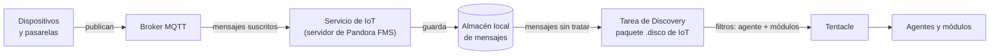

# Monitorización IoT

Un sensor de temperatura de nave industrial no tiene sitio para un EndPoint. Tampoco lo tiene el contador de una instalación solar ni el lector de puerta de un almacén. Lo que sí tienen, casi todos, es una forma de publicar lo que miden en un **broker MQTT**: un servidor de mensajería al que los dispositivos envían datos por *topics* (los «canales» con nombre del protocolo, del tipo `fabrica/linea-a/temperatura`). Pandora FMS aprovecha precisamente eso. No habla con el sensor: escucha al broker, recoge lo que se publica en los topics que le interesan y lo convierte en agentes y módulos como los de cualquier otro equipo.

El resultado práctico es que cualquier cosa capaz de publicar un mensaje MQTT se puede monitorizar, con sus gráficas, sus umbrales y sus alertas, sin instalar nada en el dispositivo. Este capítulo enseña cómo es esa cadena, cómo se configura y, sobre todo, qué módulos salen de qué mensajes, con ejemplos reales.

| Requisito | Detalle |
|---|---|
| Broker MQTT | Accesible desde el equipo del servidor de Pandora FMS. Los dispositivos publican en él; Pandora FMS solo se suscribe. |
| Servidor de Pandora FMS | Incluye el servicio de IoT (`pandora_iot_server`), que recoge los mensajes. |
| Paquete .disco de IoT | Instalado en la consola. La tarea que crea convierte los mensajes en agentes y módulos. |
| Tentacle | La tarea envía los datos generados por Tentacle, igual que cualquier otro paquete .disco. |
| Permisos | La configuración del servicio de IoT solo está disponible para usuarios administradores. |

La instalación del paquete .disco y el ciclo común de sus tareas se explican en [2.3 (Monitorización y descubrimiento automático con Discovery)](2.3-monitorizacion-y-descubrimiento-automatico-con-discovery.md#instalar-actualizar-y-desinstalar-un-paquete-disco) y no se repiten aquí. Lo que sigue es lo propio de IoT; la guía de la integración, con su referencia completa de ajustes y opciones, está en [IoT Discovery](https://pandorafms.com/docs/integrations/latest/es/discovery/iot/).

## Cómo funciona

La cadena tiene cuatro eslabones y conviene tenerlos claros, porque cada uno falla de una forma distinta.

1. **Los dispositivos publican** mensajes en el broker, cada uno en su topic.
2. **El servicio de IoT** mantiene una única conexión con el broker, se suscribe a los topics configurados y guarda cada mensaje recibido en un almacén local del servidor.
3. **La tarea de Discovery** del paquete .disco de IoT se ejecuta en cada intervalo, lee los mensajes que aún no ha tratado y les aplica los **filtros** que has definido.
4. **Por cada grupo de mensajes que encaja con un filtro**, la tarea genera un agente con sus módulos y lo envía a Pandora FMS por Tentacle. A partir de ahí es un agente normal.



Hay tres límites que explican casi todo lo que se verá después:

- **Una sola conexión.** Añadir topics no añade conexiones ni procesos: el servicio envía una única solicitud de suscripción con todos los filtros de topic.
- **Calidad de servicio 0.** Las suscripciones se piden siempre con QoS 0 (entrega como mucho una vez, sin confirmación) y no es configurable. Si la conexión se cae un momento, los mensajes publicados en ese intervalo no se recuperan.
- **Retención limitada.** Los mensajes se borran del almacén pasado un plazo (24 horas por defecto), los haya tratado la tarea o no. Una tarea que no se ejecuta en ese plazo pierde los mensajes.

## Activar y configurar el servidor de IoT

El servicio viene instalado con el servidor, pero está apagado. Se activa con el interruptor **Enable IOT Server** de **Ajustes → Configuración del sistema → Configuración general**, pestaña **Características**. Al activarlo aparece, solo para usuarios administradores, una página propia: **Ajustes → Configuración del sistema → IoT Server**.

!!! note "Etiquetas en la consola en español"
    Algunas etiquetas de esta página aparecen en la consola en español con un texto que no corresponde a su función. La tabla las identifica por su nombre original y por lo que hacen.

| Campo | Qué hace | Valor por defecto |
|---|---|---|
| Server configuration | Ruta del fichero de configuración que el servidor genera para el servicio. | `/etc/pandora/pandora_iot_config.ini` |
| Server host | Dirección del broker MQTT. | `test.mosquitto.org` |
| Server port | Puerto del broker. | `1883` |
| Server protocol | Transporte: `tcp`, `websockets` o `unix`. | `tcp` |
| Server user / Server password | Credenciales del broker, si las exige. | vacío |
| Server topic | Topic o topics a los que suscribirse (ver más abajo). | `testtopic/#` |
| Enable SSL / Trust SSL certificate | Cifrado de la conexión (ver advertencia). | desactivado / activado |
| Database location / Database name | Carpeta y nombre del almacén local de mensajes. | `/opt/pandora/pandora_iot_server/db`, `pandora_iot.db` |
| Data cleaning interval | Segundos mínimos entre dos limpiezas de mensajes caducados. | `300` |
| Data cleaning period | Antigüedad, en segundos, a partir de la cual se borra un mensaje. | `86400` (24 horas) |
| Log name / Log location | Nombre y carpeta del registro del servicio. | `pandora_iot.log`, `/var/log/pandora/` |
| Log level | Nivel de detalle del registro. | `info` |
| Max log bytes / Log rotation count | Tamaño máximo del registro activo y número de ficheros rotados que se conservan. | `50000000`, `3` |

Los valores por defecto del host y del topic apuntan a un broker público de pruebas: sirven para comprobar que todo arranca, no para producción. Lo primero que hay que cambiar es el broker.

### Topics

El campo **Server topic** admite dos formas:

- **Un solo filtro**, como `fabrica/#`.
- **Varios filtros**, como un array JSON en una sola línea: `["fabrica/+/temperatura", "fabrica/+/estado", "alertas/#"]`.

Los comodines son los de MQTT: `+` sustituye exactamente un nivel (`fabrica/+/temperatura` encaja con `fabrica/linea-a/temperatura`, pero no con `fabrica/linea-a/sala-1/temperatura`) y `#` sustituye todos los niveles restantes y debe ir al final (`alertas/#` encaja con `alertas`, `alertas/sitio-a` y todo lo que cuelgue de ahí). Un array mal formado (coma final, comillas simples, miembros vacíos) impide que el servicio arranque con el error `Invalid topic configuration`. El campo admite 200 caracteres como máximo, corchetes y comillas incluidos.

Solo llegan al almacén los mensajes de los topics suscritos: un filtro de la tarea nunca verá un mensaje cuyo topic no esté en esta lista. Y recuerda que el broker decide qué filtros acepta según sus propias reglas de acceso.

### Cifrado de la conexión

Para cifrar la conexión hay que activar **Enable SSL** y **Trust SSL certificate** a la vez. Con **Trust SSL certificate** activado el servicio **no verifica el certificado del broker**: el tráfico va cifrado, pero no se comprueba que el broker sea quien dice ser. Con **Enable SSL** activado y **Trust SSL certificate** desactivado, el servicio no configura el cifrado. Si el entorno exige validar al broker, esta versión no lo ofrece; conviene resolverlo en la red (acceso restringido al broker, por ejemplo).

### Cuándo se aplican los cambios

El servidor de Pandora FMS escribe el fichero de configuración del servicio y lo arranca **cada vez que se inicia**. Por eso los cambios hechos en la página de IoT Server **no se aplican hasta que se reinicia `pandora_server`**. Una vez reiniciado, se puede comprobar el servicio desde el sistema:

```bash
systemctl status pandora_iot_server
```

En el registro del servicio (`/var/log/pandora/pandora_iot.log` por defecto) debe aparecer, por cada topic, una línea como esta:

```text
MQTT broker accepted subscription to factory/+/temperature with QoS 0
```

Si en cambio el broker rechaza un filtro, el registro lo dice con el motivo.

## La tarea de Discovery del paquete IoT

El servicio solo recoge. Quien decide qué agentes y módulos nacen es la tarea del paquete .disco de IoT, que se crea y se gestiona como cualquier otra (ver [Cómo funciona la tarea de un paquete .disco](2.3-monitorizacion-y-descubrimiento-automatico-con-discovery.md#como-funciona-la-tarea-de-un-paquete-disco)). Su asistente tiene dos pasos propios además del primero común:

| Paso | Campo | Qué hace |
|---|---|---|
| Iot base | DB path | Ruta completa del almacén de mensajes. Por defecto, `/opt/pandora/pandora_iot_server/db/pandora_iot.db`; debe coincidir con **Database location** y **Database name** del servicio. |
| Iot base | Time window | Sin efecto en esta versión: déjalo vacío. |
| Iot base | Tentacle IP / Tentacle port | Destino de los datos generados. Por defecto, `127.0.0.1` y `41121`. |
| Iot base | Tentacle extra options | Opcional. En esta versión no se aplica al envío. |
| Iot detailed | Max threads | Hilos con los que se procesan los mensajes (por defecto, 1). |
| Iot detailed | Filter messages modules | Aquí se escriben los filtros. Es el corazón del paquete y tiene su propia sección más abajo. |

Dos condiciones que afectan al resultado:

- **La tarea debe poder leer el almacén.** El almacén es un fichero local del servidor donde corre el servicio de IoT, así que la tarea tiene que ejecutarse en ese mismo equipo. Si **DB path** no coincide o el fichero no existe, la tarea informa de que no encuentra el fichero y no genera nada.
- **El grupo de los agentes sale de la tarea.** Los agentes se crean en el grupo configurado en el primer paso de la tarea, y su intervalo es el de la tarea.

En cada ejecución, la tarea lee los mensajes que todavía no ha tratado, los pasa por los filtros, genera los agentes y los **marca como tratados**: un mensaje se procesa una sola vez. El resumen de la ejecución muestra dos contadores, **Total agents** y **Total messages** (los agentes generados y los módulos creados).

## Filtros: de mensaje a módulo

Cada filtro describe un módulo: qué mensajes lo producen, qué valor lleva y de qué agente forma parte. Los filtros se escriben en el campo **Filter messages modules**, uno detrás de otro, entre `filter_begin` y `filter_end`:

```text
filter_begin
filter_module_name Temperatura
filter_module_type generic_data
filter_topic linea-a
filter_message "value"
filter_message_capture_json $.value
filter_module_value __json1__
filter_end
```

| Directiva | Obligatoria | Qué hace |
|---|---|---|
| `filter_module_name` | Sí | Nombre del módulo. Admite macros. |
| `filter_module_type` | Sí | Tipo del módulo: `generic_data`, `generic_data_string`, `generic_proc`… |
| `filter_module_value` | Sí | Valor del módulo. Admite macros. |
| `filter_topic` | No | Texto o expresión regular que debe encajar con el topic. Sin ella, encajan todos. |
| `filter_topic_exact_match` | No | `1`: el texto debe aparecer tal cual en el topic. `0` (por defecto): expresión regular. |
| `filter_message` | No | Texto o expresión regular que debe encajar con el contenido del mensaje. |
| `filter_message_exact_match` | No | Igual que la anterior, para el mensaje. |
| `filter_message_capture_regex` | No | Expresión regular con grupos de captura; cada grupo alimenta una macro `__regexN__`. |
| `filter_message_capture_json` | No | Rutas JSONPath separadas por `\|` (por ejemplo, `$.soil.moisture`); cada ruta alimenta una macro `__jsonN__`. |

Las macros que se pueden usar en `filter_module_name` y `filter_module_value`:

| Macro | Se sustituye por |
|---|---|
| `__topic__` | El topic exacto del mensaje. |
| `__regexN__` | El grupo de captura N de `filter_message_capture_regex`. |
| `__jsonN__` | El resultado de la ruta N de `filter_message_capture_json`. |

Cuatro reglas que cambian el resultado y que es mejor saber antes de escribir el primer filtro:

1. **El agente se llama como el texto de `filter_topic`.** No como el topic del mensaje: como el texto del filtro. Todos los filtros con el mismo `filter_topic` aportan módulos al mismo agente; filtros con textos distintos crean agentes distintos. Un `filter_topic` corto y limpio (`linea-a`) da un agente bien nombrado; uno con la ruta completa da un agente con la ruta completa por nombre.
2. **Para distinguir módulos de un mismo agente se usa el mensaje.** Como dos filtros con el mismo `filter_topic` van al mismo agente, lo que los separa es `filter_message`: la temperatura en JSON de un lado, el literal `ONLINE` del otro.
3. **Un módulo, un valor por ejecución.** Si varios mensajes de una misma ejecución producen un módulo con el mismo nombre en el mismo agente, solo se conserva el primero. Los demás se marcan como tratados y no llegan a Pandora FMS. Si los dispositivos publican más deprisa de lo que se ejecuta la tarea, el intervalo de la tarea decide la resolución de los datos.
4. **Un mensaje puede alimentar varios filtros**, y un mensaje que no encaja con ninguno se marca igualmente como tratado.

## Ejemplos y resultados

Los ejemplos siguientes se probaron con un broker Mosquitto, el servicio de IoT y el procesador del paquete. Las tablas muestran lo que el procesador genera para Pandora FMS.

### Una planta con dos líneas y un invernadero (JSON)

Los dispositivos publican estos mensajes:

| Topic | Mensaje |
|---|---|
| `factory/line-a/temperature` | `{"sensor":"t1","value":21.4,"unit":"C"}` |
| `factory/line-a/status` | `ONLINE` |
| `factory/line-b/temperature` | `{"sensor":"t2","value":35.8,"unit":"C"}` |
| `greenhouse/zone1` | `{"temp":24.5,"humidity":61,"soil":{"moisture":38}}` |

Los topics suscritos son `["factory/+/temperature", "factory/+/status", "greenhouse/#"]` y los filtros de la tarea:

```text
filter_begin
filter_module_name Temperature
filter_module_type generic_data
filter_topic line-a
filter_message "value"
filter_message_capture_json $.value
filter_module_value __json1__
filter_end
filter_begin
filter_module_name Line status
filter_module_type generic_proc
filter_topic line-a
filter_message ^ONLINE$
filter_module_value 1
filter_end
filter_begin
filter_module_name Temperature
filter_module_type generic_data
filter_topic line-b
filter_message_capture_json $.value
filter_module_value __json1__
filter_end
filter_begin
filter_module_name Humidity __topic__
filter_module_type generic_data
filter_topic greenhouse/zone
filter_message_capture_json $.humidity
filter_module_value __json1__
filter_end
filter_begin
filter_module_name Soil state
filter_module_type generic_data_string
filter_topic greenhouse/zone
filter_message_capture_json $.soil.moisture
filter_module_value Moisture __json1__ %
filter_end
```

El resumen de la tarea indica `Total agents: 3` y `Total messages: 5`, y en la consola aparecen estos agentes:

| Agente | Módulo | Tipo | Valor |
|---|---|---|---|
| `line-a` | Temperature | `generic_data` | `21.4` |
| `line-a` | Line status | `generic_proc` | `1` |
| `line-b` | Temperature | `generic_data` | `35.8` |
| `greenhouse/zone` | Humidity greenhouse/zone1 | `generic_data` | `61` |
| `greenhouse/zone` | Soil state | `generic_data_string` | `Moisture 38 %` |

Fíjate en tres cosas. La línea A tiene dos módulos porque sus dos filtros comparten `filter_topic`. El agente `greenhouse/zone` recoge las zonas que encajen con ese texto, y la macro `__topic__` evita que los módulos de zonas distintas se pisen: `Humidity greenhouse/zone1`, `Humidity greenhouse/zone2`… Y el módulo de cadena (`Moisture 38 %`) muestra que el valor no tiene por qué ser el número a pelo: puede componerse con texto fijo y macros.

### Mensajes que no son JSON: puertas y contadores

No todos los dispositivos hablan JSON. Con mensajes de texto plano se captura con expresiones regulares:

| Topic | Mensaje |
|---|---|
| `sensors/door1` | `OPEN` |
| `sensors/door2` | `CLOSED` |
| `meters/m1` | `temp=24.5;hum=61` |

```text
filter_begin
filter_module_name Door __topic__
filter_module_type generic_data_string
filter_topic sensors/door
filter_message_capture_regex ^(OPEN|CLOSED)$
filter_module_value __regex1__
filter_end
filter_begin
filter_module_name Humidity
filter_module_type generic_data
filter_topic meters/
filter_message_capture_regex temp=([0-9.]+);hum=([0-9]+)
filter_module_value __regex2__
filter_end
```

| Agente | Módulo | Valor |
|---|---|---|
| `sensors/door` | Door sensors/door1 | `OPEN` |
| `sensors/door` | Door sensors/door2 | `CLOSED` |
| `meters/` | Humidity | `61` |

Las puertas acaban en un solo agente con un módulo por puerta, gracias a `__topic__`. El contador demuestra cómo `__regex2__` recoge el segundo grupo de captura (la humedad) y deja fuera la temperatura; para tener también la temperatura bastaría otro filtro con el mismo `filter_topic` y `__regex1__`.

### Qué hacer con los módulos una vez creados

Los módulos generados son módulos normales de Pandora FMS: se ven en el agente, se grafican y se pueden usar en alertas, informes y dashboards como los de cualquier otro agente. Los umbrales de estado se definen sobre cada módulo una vez que existe.

## Comprobar y diagnosticar

Cuando algo no aparece, conviene recorrer la cadena en el orden en que viaja el mensaje, de izquierda a derecha.

| Síntoma | Causa probable | Qué comprobar |
|---|---|---|
| El servicio no arranca | Configuración inválida (`Invalid topic configuration`), falta de permisos en las carpetas o broker inalcanzable. | `systemctl status pandora_iot_server` y el registro del servicio. |
| Los cambios de la página de IoT Server no surten efecto | La configuración se escribe al iniciar el servidor. | Reiniciar `pandora_server`. |
| No hay líneas de suscripción aceptada en el registro | El broker no es accesible o rechaza las credenciales. | Host, puerto, protocolo, usuario, contraseña y cortafuegos. |
| El broker rechaza un filtro | Reglas de acceso del broker o sintaxis de comodín incorrecta. | El motivo registrado por cada filtro. |
| La tarea informa de que no encuentra el fichero de la base de datos | **DB path** no coincide con el almacén, o la tarea no corre en el equipo del servicio. | Que la ruta sea exactamente `Database location` + `Database name`. |
| La tarea termina sin agentes | Ningún filtro encaja con los mensajes pendientes, o los mensajes caducaron antes de ejecutarse. | El `Total agents` del resumen; los topics suscritos; que el intervalo de la tarea sea menor que el periodo de retención. |
| Falta un valor que sí se publicó | Había varios mensajes con el mismo módulo en la misma ejecución y solo se conserva el primero. | Acortar el intervalo de la tarea o publicar menos a menudo. |
| El agente tiene un nombre inesperado | El nombre sale del texto de `filter_topic`. | Ajustar `filter_topic` (ver regla 1). |
| Los valores no se extraen | La ruta JSONPath no encaja con el mensaje o la expresión regular no tiene los grupos esperados. | Probar la ruta o la expresión contra un mensaje real; las rutas JSON van con la sintaxis `$.campo.subcampo`. |

El registro del servicio guarda los mensajes y los inserts solo con `Log level` en `debug`. En ese nivel el registro también incluye los parámetros cargados al arrancar, **contraseña incluida**, así que no se debe dejar en `debug` en producción.
