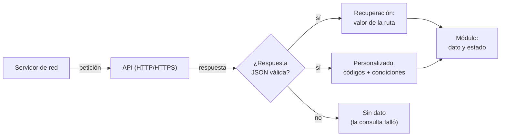

# Monitorización de APIs

Que el servidor web responda no significa que el servicio funcione. Un `ping` contesta, el puerto 443 está abierto, el proceso figura en la lista... y la API devuelve un `200` con un cuerpo que dice `"status": "degraded"`, o una cola con ciento veintiocho pedidos sin consumir, o un `503` que nadie ha visto porque el semáforo de la herramienta de monitorización sigue en verde. Hoy casi todo lo que importa en un negocio se consulta por HTTP y se contesta en JSON, y una comprobación de «¿está el puerto abierto?» se queda corta con mucha frecuencia.

Pandora FMS resuelve esto con **módulos de tipo API**: el servidor hace una petición HTTP(S) a la dirección que le indiques, lee la respuesta y la convierte en un módulo. Sin plugin, sin script y sin instalar nada en el sistema que expone la API. Hay dos preguntas que se pueden hacer a una API, y cada una tiene su módulo:

- **«¿Qué valor devuelve?»** Un número, un texto o un verdadero/falso extraído de la respuesta. Es el **módulo de recuperación de API**.
- **«¿Está bien?»** Un estado, normal o crítico, que sale de comparar el código HTTP y varios campos de la respuesta con lo que tú esperas. Es el **módulo personalizado API**.

| Requisito | Detalle |
|---|---|
| Servidor de red | Los módulos de API los ejecuta el servidor de red de Pandora FMS. Si no hay ninguno activo, la consola no ofrece estos tipos al crear un módulo. |
| Conectividad | El equipo del servidor debe llegar a la URL de la API (nombre, puerto y cortafuegos incluidos). |
| Respuesta | JSON. Si la API contesta otra cosa, el módulo no procesa nada. |
| Creación | Solo en módulos de agente, de política y en operaciones masivas. No están disponibles como componentes de red. |

Este capítulo trata de lo propio de los módulos API: la petición, la extracción del dato y la evaluación de condiciones. Los campos comunes a todos los módulos (intervalo, grupo, umbrales) funcionan igual que en el resto; las alertas están en [5.5, Alertas y notificaciones](../parte-5/5.5-alertas-y-notificaciones.md) y el reparto de módulos entre muchos agentes, en [2.10, Políticas de monitorización](2.10-politicas-de-monitorizacion.md).

## Los tipos de módulo API

Al crear un módulo de agente, el selector de tipo ofrece dos entradas nuevas, junto al módulo web y al de predicción:


| Entrada del selector | Tipo de dato | Para qué sirve |
|---|---|---|
| Módulo de recuperación de API (*API retrieve module*) | Numérico, booleano o alfanumérico, a elegir | Guardar el valor que hay en un punto concreto de la respuesta: una cola, una latencia, una versión, un indicador. |
| Módulo personalizado API (*API custom module*) | Booleano | Decidir si la API está bien: 1 si se cumplen todas las condiciones, 0 si no. |

Por dentro son cuatro tipos de módulo, porque el de recuperación se desdobla según el dato que guarda:

| Tipo | Dato | Qué guarda |
|---|---|---|
| API retrieve numeric data | Numérico | El número encontrado en la ruta. |
| API retrieve boolean data | Booleano | 1 si el valor encontrado es `true`; 0 en cualquier otro caso. |
| API retrieve alphanumeric data | Alfanumérico | El texto encontrado. Si la ruta apunta a un objeto o a una lista, guarda su contenido como texto JSON. |
| API custom retrieve | Booleano | 1 o 0 según las condiciones. |

La regla para elegir es de una línea. Si quieres **el valor** (para graficarlo, para ponerle umbrales), usa recuperación. Si quieres **un veredicto** sobre la salud de la API, usa personalizado. Y si necesitas ambas cosas, son dos módulos sobre la misma URL: no se estorban.

## Cómo funciona

El módulo no pasa por ningún EndPoint. Lo ejecuta el servidor de red, igual que un módulo de red o un módulo web:

1. Cuando toca ejecutar el módulo (según su intervalo), el servidor de red construye la petición con la URL, el método, las cabeceras y, si procede, el cuerpo.
2. Envía la petición con el tiempo máximo configurado. Si falla, reintenta: tres intentos por defecto, que se cambian con el campo **Retries** de la pestaña **Data**. Acepta respuestas de hasta 20 MB.
3. Comprueba que la respuesta es JSON.
4. Según el tipo, extrae el valor de una ruta (recuperación) o evalúa el código HTTP y las condiciones (personalizado).
5. Procesa el resultado como el de cualquier otro módulo: se guarda el dato, se calcula el estado con los umbrales y se disparan las alertas.



Un detalle que conviene tener presente: cuando la consulta falla (la API no contesta, la respuesta no es JSON o la URL está vacía), el módulo **no recibe un dato**. No pasa a crítico por esa razón: se queda sin valor nuevo y, si el fallo se mantiene, acaba en estado desconocido cuando vence su intervalo. Por eso el módulo personalizado tiene sus propios códigos de error (ver más abajo): son la forma de convertir un fallo concreto de la API en un crítico.

## Configurar la petición

Los dos módulos comparten el bloque de la petición, en la pestaña **Basic** del formulario de creación o edición del módulo (el resto de pestañas, comunes a todos los módulos, están en [2.20](2.20-configuracion-comun-de-los-modulos.md)):


| Campo | Qué hace | Valor por defecto |
|---|---|---|
| Timeout | Segundos que se espera la respuesta antes de darla por fallida. Es el de esta pestaña: el campo *Timeout* de la pestaña **Data** no interviene en estos módulos. | `10` |
| URL | Dirección completa del *endpoint*, con esquema (`http://` o `https://`). Es obligatoria: sin URL el módulo no se ejecuta. | vacío |
| Method | `GET`, `POST`, `PUT` o `DELETE`. | `GET` |
| Ignore certificate | Si está activado, no se valida el certificado de la API. Úsalo solo en pruebas o con certificados internos que no puedas arreglar: desactiva la comprobación de que hablas con quien crees. | desactivado |
| Edit Headers | Cabeceras HTTP de la petición, como pares clave-valor. | `Content-Type: application/json` |
| Edit body | Contenido de la petición. Tiene sentido con `POST`, `PUT` y `DELETE`. | `{}` |

Hay tres reglas que explican la mayoría de los módulos que «no hacen lo que debían»:

- **El cuerpo solo se envía si el método no es `GET` y la cabecera `Content-Type` es exactamente `application/json`.** Si cambias esa cabecera, el cuerpo se ignora sin avisar.
- **La autenticación va en las cabeceras.** No hay campos de usuario y contraseña: una API con *token* se consulta con una cabecera como `Authorization: Bearer <token>`, y una API con clave, con la cabecera que esa API pida. Ten presente que la cabecera forma parte de la configuración del módulo, y por tanto quien pueda ver o editar el módulo puede ver el *token*.
- **Las cabeceras llegan tal cual en `GET`.** Además, el servidor se identifica con el agente de usuario `Pandora-API-Client/1.0`, por si la API filtra por él.
- **El servidor consulta, no la consola.** La petición sale del equipo del servidor de Pandora FMS. Que la API se vea desde tu navegador no demuestra que se vea desde el servidor.

!!! warning "Content-Type en POST y PUT"
    En las pruebas con la versión 8.0NG.805, la API de destino recibió los `POST` y `PUT` con `Content-Type: application/x-www-form-urlencoded` aunque la cabecera del módulo fuese `application/json`; el cuerpo sí llegó íntegro. Si tu API exige exactamente `application/json`, compruébalo con una petición real antes de dar el módulo por bueno.

## Extraer un dato de la respuesta

El módulo de recuperación guarda lo que encuentra en la **consulta de ruta JSON** (*JSON path Query*). La ruta se escribe con los nombres de los campos separados por puntos, y los elementos de una lista se numeran desde cero:

| Respuesta de la API | Ruta | Valor |
|---|---|---|
| `{"queue": {"name": "pedidos", "pending": 128}}` | `queue.pending` | `128` |
| `{"queue": {"name": "pedidos", "pending": 128}}` | `queue.name` | `pedidos` |
| `{"items": [{"id": 7}, {"id": 9}]}` | `items.1.id` | `9` |

!!! warning "No es JSONPath completo"
    La consola habla de «JSONPath» en sus mensajes, pero la sintaxis real es la de puntos de la tabla. Una ruta como `$.queue.pending`, `queue['pending']` o `items[?(@.id==9)]` no encuentra nada. Tampoco se pueden usar nombres de campo que contengan un punto.

Los módulos de recuperación tienen sus umbrales de aviso y crítico en la misma pestaña **Basic**, como cualquier módulo con dato; su funcionamiento está en [2.20](2.20-configuracion-comun-de-los-modulos.md#umbrales-y-estados).

No hace falta escribir la ruta a mano. Con la URL ya rellenada, el botón de lupa de **JSON path Query** hace una consulta previa y muestra la respuesta en un árbol; al pulsar sobre un valor y confirmar, la ruta se rellena sola. Ese botón hace la petición **desde la consola**, no desde el servidor, así que puede funcionar aunque el servidor no llegue a la API (y al revés). El botón **Test** hace lo mismo y muestra el resultado de la ruta antes de guardar.

El tipo de módulo decide qué se hace con el valor:

| Tipo | Valor encontrado | Dato del módulo |
|---|---|---|
| Numérico | `128` | `128` |
| Alfanumérico | `"2.4.1"` | `2.4.1` |
| Alfanumérico | un objeto, como `queue` en la primera tabla | Su contenido como texto JSON; el orden de los campos puede cambiar (`{"pending":128,"name":"pedidos","consumers":4}`) |
| Booleano | `true` | `1` |
| Booleano | `"true"` (texto) | `1` |
| Booleano | `false`, `"ok"`, `1` o cualquier otra cosa | `0` |

Si la ruta está vacía, si la respuesta no es JSON o si la ruta no existe en la respuesta, el módulo no guarda nada en esa ejecución.

## Comprobar el estado de una API

El módulo personalizado no extrae un valor: da un veredicto. Su dato es `1` (normal) cuando todo va bien y `0` (crítico) cuando algo no cuadra. No tiene umbrales propios: el estado lo deciden los códigos de error y las condiciones.

La evaluación sigue un orden fijo:

1. **Códigos de error.** El campo **Error Codes** es una lista de códigos HTTP separados por comas. Por defecto, en un módulo nuevo: `500, 404, 403`. Si la respuesta trae uno de ellos, el módulo pasa a `0` y no se evalúa nada más.

    !!! warning "Escribe los códigos sin espacios"
        En las pruebas con la versión 8.0NG.805, con espacios después de las comas (`500, 503, 404, 403`, que es también el formato del valor por defecto) solo se reconoce el primer código: un `503` o un `404` no ponen el módulo en `0`. Sin espacios (`500,503,404,403`) funcionan todos. Hasta que se corrija, escribe la lista sin espacios.
2. **Condiciones.** Si el código no está en la lista, se evalúa cada condición. **Todas** deben cumplirse para que el módulo valga `1`; con que falle una, vale `0`. Un módulo sin condiciones vale `1` mientras el código no esté en la lista.


Cada condición se compone de cuatro piezas:

| Pieza | Qué es |
|---|---|
| JSON path Query | La ruta del campo a evaluar, con la misma sintaxis de puntos de la sección anterior. Se rellena con la lupa. |
| Type | El tipo de dato esperado: `Null`, `String`, `Number` o `Boolean`. |
| Condition | El operador de comparación (depende del tipo; tabla siguiente). |
| Value | El valor con el que se compara. No se usa en los operadores que no necesitan uno. |

Los operadores disponibles dependen del tipo que elijas:

| Tipo | Operadores | Se cumple si |
|---|---|---|
| Boolean | Is true / Is false | El campo es verdadero / falso. No usan *Value*. |
| Null | Equals / Not equals | El campo es / no es nulo. |
| Number | Equals / Not equals | El número es igual / distinto del esperado. |
| Number | Greater than / Less than | Es mayor / menor que el esperado. |
| String | Equals / Not equals | El texto es igual / distinto del esperado. |
| String | Contains / Not contains | El texto contiene / no contiene el esperado. |
| String | Is empty / Is not empty | El campo está vacío / no está vacío. No usan *Value*. |
| String | Regex match | El valor encaja con la expresión regular, sin distinguir mayúsculas. |

Algunas reglas que cambian el resultado:

- **Una ruta que no existe cuenta como condición incumplida.** Si la API cambia de formato y desaparece el campo, el módulo se pone en `0`, que es justo lo que se quiere.
- **El tipo debe encajar con el dato.** Con tipo `Number`, un campo que no sea numérico incumple la condición.
- **Los códigos de error se evalúan sobre una respuesta JSON.** Si la API contesta un error con un cuerpo que no es JSON (una página HTML de error, por ejemplo) o sin cuerpo, la consulta se da por fallida y el módulo se queda sin dato, en lugar de pasar a `0` (comprobado con un `500` y cuerpo HTML). Si te interesa capturar ese caso, vigila también que el módulo no se quede en desconocido.

La consola incluye un botón **Test** debajo de las condiciones. Lanza la petición y muestra qué condiciones se cumplen, cuántas se han evaluado (*Total conditions*), cuántas pasan (*Passed*) y cuántas no (*Failed*).


 Úsalo siempre antes de guardar: es mucho más barato que descubrir una condición mal escrita a las tres de la madrugada.

## Ejemplos y resultados

Los tres ejemplos usan una API ficticia en `api.example.com`. Se han reproducido en una consola 8.0NG.805 con una API de prueba local, y los resultados son los que devolvió el módulo.

!!! example "Cola de pedidos pendientes (recuperación numérica)"
    Se quiere graficar cuántos pedidos esperan en la cola y alertar si pasan de 500.

    Configuración: tipo de módulo de recuperación de API, dato **numérico**; URL `https://api.example.com/v1/queues/pedidos`; método `GET`; consulta de ruta `queue.pending`; umbral crítico a partir de 500.

    Respuesta de la API:

    ```json
    {"queue": {"name": "pedidos", "pending": 128, "consumers": 4}}
    ```

    Resultado: el módulo vale `128` y se grafica como cualquier módulo numérico. Cuando la API devuelva `"pending": 612`, el umbral lo pondrá en crítico y saltarán las alertas asociadas.

!!! example "Versión desplegada (recuperación alfanumérica)"
    Se quiere saber qué versión corre en producción, para ver en el historial cuándo cambió.

    Configuración: dato **alfanumérico**; URL `https://api.example.com/v1/info`; consulta de ruta `build.version`.

    Respuesta: `{"build": {"version": "2.4.1", "commit": "9f3c2ab"}}`

    Resultado: el módulo vale `2.4.1`. Cada despliegue queda reflejado como un cambio de valor.

!!! example "Salud de la API con una cabecera de autenticación (personalizado)"
    Se quiere un único módulo que ponga la API en crítico si no está sana, si la base de datos va lenta o si responde con error.

    Configuración: módulo personalizado API; URL `https://api.example.com/v1/health`; método `GET`; cabeceras `Content-Type: application/json` y `Authorization: Bearer <token>`; códigos de error `500,503,404,403` (sin espacios); dos condiciones:

    | JSON path Query | Type | Condition | Value |
    |---|---|---|---|
    | `status` | String | Equals | `ok` |
    | `checks.database.latency_ms` | Number | Less than | `500` |

    Resultado según lo que conteste la API:

    | Respuesta | Módulo | Por qué |
    |---|---|---|
    | `200` con `{"status": "ok", "checks": {"database": {"latency_ms": 120}}}` | `1` | Código fuera de la lista y las dos condiciones se cumplen. |
    | `200` con `{"status": "degraded", "checks": {"database": {"latency_ms": 120}}}` | `0` | La primera condición falla. |
    | `200` con `{"status": "ok", "checks": {"database": {"latency_ms": 900}}}` | `0` | La segunda condición falla: 900 no es menor que 500. |
    | `200` con `{"status": "ok"}` | `0` | No existe `checks.database.latency_ms`. |
    | `503` con `{"error": "unavailable"}` | `0` | Código en la lista de errores (y, además, falta `status`). |
    | `200` con una página HTML | sin dato | La respuesta no es JSON. |

## Uso con políticas y operaciones masivas

Los módulos de API se pueden crear de las mismas formas que el resto de módulos de red:

- **En un agente**, desde su formulario de módulos.
- **En una política**, para repartir el mismo módulo entre muchos agentes (ver [2.10, Políticas de monitorización](2.10-politicas-de-monitorizacion.md)). Es el caso típico de una API con el mismo contrato en varios entornos.
- **Con operaciones masivas**, para cambiar un campo (un *timeout*, una cabecera) en muchos módulos a la vez (ver [2.11, Operaciones masivas](2.11-operaciones-masivas.md)).

!!! note "Secretos en las cabeceras"
    Una política que lleve un *token* en una cabecera lo distribuye a todos los módulos que genera. Si el *token* caduca o rota, hay que cambiarlo en la política (o con una operación masiva), no agente por agente.

## Comprobar y diagnosticar

| Síntoma | Causa probable | Comprobación |
|---|---|---|
| La consola no ofrece los tipos de API al crear el módulo. | No hay un servidor de red activo, o se está creando un componente de red. | Revisa en la lista de servidores que hay uno de red en marcha; crea el módulo en un agente. |
| El módulo no tiene ningún dato nuevo. | La API no contesta, la respuesta no es JSON o la URL está vacía. | Repite la petición desde el equipo del servidor (`curl -i <url>`) con las mismas cabeceras y comprueba que la respuesta es JSON. |
| El módulo de recuperación no guarda nada. | La ruta no existe en la respuesta o está mal escrita (por ejemplo, con `$.` delante). | Usa la lupa para elegir la ruta sobre la respuesta real. |
| El módulo booleano vale siempre `0`. | El valor de la ruta no es `true`. Un `1` o un `"ok"` valen `0`. | Cambia a un módulo numérico o a un módulo personalizado con condiciones. |
| Un código de la lista de errores (por ejemplo `503` o `404`) no pone el módulo en `0`. | La lista está escrita con espacios después de las comas y solo se reconoce el primer código. | Reescribe la lista sin espacios: `500,503,404,403`. |
| El módulo personalizado vale `0` y la API responde bien. | Una condición no se cumple: ruta inexistente, tipo que no encaja u operador equivocado. | Pulsa **Test**: indica cuántas condiciones fallan. |
| El cuerpo no llega a la API. | Método `GET`, o la cabecera `Content-Type` no es exactamente `application/json`. | Revisa el método y la cabecera. |
| Error de certificado (HTTPS). | Certificado caducado, autofirmado o con un nombre que no coincide. | Arréglalo en la API; solo como último recurso, activa **Ignore certificate**. |
| El módulo personalizado vale `1` aunque la API esté rota (por ejemplo, responde `401`). | El código no está en la lista de errores y no hay condiciones que lo detecten: sin condiciones, todo lo que no esté en la lista da `1`. | Añade el código a **Error Codes** (`401` si falla la autenticación) y define al menos una condición sobre el cuerpo. |
| La lupa funciona, pero el módulo no. | La consola llega a la API y el servidor no (o al revés). | Prueba la petición desde cada equipo por separado. |

Para ver qué hace el servidor con cada petición, consulta su registro (`/var/log/pandora/pandora_server.log`). Los fallos de la consulta (URL vacía, petición fallida) aparecen con el identificador del módulo; el detalle de las ejecuciones correctas y de las respuestas que no son JSON solo se ve subiendo la verbosidad del servidor.
