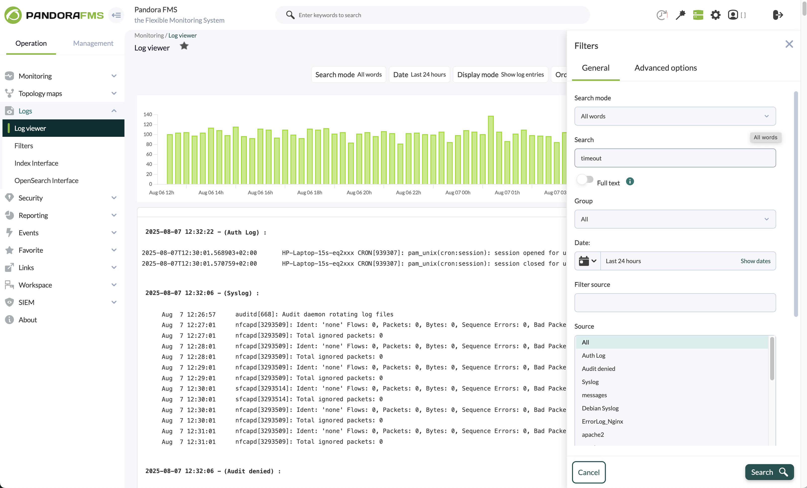
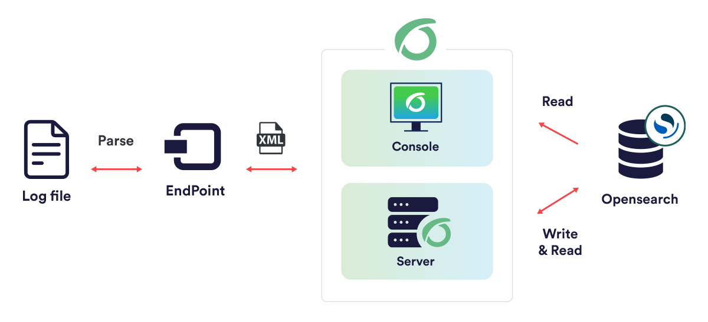
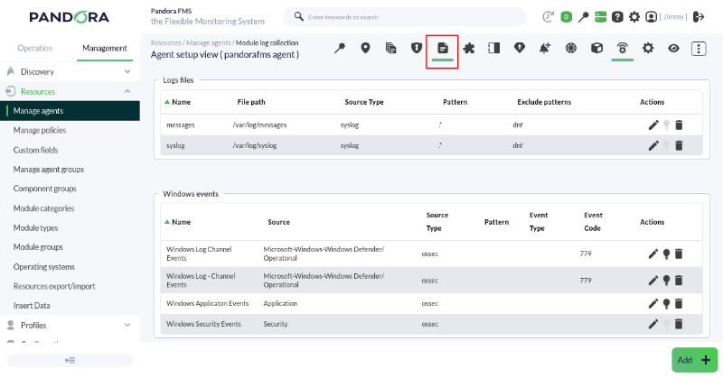
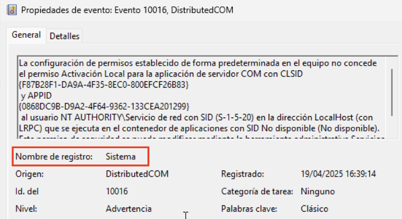
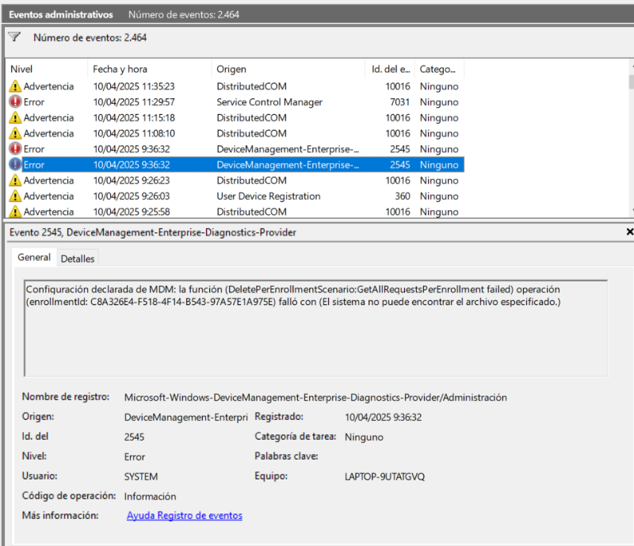
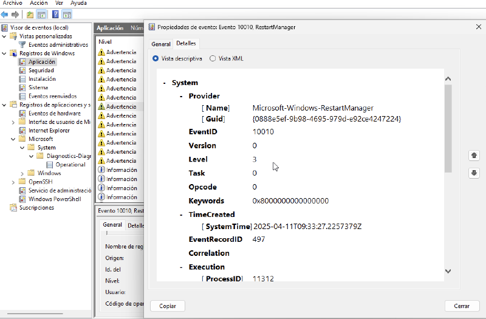
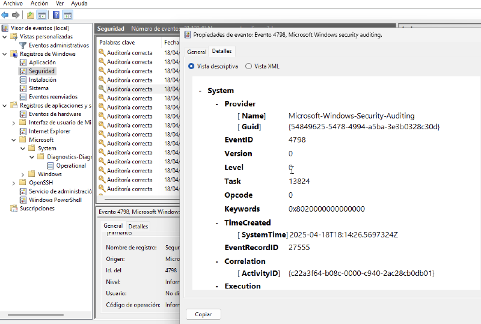
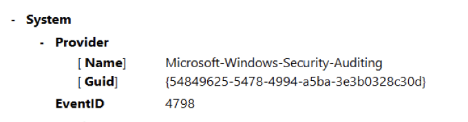
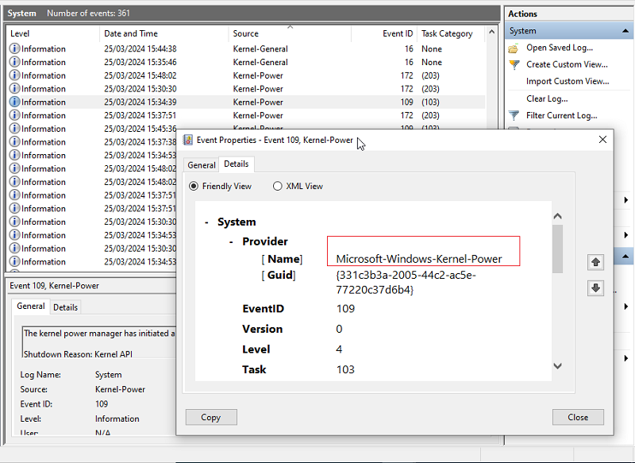
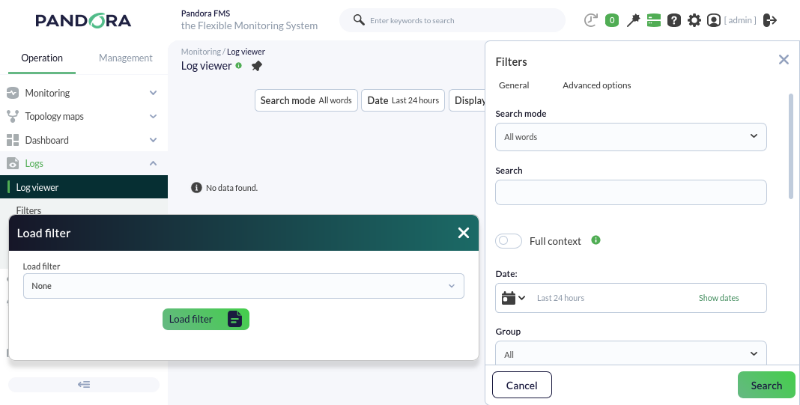

# Recolección y monitorización de logs

Los *logs* son ese fichero que nadie mira hasta que algo arde a las tres de la
mañana y toca reconstruir qué pasó. Pandora FMS los recoge de todos los
orígenes que le digas —el registro de eventos de Windows, los ficheros de texto
de medio Unix, el *syslog* de cualquier equipo— y los deja en una sola consola,
ordenados por el momento en que llegaron. Este capítulo cuenta cómo se activa
esa recogida, cómo se le piden los *logs* a cada EndPoint y qué se puede hacer
después con ellos.



Pandora FMS no guarda los *logs* en su base de datos de monitorización. Los
almacena en **OpenSearch**, un motor de búsqueda pensado para texto, y por eso
el primer requisito —antes de tocar nada en la consola— es tener ese motor
disponible y accesible. El resto del capítulo asume que ya lo está; la
instalación y configuración del motor tiene su propio anexo técnico.



!!! note "Qué no es esto"
    La monitorización de *logs* no estructurada no es un SIEM. Pandora FMS
    guarda el texto tal cual, sin analizarlo, y lo pone a tu disposición para
    buscarlo. Si lo que quieres es correlar eventos y lanzar *rules*, eso es
    [Pandora SIEM](../parte-7/7.2-siem.md), que se apoya en estos mismos datos.

## Cómo funciona

La cadena tiene cuatro eslabones y conviene tenerlos claros porque cada uno
puede fallar por su cuenta.

1. El **EndPoint** lee el registro de eventos o el fichero de texto y mete los
   *logs* en crudo —en formato *RAW*— dentro del XML de reporte que ya envía
   normalmente. No hace falta un canal aparte.
2. El **Data Server** de Pandora FMS recibe ese XML, que lleva a la vez
   monitorización y *logs*. Al procesarlo separa una cosa de la otra.
3. Las **referencias** del EndPoint que ha reportado y del origen del *log* se
   guardan en la base de datos principal. El texto del *log*, no: el texto se
   envía a OpenSearch.
4. OpenSearch lo indexa. Pandora FMS crea **un índice nuevo cada día** por cada
   instancia, con un nombre del tipo `pandorafms-<identificador>-<año.mes.día>`,
   más un índice auxiliar de orígenes que termina en `-sources`.

El servidor parte el contenido recibido por saltos de línea, de modo que cada
línea física se convierte en un documento de OpenSearch. La excepción son los
**eventos de Windows**, que ya llegan como un bloque y se guardan enteros. Desde
la versión 806, justo después de ese troceado, el servidor sustituye en cada
entrada todas las apariciones del literal `{{\n}}` por un salto de línea real. La
sustitución es posterior al troceado, así que no crea documentos nuevos: una
entrada lógica sigue siendo un documento. Es lo que permite que una entrada
multilínea se vea como un bloque en el visor (ver [Entradas de log
multilínea](#entradas-de-log-multilinea)).

Los *logs* viajan por la red codificados, para evitar que un formato raro rompa
el transporte. Si además quieres que viajen cifrados, se usa
[Tentacle cifrado](../parte-9/9.4-referencia-completa-de-tentacle.md); no hay
que hacer nada especial para los *logs*, es el mismo transporte seguro que
aplica al resto del XML.

Una tarea de mantenimiento del servidor borra la información antigua pasado el
intervalo que fijes (por defecto, **30 días**). No es un borrado a lo bruto: el
servidor elimina los documentos por fecha y, cuando un índice se queda vacío,
lo elimina también.

El **Syslog Server** es el atajo. En lugar de esperar a que un EndPoint lea un
fichero y lo mande, este componente lee directamente el *syslog* de la máquina
donde vive el servidor y lo procesa en el sitio. Para volúmenes altos de
*syslog* es bastante más rápido, y permite repartir la carga: varios EndPoints
por un lado y varios servidores *syslog* remotos por otro.

## Requisitos previos

| Requisito | Detalle |
|---|---|
| OpenSearch | Instalado, arrancado y accesible desde el servidor de Pandora FMS. Sin él no hay dónde guardar los *logs*. |
| Colector de *logs* | Activado en la consola web (siguiente apartado). Si está desactivado, los módulos de tipo *log* se descartan sin más. |
| `rsyslog` | Solo si vas a usar el **Syslog Server**; se instala en el servidor y, si hace falta, en los clientes que envían. |
| Puertos | El del motor de búsqueda (por defecto `9200`) para el colector, y el `514` (TCP y UDP) para la recogida de *syslog*. |

## Configuración del Log collector

Menú **Management → Settings → System Settings → Log collector** (*Gestión →
Configuración → Configuración del sistema → Colector de logs*). Se activa con
**Activate Log Collector** y se confirma con **Update**. Hasta que no lo
actives, esa pantalla solo muestra el interruptor.

Al activarlo aparecen las **OpenSearch options**, que son las que conectan la
consola con el motor:

| Opción | Para qué sirve |
|---|---|
| **OpenSearch IP** | Dirección o nombre del servidor OpenSearch. |
| **Use https** | Actívala si el motor escucha con HTTPS. |
| **OpenSearch Port** | Puerto TCP; por defecto `9200`. |
| **Number of logs viewed** | Cuántos registros muestra el visor de *logs*; por defecto `50`. |
| **Days to purge old information** | Días antes de borrar lo recogido; por defecto `30`. |
| **Basic authentication** | Usuario (**User**) y contraseña (**Password**) si el motor los pide. Muy recomendable tenerlos puestos. |

La propia pantalla te dice si la conexión va: **OpenSearch is running.** cuando
todo cuadra, **Unauthorized** cuando las credenciales no son correctas y
**There is no OpenSearch defined. Empty ip or port.** cuando falta la dirección
o el puerto. Ese indicador es la forma más rápida de saber si el problema es de
configuración o de red.

!!! warning "Index configuration: toca solo si sabes lo que haces"
    El bloque **Index configuration** cambia cómo OpenSearch construye el índice.
    Una configuración incorrecta puede desestabilizar el sistema, así que no lo
    muevas por curiosidad. Además, los cambios de plantilla se aplican **a
    partir del índice siguiente**: no reescriben lo ya indexado.

Las opciones del bloque **Index configuration** son las siguientes:

- **Indexing size**: longitud máxima, en caracteres, que OpenSearch indexa de
  cada línea como valor completo (*keyword*). Las líneas que la superan se
  siguen guardando y se pueden buscar por palabras, pero quedan fuera de las
  búsquedas por expresión regular (modo REGEX). Por defecto, `2000`.
- **Number of shards**: fragmentos primarios del índice; por defecto `1`. Solo
  se fija al crear el índice: no se puede cambiar en un índice ya cerrado.
- **Number of replicas**: réplicas de cada fragmento; por defecto `0`. Poner
  `0` ahorra disco, pero un reinicio del nodo deja la información sin
  disponibilidad temporal y una corrupción se convierte en pérdida permanente.
- **Auto expand replicas**: ajusta las réplicas solo según el número de nodos,
  con un rango tipo `0-1` o `all` como tope. Si las reglas de asignación impiden
  colocar todas las réplicas, el clúster puede quedarse en estado `YELLOW`.


## Recoger logs con los EndPoints

La recolección real la hacen los **EndPoints**, tanto en Windows como en Unix
(Linux, macOS, Solaris, HPUX, AIX, BSD…). Para dar de alta los módulos desde el
asistente **Module log collection** hay que tener ya el colector configurado, y
si vas a añadir módulos de tipo **Windows event channel**, el EndPoint tiene
que ser de Windows. El resto de módulos y sus tokens generales están en
[Monitorización con EndPoints](2.1-monitorizacion-con-endpoints.md) y en la
[referencia completa de configuración del EndPoint](../parte-9/9.1-referencia-completa-de-configuracion-del-endpoint.md).



La recolección que trae el producto (los EndPoints Unix, Windows y Go, y los
*plugins* incluidos) envía **una línea física por entrada** y no une las líneas
de una misma entrada lógica; la excepción son los eventos de Windows, que ya se
guardan como un bloque. Para que una entrada se vea como un bloque hay que
usar una recolección propia (por ejemplo, un *plugin* a medida) que sepa dónde
empieza y acaba, la envíe en una sola línea y codifique sus saltos internos con
el marcador `{{\n}}`. El mecanismo y sus límites están en [Entradas de log
multilínea](#entradas-de-log-multilinea); escribir ese *plugin* es otra tarea.
Sin el marcador, todo se comporta exactamente como antes.

### Logs en texto plano

Para vigilar un fichero de texto se usa un módulo de tipo `log` con el token
`module_regexp`, que apunta a la ruta del fichero. Un módulo de ejemplo en
Linux:

```text
module_begin
module_name Syslog
module_description Recogida del fichero de mensajes del sistema
module_type log
module_regexp /var/log/messages
module_pattern .*
module_pattern_exclude DEBUG
module_end
```

En Windows la sintaxis es la misma, solo cambia la ruta:

```text
module_begin
module_name Apache_log
module_description Recogida del log de Apache
module_type log
module_regexp C:\server\logs\apache.log
module_source_type apache
module_pattern .*
module_end
```

`module_pattern` filtra las líneas que te interesan y `module_pattern_exclude`
excluye las que no. Otros ejemplos de la casa:

```text
module_begin
module_name apache_access
module_type log
module_regexp /var/log/httpd/access_log
module_pattern .*
module_pattern_exclude \s200\s|\s301\s
module_source_type web-log
module_end

module_begin
module_name Audit denied
module_type log
module_regexp /var/log/audit/audit.log
module_pattern denied
module_end

module_begin
module_name Secure
module_type log
module_regexp /var/log/secure
module_pattern Failed|failure|invalid|denied|accepted|root
module_end
```

!!! warning "`module_type log` no guarda en base de datos"
    Un módulo con `module_type log` no se almacena como módulo normal: se manda
    al colector de *logs*. Si el colector está desactivado, **la información se
    descarta**. Es la causa número uno de «he puesto el módulo y no veo nada».

Hace tiempo la recogida en Linux se hacía con *plugins*. Desde la versión 781
este es el método recomendado; los *plugins* quedaron como legado.

### Eventos de MS Windows con `module_logchannel`

En Windows, además de ficheros, se puede leer el **registro de eventos**. Para
eso está `module_logchannel`, que desplaza al antiguo `module_logevent`. Este
último sigue funcionando por compatibilidad, pero no está soportado desde la
versión LTS 2025 y solo tiene sentido en sistemas Microsoft antiguos (Windows 7,
Windows 2003 o anteriores). En un Windows moderno, `module_logchannel`.

El formato general es este:

```text
module_begin
module_name MyEvent
module_type log
module_logchannel
module_source <logName>
module_eventtype <nivel del evento (opcional)>
module_eventcode <id del evento (opcional)>
module_application <origen (opcional)>
module_pattern <subcadena a buscar (opcional)>
module_source_type <tipo de log para el SIEM (opcional)>
module_end
```

Hay dos avisos que conviene leer antes de pelearse con los filtros. El primero:
solo se tienen en cuenta los eventos **posteriores a la última ejecución** del
EndPoint. En la primera ejecución no se recoge todo lo que ya existía en el
registro; se empieza a enviar desde ahí. El segundo: los nombres de los
parámetros distinguen mayúsculas y minúsculas, así que cópialos tal cual.

#### `module_source`

Es la fuente que origina el evento: la vieja clasificación de Windows NT
(Sistema, Aplicación, Seguridad…). No confundirla con `module_application`, que
identifica la aplicación. Puedes usar una u otra, pero una de las dos hace
falta.



Aunque el visor de eventos te lo muestre traducido —«Sistema», «Aplicación»,
«Seguridad»—, aquí **se escriben en inglés**: `System`, `Application`,
`Security`. Los nombres largos se copian tal cual, sin traducir:

```text
Microsoft-Windows-DeviceManagement-Enterprise-Diagnostics-Provider/Administración
```



#### `module_source_type`

Es el tipo de *log* que consumen los *decoders* y las *rules* del SIEM. Si lo
omites, se usa `syslog` por defecto. Los tipos que suele manejar la herramienta
son `syslog`, `ids`, `web-log`, `squid`, `host-information` y `ossec`.

!!! tip "No todos los tipos están activos de fábrica"
    El motor de decoders no trae todos esos tipos listos para usar. En la
    instalación por defecto están activos `ossec` (eventos de Windows),
    `web-log`, `ids`, `firewall` y `syslog`; `squid` y `windows` vienen en la
    carpeta de decoders deshabilitados, y `host-information` no existe como tal.
    Antes de elegir un tipo, comprueba qué decoders tienes activos en el
    [capítulo de SIEM](../parte-7/7.2-siem.md).

Para el SIEM, los eventos de Windows se procesan con `ossec`. Este ejemplo
recoge todos los eventos de seguridad:

```text
module_begin
module_logchannel
module_name Security_Events
module_type log
module_source Security
module_source_type ossec
module_end
```

#### `module_eventtype`

Filtro opcional por nivel del evento. Los valores son los del visor de eventos:

| Código | Tipo de evento |
|---|---|
| `0` | Auditoría correcta |
| `1` | Crítico |
| `2` | Error |
| `3` | Advertencia |
| `4` | Información |

Para quedarte solo con las advertencias de seguridad:

```text
module_begin
module_logchannel
module_name Security_Events_Warning
module_type log
module_source Security
module_eventtype 3
module_source_type ossec
module_end
```




#### `module_eventcode`

Filtro opcional por **identificador de evento**, el `eventID` que ves en el
visor. Es el filtro más preciso de todos. Este ejemplo toma únicamente los
eventos con identificador `4798`:

```text
module_begin
module_logchannel
module_name Security_Events_4798
module_type log
module_source Security
module_eventcode 4798
module_source_type ossec
module_end
```



#### `module_application`

Origen del evento, opcional. Para obtener el nombre exacto del proveedor,
selecciona un evento en el visor de Windows, abre **Propiedades** y copia el
campo **Full name**. Si el nombre lleva espacios, **no lo entrecomilles**. Por
ejemplo:

```text
module_begin
module_name Pandora_Events_Windows
module_type log
module_logchannel
module_application Pandora FMS
module_source Application
module_end
```



Como referencia, los proveedores que más aparecen son los propios del sistema
operativo (`Microsoft-Windows-Winlogon`,
`Microsoft-Windows-Security-Auditing`, `Microsoft-Windows-WindowsUpdateClient`,
`Microsoft-Windows-TaskScheduler`…), los de aplicaciones y servicios
(`MSSQLSERVER`, `Windows Defender`, `Windows Firewall`, `VSS`…), los útiles para
diagnóstico avanzado (`Microsoft-Windows-Kernel-General`,
`Microsoft-Windows-DistributedCOM`, `Microsoft-Windows-Ntfs`…) y los de terceros
(`VMware Tools`, `Oracle Database`, `Symantec Endpoint Protection`, `TeamViewer`,
`Apache Service`…). Cada aplicación usa el suyo y hay cientos.

### Eventos de Windows y Sysmon

**Sysmon** (System Monitor) es una utilidad gratuita de Microsoft, dentro del
paquete Sysinternals, que registra en detalle actividades que el visor de
eventos normal deja pasar de largo: creación y ejecución de procesos,
conexiones de red entrantes y salientes, cambios en el registro de Windows,
carga de DLL, acceso a ficheros, inyección de código en procesos legítimos. Es
material habitual en intentos de intrusión y movimiento lateral, y por eso
interesa tanto en ciberseguridad.

Funciona instalando un controlador en modo *kernel* que va escribiendo en el
Visor de eventos. Pandora FMS lo recoge como un canal más del EndPoint de
Windows y lo manda al servidor. La combinación Sysmon + Pandora FMS + Pandora
SIEM da una visibilidad muy superior a la del registro tradicional: detección
temprana de ataques avanzados, alertas automáticas sobre los eventos que definas
y un histórico correlacionable para forense o auditoría.

Sysmon viene en el paquete *Sysinternals Suite* y su fichero de configuración es
largo: monitorizarlo «todo» castiga el rendimiento del equipo y del sistema que
recibe los datos. Para los eventos Sysmon hay que usar **este** módulo, con el
nombre y el tipo exactos:

```text
module_begin
module_name WinEvtLog
module_type log
module_logchannel
module_source Microsoft-Windows-Sysmon/Operational
module_source_type windows
module_end
```

Aquí `module_source_type windows` sustituye a `ossec`, y el nombre `WinEvtLog`
es el que esperan las *rules* de Pandora SIEM.

!!! warning "Sysmon no viene listo de fábrica"
    El canal de Sysmon hay que habilitarlo y afinar sus decoders y reglas; en
    una instalación recién puesta, los decoders y reglas de `windows`/`sysmon`
    están deshabilitados y el canal de Windows activo es el de `ossec`. No des
    por hecho que con poner el módulo ya verás los eventos procesados por el
    SIEM: revisa decoders y reglas en [Pandora SIEM](../parte-7/7.2-siem.md).

## Pandora FMS Syslog Server

El **Syslog Server** permite a Pandora FMS analizar el *syslog* de la máquina
donde reside el servidor y guardarlo en OpenSearch. Su ventaja es que unifica
orígenes sin depender de que cada equipo tenga un EndPoint: todo equipo que
sepa exportar *syslog* puede mandarle sus mensajes. Y por comodidad: **cada host
del que lleguen *logs* genera automáticamente su agente** si no existía.

La instalación de `rsyslog` es tanto para el servidor como para los clientes:

```bash
dnf install rsyslog
```

En el servidor, edita `/etc/rsyslog.conf` y habilita la escucha por **TCP** y
**UDP**:

```conf
# Recepción syslog por UDP
module(load="imudp")
input(type="imudp" port="514")

# Recepción syslog por TCP
module(load="imtcp")
input(type="imtcp" port="514")
```

Reinicia el servicio y comprueba que el puerto `514` escucha:

```bash
systemctl restart rsyslog
netstat -ltnp
```

En el cliente, en su `/etc/rsyslog.conf`, activa el reenvío al servidor
(cambia `remote-host` por la dirección real):

```conf
action(type="omfwd" Target="remote-host" Port="514" Protocol="tcp")
```

!!! warning "El límite de 8 KB y los orígenes fantasma"
    Por defecto, `rsyslog` corta los mensajes en 8 KB. Un *log* más largo se
    parte en varias entradas y las siguientes pierden el nombre del host, lo que
    crea orígenes —y agentes— nuevos que no existen. Para evitarlo, sube el
    tamaño máximo:

    ```conf
    $MaxMessageSize 512k
    ```

    Y, si puedes, crea los agentes con **alias as name** igual al *hostname*
    del cliente: así no se duplican.

Para activar la funcionalidad en el servidor de Pandora FMS, edita
`pandora_server.conf`:

```conf
# Habilitar (1) o deshabilitar (0) el Servidor Syslog de Pandora FMS
syslogserver 1

# Ruta absoluta del fichero de entrada que lee el Syslog Server
syslog_file /var/log/messages

# Número de hilos del Syslog Server
syslog_threads 2

# Número máximo de líneas en cola del Syslog Server
syslog_max 65535
```

Y, cómo no, hay que decirle al dispositivo o al cliente que mande sus *logs* al
servidor. Sin eso, el servidor escucha al vacío.

### Filtros a nivel del servidor de Pandora FMS

El servidor puede cribar lo que entra con dos tokens de `pandora_server.conf`.
`syslog_whitelist` **admite solo** lo que case con la expresión regular y
descarta lo demás. `syslog_blacklist` **descarta** lo que case y deja entrar el
resto. Ambos vienen desactivados.

La lista blanca se aplica primero —reduce el trabajo de la negra— y la negra, al
final. La expresión distingue mayúsculas y minúsculas: `windows` no es
`Windows`. Y hay dos trampas:

- Si activas `syslog_whitelist` **sin** expresión, no entra **nada**. Con la
  expresión `.*` del ejemplo sí entra todo.
- Si activas `syslog_blacklist` **sin** expresión, no se bloquea nada.

## Interfaz de OpenSearch: el Log Viewer

Con el colector en marcha y datos dentro, todo se mira desde **Operation → Logs →
Log viewer** (*Operación → Logs → Visor de logs*). La pantalla muestra las
ocurrencias por unidad de tiempo y permite filtrar por fecha, grupo, agente,
origen y palabra clave.

El campo **Search** es lo más útil. Se combina con el modo de búsqueda
(**Search mode**), que tienen cuatro opciones:

- **Exact match**: el *log* **contiene** la cadena exacta.
- **All words**: contiene **todas** las palabras, en cualquier orden. Es el modo
  por defecto.
- **Any word**: contiene **alguna** de las palabras, en cualquier orden.
- **REGEX**: trata el texto como expresión regular.

Si marcas la opción de ver el **contexto**, el visor te muestra además las
líneas vecinas del resultado, que muchas veces explican más que la línea en sí.

Con el campo **Search** vacío no se filtra por contenido: el visor lista todas
las entradas del periodo, con los filtros de fecha, agente y origen que tengas
puestos. Escribe un término (el nombre del agente, una palabra del mensaje)
solo para acotar los resultados.


### Visualización y búsqueda avanzadas

En la pestaña **Advanced options** se puede cambiar la vista y convertir los
*logs* en gráficas. El **Display mode** decide si se muestran entradas de texto
o una gráfica. Para la gráfica hay que elegir un **modelo de captura** (**Use
capture model**): un conjunto de expresiones regulares e identificadores que
extraen valores de cada línea.

El modelo por defecto es **Apache log model**, que entiende el `access_log` de
Apache en formato estándar y dibuja tiempos de respuesta agrupados por página y
código de respuesta. Vienen algunos modelos más de fábrica y puedes crear los
tuyos con los botones de editar y crear.


### Entradas de log multilínea

Un *stack trace* no cabe en una línea. Tampoco una petición y su respuesta XML,
ni una excepción con veinte marcos de pila. Hasta la versión 806, el visor
partía esas entradas en una fila por línea física; desde la 806 puede mostrarlas
como lo que son, un solo bloque, si la recolección se lo pide.

El servidor no adivina dónde empieza y acaba una entrada: eso lo decide la
recolección. Para que una entrada se vea entera, la recolección tiene que
enviarla como **una sola línea física** y, dentro de ella, codificar cada salto
de línea interno con el marcador literal `{{\n}}` (dos llaves, barra invertida,
`n` y dos llaves). El marcador es exactamente ese: `{{/n}}` no funciona.

A partir de ahí, el servidor hace tres cosas, en este orden:

1. Parte el contenido recibido por saltos de línea, como siempre, y obtiene una
   cadena por entrada.
2. Sustituye en cada cadena **todas** las apariciones de `{{\n}}` por un salto
   de línea real.
3. Indexa la entrada como **un solo documento** de OpenSearch, con los saltos
   dentro del contenido.

Como la sustitución es posterior al troceado, no aparecen documentos nuevos: una
entrada lógica sigue siendo un documento. El visor pinta el contenido dentro de
un `<pre>` con ajuste de línea (`pre-wrap`), así que los saltos se ven tal cual,
igual que en los eventos de Windows.

Por ejemplo, la recolección envía esta línea:

```text
2026-06-11 16:49:57 ERROR Procesando peticion 471{{\n}}  at Servicio.Procesar (Servicio.cs:120){{\n}}  at Host.Ejecutar (Host.cs:45)
```

Y el visor muestra una única entrada de tres líneas:

```text
2026-06-11 16:49:57 ERROR Procesando peticion 471
  at Servicio.Procesar (Servicio.cs:120)
  at Host.Ejecutar (Host.cs:45)
```

!!! note "Lo que no cambia"
    - La recolección incluida sigue enviando una línea por entrada y el servidor
      la sigue troceando igual. Sin el marcador, el visor se ve exactamente como
      antes.
    - No hay migración de datos, cambio de mapeo ni índices nuevos: los
      existentes se siguen usando.
    - Los **eventos de Windows** ya se guardaban como un único documento y no
      pasan por el troceado; su comportamiento no cambia.
    - No hay ninguna opción nueva de configuración ni hace falta un reinicio
      distinto de la actualización habitual del servidor.
    - Una entrada es un evento. Si una línea contiene el literal `{{\n}}` de
      forma casual, también se convertirá en salto de línea; es improbable, pero
      conviene saberlo.
    - Todas las líneas del bloque comparten la fecha del ciclo de recolección, no
      la de cada línea.

!!! tip "Agrupar en el visor no es la solución"
    Se descartó agrupar por agente, origen y fecha en el propio visor. El
    `@timestamp` es el del ciclo de recolección, así que esa agrupación uniría
    todas las entradas de la ejecución y no una entrada lógica. Por eso la
    agrupación es responsabilidad de la recolección.

Para el SIEM, la entrada llega ya decodificada: un único evento con sus saltos
de línea, y los *decoders* y las *rules* se aplican al bloque completo, no a
cada línea. Se explica en [SIEM](../parte-7/7.2-siem.md#recoleccion-de-logs-para-el-siem).

### Filtros frecuentes

Si repites la misma combinación de filtros, guárdala: **Save filter**, le pones
nombre y **Save**. Luego la recuperas con **Load filter**, eligiéndola de la
lista. Un filtro guardado se puede sobrescribir con los cambios actuales.

En **Operation → Logs → Filters** se administran esos filtros: editarlos,
borrarlos de uno en uno o en bloque, y crear otros nuevos.



### Filtros guardados como elementos anclados

El sistema de anclados de Pandora FMS permite dejar el **Log viewer** a mano en
el menú, con los filtros ya puestos. Se hace con el icono de chincheta que hay
junto al título de la sección. Al volver a cargar el filtro, la chincheta
aparece desactivada, y si la pulsas se quita el anclado. Los anclados son
independientes de los filtros frecuentes; no se estorban entre sí.

## Log Source en la vista del agente

Cada agente que envía *logs* lo dice en su propia ficha (ver [2.21, Configuración
común de los agentes](2.21-configuracion-comun-de-los-agentes.md#las-pestanas-de-la-vista-del-agente)
para el resto de pestañas). En la vista del agente
aparece un cuadro **Logs** con una fila por origen, donde ves la **fecha de la
última actualización** y un botón **Review** (la lupa) que abre el Log Viewer ya
filtrado por ese agente y ese origen. Es la forma más cómoda de saltar de «este
agente dejó de mandar *logs*» a «aquí están sus últimos mensajes».

Por defecto, tanto el cuadro como el visor trabajan con las **últimas 24
horas**; se cambia cuando haga falta.


## Monitorizar el propio motor de logs

¿Y si el que se queda callado es el propio motor? Cuando el colector está
activado, el servidor de Pandora FMS se vigila a sí mismo: genera una batería de
módulos sobre OpenSearch y los añade a su **agente de automonitorización**
(`pandora.internals` por defecto). Se ven como cualquier otro módulo, en
**Resources → Manage agents** (*Recursos → Gestionar agentes*), dentro de ese
agente.

Son catorce, además de los módulos internos habituales del servidor:

| Módulo | Qué mide | Valores |
|---|---|---|
| **Log server connection** | Conexión con el motor | `1` conectado; `0` sin conexión |
| **Total sources** | Orígenes distintos con *logs* | Número entero (`0` o más) |
| **Total documents** | Documentos (líneas) almacenados | Número entero (`0` o más) |
| **Opensearch nodes online** | Nodos que responden en el clúster | Número entero (`0` o más) |
| **Opensearch CPU %** | CPU del clúster | `0`–`100` % |
| **Opensearch available memory** | Memoria libre del sistema | `0`–`100` % |
| **Opensearch JVM heap usage** | Uso del montículo (*heap*) de la JVM | `0`–`100` % |
| **Opensearch Disk usage** | Disco usado | `0`–`100` % |
| **Opensearch Total shards** | Ocupación de la capacidad de fragmentos por nodo | `0`–`100` % (puede pasar de `100` si hay más fragmentos que capacidad) |
| **Opensearch Index Health** | Salud del índice más reciente | `green`, `yellow` o `red` |
| **Opensearch Index Status** | Estado del índice más reciente | `open` o `close` |
| **Opensearch daily index** | El índice más reciente es el del día | `0` sí; `1` no |
| **Opensearch index deletion** | Purga de índices antiguos | `0` con normalidad; `1` no se está purgando |
| **Longest data archived** | Fecha del dato más antiguo | Fecha `AAAA-MM-DD HH:MM:SS` |

Con esto se detecta lo que de verdad duele: que el motor dejó de ingerir
*logs*. Para enterarte sin mirar a mano, monta una alerta sobre cualquiera de
estos módulos, como en cualquier otro ([Alertas y notificaciones](../parte-5/5.5-alertas-y-notificaciones.md)).

## Permisos

El visor se rige por los permisos de siempre sobre agentes. Para abrirlo hace
falta permiso de **lectura de agentes** (`AR`). Sin él, la pantalla no se
muestra. Las búsquedas respetan además los grupos sobre los que el usuario tiene
permiso de lectura, igual que el resto de la consola web.
