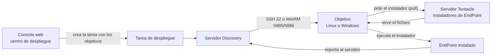

# Distribución e instalación automática de agentes

Instalar un EndPoint en un equipo es un rato de trabajo. Instalarlo en cincuenta es una tarde. Instalarlo en doscientos, con sistemas operativos distintos y contraseñas que nadie apuntó, es una de esas tareas que se posponen hasta que ya no queda más remedio. El **centro de despliegue** de Pandora FMS existe para eso: se le da una lista de objetivos, una credencial y una versión del EndPoint, y él se encarga de que el objetivo se conecte, descargue el instalador, lo ejecute y deje el agente reportando. Sin entrar máquina por máquina y sin copiar el mismo instalador veinte veces.

La idea se entiende mejor si se dice al revés de lo que parece. El centro de despliegue **no empuja nada**: no lanza un instalador contra el equipo desde el servidor. Lo que hace es ordenar al objetivo que se descargue el instalador de un servidor Tentacle y lo ejecute él mismo. Es una diferencia pequeña en la explicación y enorme en la práctica, porque condiciona toda la red: el objetivo tiene que poder llegar al Tentacle, no al revés. Todo lo demás (el escaneo, la credencial, el estado del objetivo) gira alrededor de esa conexión.

En el laboratorio de este capítulo se desplegaron EndPoints en tres máquinas reales: Rocky Linux 9, Ubuntu 22.04 y Windows 11. Las tres acabaron reportando a la consola. Los detalles, y unos cuantos matices, están en las páginas que siguen.

## Introducción: qué resuelve y cuándo usarlo

El centro de despliegue es la pantalla desde la que se distribuyen EndPoints a equipos ya localizados o localizables por red. En la consola está en **Gestión → Discovery → Host y dispositivos → Implementación de EndPoint**, y la página se titula **Centro de despliegue**. Reúne en un solo sitio las cuatro piezas que antes se llevaban a mano: el **instalador** (el repositorio de EndPoints), la **credencial** con la que se accede al equipo, la **lista de objetivos** y la **tarea** que ejecuta el despliegue. Lo que antes era copiar el instalador y entrar en cada máquina se convierte en una fila por máquina y un botón.

Sirve cuando hay varios equipos que cumplen tres condiciones: se puede entrar en ellos por SSH o por WinRM, pueden alcanzar un servidor Tentacle de Pandora FMS y comparten una versión de EndPoint que quieres dejar instalada. Es el caso típico de un grupo de servidores Linux, de un conjunto de puestos Windows o de una red de sucursal con un servidor Discovery cerca. También sirve para reinstalar un EndPoint que se quedó a medias, siempre con las precauciones que se cuentan en [Desplegar el EndPoint](#desplegar-el-endpoint).

No sirve para todo. Si el equipo no tiene SSH ni WinRM, el centro no puede entrar y habrá que instalarlo a mano o con el instalador en línea de [1.1 (Instalación)](../parte-1/1.1-instalacion.md). Si la red impide que el objetivo llegue al Tentacle, el despliegue fallará aunque la credencial sea correcta: el problema no estará en la autenticación, estará en la vuelta. Y si solo hay un equipo, o dos, el viaje por la consola puede ser más largo que ejecutar el instalador una vez.

Tampoco hay que confundirlo con el resto de piezas que lo rodean. El centro **instala el EndPoint**, no configura la monitorización: los módulos, las políticas y las alertas llegan después, por las vías de [2.1 (Monitorización con EndPoints)](../parte-2/2.1-monitorizacion-con-endpoints.md) y [2.10 (Políticas de monitorización)](../parte-2/2.10-politicas-de-monitorizacion.md). Y no sustituye al descubrimiento de redes de [2.4 (Descubrimiento de redes con Host y dispositivos)](../parte-2/2.4-descubrimiento-de-redes-con-host-y-dispositivos.md): el descubrimiento encuentra equipos; el centro de despliegue les instala el EndPoint cuando ya sabes cuáles son.

## Cómo funciona: del objetivo al EndPoint instalado

El recorrido tiene seis pasos y conviene tenerlos en la cabeza, porque cada uno deja un rastro distinto cuando algo falla.

1. **Se registra el objetivo.** La consola guarda su dirección, el método de acceso (SSH, WinRM o Secure WinRM), el puerto, la credencial, la versión de EndPoint que se quiere instalar, la dirección y el puerto del Tentacle y una carpeta temporal. El objetivo todavía no sabe nada.
2. **Se crea una tarea de despliegue.** Al pulsar el botón de despliegue, la consola crea una tarea con la lista de objetivos seleccionados. La tarea queda habilitada y con intervalo manual: no se repite sola cada cierto tiempo, se ejecuta cuando le toca.
3. **La ejecuta el servidor Discovery.** El servidor de descubrimiento toma la tarea y, por cada objetivo, lanza la utilidad de despliegue. Si el servidor Discovery es remoto, es él quien necesita llegar a los objetivos; la consola solo manda.
4. **Se abre la conexión.** La utilidad entra por SSH o por WinRM con la credencial guardada, comprueba que puede ejecutar un comando y, si puede, sigue adelante.
5. **El objetivo descarga el instalador.** Aquí está el giro: el objetivo abre una conexión TCP al Tentacle, en la dirección y el puerto que se configuraron, y pide el fichero por su nombre. El Tentacle se lo sirve desde el directorio de agentes. Es una descarga, no un envío.
6. **Se instala y arranca.** El instalador deja el EndPoint en su sitio, configura la dirección del servidor, activa la configuración remota y arranca el servicio. A partir de ahí, el EndPoint empieza a reportar como cualquier otro agente.



El servidor Discovery procesa los objetivos **de uno en uno dentro de una misma tarea**. No hay un despliegue paralelo que reparta la carga entre diez máquinas: hay una cola y un objetivo cada vez. Tampoco hay reintentos automáticos. Si un objetivo falla, se apunta el error y se pasa al siguiente; volver a intentarlo es una decisión tuya, con el botón de forzar la tarea o creando otra. El tiempo máximo por objetivo sale del repositorio: la pantalla propone 500 segundos y el servidor corta la ejecución cuando se agota. Un objetivo que se queda colgado no bloquea la cola para siempre, pero sí puede tardar lo suyo en liberarse.

Hay una consecuencia que conviene entender desde el principio: **«desplegado» significa que el instalador terminó, no que el EndPoint ya esté reportando**. La marca de éxito se pone cuando la utilidad de despliegue termina sin error; el primer contacto del agente puede llegar unos segundos o unos minutos después. En [Seguimiento: objetivos, estados y tareas](#seguimiento-objetivos-estados-y-tareas) se explica cómo distinguir una cosa de la otra.

## Requisitos previos

Antes de añadir el primer objetivo hay que preparar cuatro cosas: el acceso a los equipos, el servidor Tentacle, la credencial y el repositorio. Si una falta, el despliegue no empieza o falla en el peor momento.

| Requisito | Detalle |
|---|---|
| Acceso por SSH en Linux | Puerto `22` abierto y autenticación por contraseña. La utilidad usa la contraseña de la credencial; no admite clave privada. El usuario debe poder ejecutar el instalador como root, porque el instalador de Linux lo exige |
| Acceso por WinRM en Windows | WinRM o Secure WinRM habilitado, PowerShell disponible y un usuario administrador local. Puertos por defecto `5985` (WinRM) y `5986` (Secure WinRM) |
| Servidor Tentacle accesible | El objetivo debe poder abrir una conexión TCP al puerto `41121` del servidor Tentacle. La conexión la inicia el objetivo, no el servidor |
| Filtros del Tentacle | El Tentacle debe servir los instaladores del repositorio. Hacen falta los filtros de `.agent_setup.tar.gz` y `.agent_setup.exe` en el directorio `agent`, y el servicio debe reiniciarse después de cambiarlos |
| Credencial personalizada | Una credencial de tipo *personalizado* con usuario y contraseña, registrada en el gestor de credenciales. Su identificador es lo que se guarda en el objetivo |
| Repositorio con instaladores | Al menos un instalador por sistema operativo y arquitectura, subido al repositorio de EndPoints y sincronizado con el directorio de agentes del servidor |
| Perfil PM | El centro de despliegue y su entrada de menú exigen el perfil **PM**. El enlace al gestor de credenciales exige además **UM** |
| Utilidad de barrido de red en el servidor Discovery | Solo para el escaneo de redes. Sin ella, el escaneo no puede descubrir hosts |
| Red de gestión | El servidor Discovery debe llegar a los puertos de despliegue de los objetivos, y los objetivos al Tentacle. Abrir el 41121 en el servidor hacia el objetivo no sirve de nada: la conexión va en el otro sentido |

El detalle del acceso a Windows no es un adorno: WinRM viene deshabilitado por defecto en muchas instalaciones y, si la red está marcada como pública, el cortafuegos bloquea el puerto aunque el servicio esté levantado. La guía de habilitación de WinRM sigue siendo el punto de partida. En el laboratorio, el Windows 11 necesitó habilitar el listener y añadir una regla de cortafuegos para la red de gestión; sin eso, el puerto aparecía cerrado desde el servidor.

Sobre el **usuario de Linux**: el instalador comprueba que se ejecuta como root y aborta si no. La utilidad no usa `sudo` ni eleva privilegios por su cuenta, así que la credencial tiene que ser de root o de una cuenta que ya tenga privilegios de root en la sesión. Si el equipo tiene SSH pero no permite root por contraseña, el centro de despliegue no es el camino; habrá que instalar a mano o cambiar la política de acceso.

Sobre **Secure WinRM**: usa HTTPS y valida el certificado del servidor. Un certificado autofirmado o caducado hará que la conexión falle; para probar en un laboratorio suele ser más rápido empezar por WinRM en `5985` y dejar Secure WinRM para cuando el certificado esté en regla.

!!! warning "El Tentacle no es opcional"
    El centro de despliegue no lleva el instalador dentro de la conexión SSH o WinRM. El objetivo lo descarga del Tentacle. Si el objetivo no llega al Tentacle, el despliegue falla con un error de conexión aunque la credencial sea correcta. Es el fallo más habitual cuando se prueba por primera vez en una red segmentada.

## El repositorio de EndPoints

El repositorio es la despensa del despliegue. Está en **Configuración → Repositorio de EndPoints** y guarda los instaladores que después se sirven a los objetivos. Cada entrada es una combinación de sistema operativo, arquitectura y versión; no hay una entrada «genérica» que valga para todo.

| Campo | Qué se pone |
|---|---|
| OS | `Linux` o `Windows`. Son los dos sistemas que el centro de despliegue sabe instalar |
| Architecture | `x64` o `x86` |
| Version | La versión del EndPoint, hasta 10 caracteres. Es la que se muestra en la lista de objetivos y la que se guarda como versión instalada |
| Transfer timeout | Tiempo máximo, en segundos, que se concede a la descarga y a la instalación de ese instalador. La pantalla propone 500 |
| Installation file | El paquete del EndPoint. Para Linux, un `.tar.gz`; para Windows, un `.exe` |

Al guardar, la consola copia el fichero a su almacén y lo sincroniza con el directorio de agentes del servidor, que es de donde se sirve el instalador. No conviene renombrar ficheros a mano ni moverlos de sitio.


El alta tiene tres decisiones que importan:

- **La versión no se puede repetir para el mismo sistema y arquitectura.** Si ya existe una entrada con esa combinación, la consola rechaza el alta. Para cambiarla, se edita la entrada existente (solo el tiempo de transferencia) o se borra y se vuelve a subir.
- **El tipo de fichero se valida al subirlo.** La consola solo acepta un `.tar.gz` para Linux y un `.exe` para Windows; si se sube otra cosa, responde con un error de fichero de instalación no válido.
- **La sincronización es parte del alta.** No basta con que el fichero esté en el repositorio: tiene que estar en el directorio de agentes del Tentacle. El alta lo hace por ti; el icono de refresco de la lista vuelve a sincronizar una entrada existente si la copia del directorio de agentes se perdió o se actualizó.


Los instaladores se obtienen de las mismas fuentes que se describen en [1.1 (Instalación)](../parte-1/1.1-instalacion.md). El instalador en línea y el repositorio no son lo mismo: el primero descarga el paquete de los servidores de Pandora FMS y lo instala en el equipo; el segundo guarda el paquete que tú subes para que el centro de despliegue lo sirva por Tentacle. Si actualizas la versión de los EndPoints, sube el instalador nuevo al repositorio antes de cambiar la versión deseada de los objetivos.

## Credenciales y permisos

El centro de despliegue no guarda usuarios ni contraseñas en el objetivo. Guarda el **identificador** de una credencial del gestor y la recupera en el momento de desplegar. Esa indirección tiene una ventaja evidente: cuando cambia la contraseña de los equipos, se actualiza una vez en el gestor y los objetivos usan la nueva en el siguiente despliegue. También tiene una consecuencia: si borras la credencial, los objetivos que la usaban se quedan sin poder desplegar y hay que volver a asignarles otra.

La credencial que necesita este capítulo es de tipo **personalizado**: un identificador, un usuario y una contraseña. El identificador es el que se elige en el formulario de alta de objetivo y el que se escribe en el CSV; el usuario y la contraseña no se copian al objetivo. En el gestor, la credencial pertenece a un grupo, y ese grupo decide quién la ve. El detalle de tipos, grupos y cifrado está en [2.2 (Gestor de credenciales)](../parte-2/2.2-gestor-de-credenciales.md).

!!! warning "Cifrado de credenciales"
    Si el cifrado no está activado, la pantalla del gestor avisa de que las credenciales se guardan sin cifrar. Un almacén de contraseñas en claro es un regalo para quien consiga una copia de los datos.

En cuanto a los permisos, el centro de despliegue es una pantalla de administración: la entrada de menú y la página exigen el perfil **PM**. El enlace al gestor de credenciales solo aparece con **UM**; si no lo tienes, puedes usar una credencial ya creada, pero no crear una nueva desde ahí. El grupo que se elige al crear la tarea de despliegue decide su visibilidad en la lista de tareas, como en cualquier otra tarea de Discovery.

## Buscar objetivos

Hay tres formas de llenar la lista de objetivos: escanear una red, añadir uno a mano o cargar un CSV. Las tres acaban en el mismo sitio, la lista de objetivos, y las tres guardan la misma información. La diferencia está en cuánto trabajo quieres hacer tú y cuánto quieres que haga la consola.

Antes de desplegar, conviene tener claro qué objetivos son **válidos**. La consola solo ofrece en **Objetivos disponibles** los que tienen una credencial y una versión de EndPoint asignadas. Un objetivo sin credencial, o con una versión que ya no existe en el repositorio, no aparece. No es un capricho: sin esas dos piezas el despliegue no puede empezar.

### Escanear una o varias redes

El escaneo es la vía cómoda cuando no sabes exactamente qué hay en la red. Se le da una o varias redes con su máscara, un servidor Discovery, una versión deseada y una o varias credenciales, y él hace el trabajo sucio: lanza un barrido de red, se queda con los hosts vivos y, por cada uno que no sea ya un objetivo, prueba a conectarse.

La prueba de conexión recorre tres métodos en este orden: **SSH en el 22**, **WinRM en el 5985** y **Secure WinRM en el 5986**. Para cada método prueba todas las credenciales seleccionadas. La primera combinación que consigue ejecutar un comando es la que se guarda: el objetivo queda dado de alta con ese método, ese puerto y la carpeta temporal correspondiente. Si ninguna funciona, el host se descarta y se pasa al siguiente.


Hay tres detalles que ahorran disgustos:

- **El escaneo no despliega.** Solo añade objetivos a la lista. Cuando termine, todavía hay que seleccionarlos y lanzar el despliegue. La tarea de escaneo aparece en la lista de tareas con su progreso y su resumen de hosts vivos y conectados.
- **El escaneo no toca los objetivos que ya existen.** Si un host ya está en la lista, se salta. Eso evita duplicados, pero también significa que un objetivo con una credencial equivocada no se corrige solo: hay que editarlo o borrarlo y volver a escanear.
- **El primer método que funciona manda.** Un Windows con OpenSSH habilitado puede aceptar SSH y quedar con método SSH; el despliegue usará entonces el procedimiento de Linux, que no sirve para un equipo Windows. Si los equipos mezclan sistemas, revisa el método que ha elegido el escaneo antes de desplegar.

El escaneo puede tardar. El barrido recorre la red, y por cada host vivo se prueban tres métodos por cada credencial; en una red grande con varias credenciales, la tarea puede pasar minutos trabajando. El progreso se ve en la lista de tareas, y el resumen final dice cuántos hosts se encontraron y cuántos aceptaron la conexión.

### Añadir un objetivo a mano

El alta manual es para cuando ya sabes la dirección, el método y la credencial. Es más rápido que un escaneo y más preciso: no hay interpretación que valga.

| Campo | Qué significa |
|---|---|
| IP del objetivo | Dirección del equipo que va a recibir el EndPoint |
| Método de despliegue | `SSH`, `WinRM` o `Secure WinRM`. Al cambiar de método, la consola ajusta el puerto y la carpeta temporal a los valores del método |
| Puerto de despliegue | Puerto de conexión. `22` para SSH, `5985` para WinRM, `5986` para Secure WinRM. Se puede cambiar si el servicio escucha en otro sitio |
| Versión de EndPoint deseada | Versión del repositorio que se va a instalar |
| Credenciales | Credencial personalizada con la que se accede al equipo |
| IP del servidor Tentacle | Dirección del servidor Tentacle que el objetivo usará para descargar el instalador y, después, para reportar |
| Puerto del servidor Tentacle | Puerto del Tentacle. Por defecto, `41121` |
| Carpeta temporal de despliegue | Carpeta temporal donde se descarga y se extrae el instalador. `/tmp` en Linux, `C:\Windows\Temp` en Windows |


El campo que más se equivoca es **IP del servidor Tentacle**. La consola propone la dirección que ella misma ve, que en una instalación normal es la del servidor, pero en un entorno con contenedores o con NAT puede ser una dirección interna que el objetivo no alcanza. Hay que poner la dirección que el objetivo puede alcanzar, no la que la consola cree que tiene. Si el objetivo está en otra red, esa dirección será la de la interfaz del servidor en esa red, no la de `localhost`.

La otra decisión es la **carpeta temporal**. En Linux, `/tmp` suele valer; en Windows, `C:\Windows\Temp` es el valor por defecto. El instalador se descarga ahí, se ejecuta y se borra; si el usuario no tiene permisos de escritura en esa carpeta, el despliegue falla antes de empezar.

La consola valida lo mínimo: que haya IP, credencial, versión y protocolo. No comprueba el formato de la IP ni el rango del puerto. Si la IP ya existe, responde con un aviso de objetivo ya definido y no crea un duplicado; para cambiarla, se edita el objetivo existente.

### Cargar objetivos desde CSV

El CSV es la vía para dar de alta muchos objetivos de golpe. El formato es el que muestra la propia pantalla:

```text
IP; Protocol; Target port; Target EndPoint version; Credential identifier; Tentacle server ip; Tentacle server port; Temp folder
```

El separador se elige en el formulario: `,`, `;`, `:`, `.` o `#`; por defecto, `;`. La primera línea **no es una cabecera**: todas las líneas se procesan como objetivos. Si copias la cabecera de arriba al fichero, la consola intentará dar de alta un objetivo llamado «IP» y fallará.


Hay dos valores que se escriben distinto de lo que parece:

- **Target EndPoint version** es el **identificador numérico** del repositorio, no la cadena de versión. Si en la lista de objetivos ves `8.0.2608 - Linux - x64`, en el CSV hay que poner el identificador de esa entrada (por ejemplo, `1`), no el texto. La consola comprueba que ese identificador exista y rechaza la línea si no.
- **Protocol** acepta `SSH`, `HTTP` o `HTTPS`. `HTTP` es WinRM y `HTTPS` es Secure WinRM; no escribas «WinRM» ni «Secure WinRM» en el CSV, porque la consola no los reconoce como protocolo.

Si la IP ya existe, la línea **actualiza** el objetivo; si no existe, lo **inserta**. Los campos vacíos se rellenan con el valor anterior del objetivo, si existe, o con los valores por defecto: el puerto de despliegue según el protocolo, la IP del servidor de consola para el Tentacle, `41121` para el puerto y `/tmp` o `C:\Windows\Temp` para la carpeta temporal. El informe final dice cuántas líneas se procesaron, cuántas se añadieron y qué errores hubo; los errores se cuentan por línea, no se aborta el fichero entero.

!!! tip "Un CSV pequeño primero"
    Antes de subir doscientos objetivos, sube dos. Comprueba que el identificador de versión y el de credencial son los correctos y que el separador es el que has elegido. Un CSV mal separado no falla de forma evidente: genera una lista de errores por línea que hay que leer una a una.

## Desplegar el EndPoint

Con los objetivos en la lista, el despliegue es el paso corto. Se pulsa **Desplegar el EndPoint a los objetivos**, se elige un nombre de tarea, un grupo, el servidor Discovery que va a ejecutarla y los objetivos. La consola solo ofrece los objetivos que tienen credencial y versión; el resto no aparece en **Objetivos disponibles**.


Al aceptar, la consola crea una tarea de despliegue habilitada, con intervalo manual y el grupo elegido. La tarea se ejecuta en segundo plano. No hay que quedarse mirando la pantalla: se puede cerrar y volver más tarde; el progreso y el resultado quedan en la lista de tareas y en la lista de objetivos.

Por cada objetivo, la utilidad hace lo siguiente:

1. Comprueba que el objetivo no esté ya en pleno despliegue. Si lo está, lo salta.
2. Marca el objetivo como «desplegando».
3. Recupera la credencial.
4. Localiza el instalador en el repositorio.
5. Prepara la orden de despliegue y la lanza con un tiempo máximo.
6. Si la utilidad termina bien, marca el objetivo como desplegado, guarda la versión instalada y borra el error anterior. Si falla, marca el objetivo como no desplegado y guarda la salida del error. Si se agota el tiempo, guarda «Deployment timeout after N seconds».

En Linux, la utilidad descarga el `.tar.gz` en la carpeta temporal, lo extrae, ajusta la configuración del EndPoint y ejecuta el instalador en modo desatendido. Si el equipo ya tenía un EndPoint, **conserva su configuración existente** y no reescribe la dirección del servidor ni el puerto. En Windows, descarga el `.exe`, detiene el servicio si ya existe, lo ejecuta en modo silencioso con la dirección del servidor y la configuración remota activada, añade el puerto si no es el de por defecto y arranca el servicio. Si ya había una configuración, **se conserva**: en una reinstalación no se reescribe la dirección del servidor ni el estado de la configuración remota, y solo se añade el puerto si no es el de por defecto. La dirección y la configuración remota que se indican al desplegar se aplican cuando el EndPoint se instala por primera vez.

!!! warning "Qué significa exactamente «desplegado»"
    El centro marca el objetivo como desplegado cuando la utilidad de despliegue termina, no cuando el EndPoint ya ha contactado con el servidor. El primer contacto del agente puede llegar unos segundos o unos minutos después. Si el agente no aparece en la consola, revisa la conectividad y el registro del EndPoint.

En la consola se muestra el alias del agente, que por defecto es el nombre del equipo. Si quieres cambiar cómo aparece, edita el alias.

Una reinstalación no es un borrado y una instalación limpia. En Linux, si el equipo ya tenía un EndPoint, el instalador conserva su configuración y no aplica la nueva dirección del Tentacle. Eso está bien para no perder módulos ni ajustes, pero es una trampa si lo que querías era mover el agente a otro servidor: el objetivo seguirá apuntando al servidor anterior. Para cambiar de servidor, hay que editar la configuración del EndPoint en el equipo o desinstalarlo antes de volver a desplegar.

## Seguimiento: objetivos, estados y tareas

La lista de objetivos es el panel de control del despliegue. Cada fila es un equipo, y cada dato cuenta una parte de su historia.

| Campo | Qué muestra |
|---|---|
| IP del objetivo | Dirección del objetivo. Si el agente ya existe en la consola, la IP es un enlace a su ficha |
| Método de despliegue | SSH, WinRM o Secure WinRM |
| IP del servidor Tentacle | Dirección del Tentacle que usa el objetivo |
| Versión de EndPoint deseada | Versión que se quiere instalar |
| Última versión de EndPoint desplegada | Última versión que se instaló correctamente, con su sistema y arquitectura |
| Último despliegue correcto | Hace cuánto fue el último despliegue correcto |
| Último error de despliegue | Salida del último error, si lo hubo |
| Estado | Indicador de color con su descripción emergente |
| Opciones | Editar o borrar el objetivo |


El estado se lee por color y por texto emergente, no por una etiqueta escrita en la celda. Un objetivo **no desplegado** aparece en azul; uno **desplegado correctamente**, en verde; uno **fallido**, en rojo. Mientras se está desplegando, el apartado del último despliegue muestra el texto «Desplegando» y un icono de desbloqueo, y el estado sigue en azul. Ese icono es la salida de emergencia: si el proceso se quedó colgado, el desbloqueo libera la marca, deja constancia del desbloqueo manual en el error y permite volver a intentarlo; la fila aparece como fallida hasta el siguiente despliegue correcto. No cancela el proceso que esté corriendo en el servidor; solo libera la marca.

Los filtros de la parte superior permiten buscar por IP, método, versión, IP del Tentacle y estado. Son útiles cuando la lista crece, aunque conviene saber que el filtro por estado «Desplegado» no es fiable en esta pantalla. Para saber si un objetivo concreto está bien, el estado y el último error son más fiables que ese filtro.

Las tareas viven en **Discovery → Lista de tareas → Tareas de Host & devices**. Cada despliegue aparece como una tarea de despliegue, con su estado, su progreso y su tiempo de actualización.


Las operaciones de la tarea son las habituales de Discovery, con matices:

- **Forzar** vuelve a ejecutar la tarea con los mismos objetivos. Es la forma de reintentar un despliegue fallido sin crear una tarea nueva.
- **Editar** abre el formulario de despliegue si la tarea tiene objetivos, o el de escaneo si es una tarea de red. Permite cambiar el nombre, el grupo, el servidor y los objetivos.
- **Habilitar/Deshabilitar** activa o desactiva la tarea. Una tarea deshabilitada no se ejecuta, pero no se borra.
- **Borrar** elimina la tarea. No desinstala el EndPoint de los objetivos ni borra los objetivos de la lista; solo elimina la tarea.

Si has usado el escaneo para llenar la lista, la tarea de escaneo y la de despliegue son distintas. La primera solo añade objetivos; la segunda los instala. No mezcles sus resultados: que el escaneo termine bien no significa que el EndPoint esté instalado.

## Diagnóstico y problemas habituales

Cuando un despliegue falla, hay tres sitios donde mirar, en este orden: el **último error** del objetivo en la lista, el **registro del servidor** y el **registro del EndPoint** en el propio equipo. El último error suele dar la pista; el registro del servidor añade el contexto de la tarea; el del EndPoint dice si el EndPoint llegó a arrancar.

| Síntoma | Causa probable | Qué hacer |
|---|---|---|
| El objetivo no aparece en **Objetivos disponibles** | Le falta la credencial o la versión; o la credencial o la versión se borraron | Edita el objetivo y asigna ambas; comprueba que la versión sigue en el repositorio |
| La autenticación falla o la conexión se rechaza | Usuario o contraseña incorrectos, o el método no es el que espera el equipo | Prueba la credencial a mano por SSH o WinRM; revisa el método y el puerto |
| `No route to host` al conectar con el Tentacle | El objetivo no llega a la IP o al puerto configurados | Corrige la IP del Tentacle en el objetivo; comprueba el puerto `41121` y el cortafuegos |
| Aviso de que no se pudo conectar con el Tentacle | El Tentacle no está levantado, no escucha en esa dirección o el filtro no sirve el fichero | Revisa el servicio Tentacle, la dirección y los filtros de instaladores |
| El escaneo encuentra el host pero no lo añade | Ninguna credencial funciona, o el host ya existe con otra credencial | Prueba las credenciales a mano; borra el objetivo antiguo si quieres que el escaneo lo vuelva a crear |
| El CSV rechaza una línea porque la versión no existe | Se puso la cadena de versión en lugar del identificador del repositorio | Usa el identificador numérico de la entrada del repositorio |
| El CSV rechaza una línea porque la credencial no existe | El identificador de la credencial no coincide exactamente | Copia el identificador del gestor, sin espacios ni cambios de mayúsculas |
| El objetivo se queda en «Desplegando» | El proceso se cortó o el servidor no liberó la marca | Usa el desbloqueo del objetivo y vuelve a lanzar el despliegue |
| La instalación agota el tiempo máximo | La descarga o la instalación tardaron más que el tiempo de transferencia | Aumenta el tiempo en el repositorio o revisa la red y el tamaño del instalador |
| El agente no aparece en la consola | El EndPoint no arrancó, no llega al servidor o el nombre cambió | Revisa el servicio, la dirección y el puerto del servidor configurados en el EndPoint, la conectividad y el registro del EndPoint |

El error de Tentacle es el más fácil de diagnosticar y el más fácil de evitar. En el laboratorio, un objetivo con la IP del Tentacle cambiada a una dirección inexistente falló con un error de conexión (`No route to host`) y un aviso de que no se pudo conectar con el Tentacle. La credencial era correcta y la conexión SSH funcionaba; lo que no funcionaba era la vuelta al Tentacle. Si el error menciona el Tentacle, no pierdas tiempo con la contraseña: el problema está en la red o en la dirección.

En Linux, el objetivo necesita un shell con las utilidades habituales de compresión y gestión de servicios; en un sistema mínimo puede fallar la descarga aunque SSH funcione. En Windows, necesita PowerShell y el servicio del EndPoint; el instalador es un `.exe` silencioso.

Para el diagnóstico general del servidor y del agente, [9.13 (Troubleshooting con Pandora)](../parte-9/9.13-troubleshooting-con-pandora.md) recoge las comprobaciones que van más allá de este capítulo.

## Seguridad y buenas prácticas

El centro de despliegue mueve credenciales, instala software y arranca servicios. No es una pantalla para dejar abierta a cualquiera, y la red en la que se usa debería tratarse como una red de administración.

Por el lado de las conexiones, conviene saber qué hace el centro de despliegue y qué no:

- **SSH** acepta la clave del host que encuentre y no la verifica contra una lista de confianza. Usa autenticación por contraseña, no por clave privada. En una red de gestión controlada es aceptable; en una red abierta, es un riesgo de intermediario.
- **WinRM** usa NTLM. **Secure WinRM** añade TLS y valida el certificado del servidor; si el certificado no es de confianza, la conexión falla. Para producción, Secure WinRM con un certificado en regla es la opción sensata.
- **Tentacle** sirve los instaladores sin contraseña ni cifrado por defecto. El tráfico va en claro. Si la red no es de confianza, configura las opciones de seguridad de Tentacle que se describen en [9.4 (Referencia completa de Tentacle)](../parte-9/9.4-referencia-completa-de-tentacle.md).
- **Las credenciales** se guardan cifradas si el cifrado está activado; si no, se guardan en claro y la pantalla lo avisa.
- **La carpeta temporal** se usa para descargar y ejecutar el instalador. La utilidad borra el instalador al terminar, pero mientras dura el despliegue el fichero está ahí. En un equipo compartido, usa una carpeta con permisos restringidos.

Las buenas prácticas son las de cualquier despliegue masivo: probar primero en un objetivo piloto, no lanzar doscientos a la vez sin haber visto uno funcionar, mantener el repositorio con la versión que quieres instalar, revisar el método que ha elegido el escaneo y no usar la misma credencial de root para todos los equipos si puedes evitarlo. El centro de despliegue no te obliga a nada de eso; solo te lo pone fácil si lo haces.

## Relación con otras formas de instalación

El centro de despliegue es una pieza más del rompecabezas. La elección depende de cuántos equipos hay, de si tienen acceso a internet y de si ya están localizados.

| Vía | Cuándo usarla | Dónde se explica |
|---|---|---|
| Instalador en línea | Uno o pocos equipos con acceso a internet y una IP de servidor conocida | [1.1 (Instalación)](../parte-1/1.1-instalacion.md) |
| Instalación manual | Equipos sin red de gestión, sin SSH/WinRM o con requisitos especiales | [1.1 (Instalación)](../parte-1/1.1-instalacion.md) |
| Centro de despliegue | Varios equipos accesibles por SSH/WinRM y un Tentacle común | Este capítulo |
| Autoprovisión | Equipos que se dan de alta solos con una configuración predefinida | [6.6 (Mecanismos de autoprovisión)](6.6-mecanismos-de-autoprovision.md) |
| Descubrimiento con políticas | Equipos ya monitorizados a los que se les aplica configuración de forma masiva | [2.3 (Monitorización y descubrimiento automático con Discovery)](../parte-2/2.3-monitorizacion-y-descubrimiento-automatico-con-discovery.md) y [2.10 (Políticas de monitorización)](../parte-2/2.10-politicas-de-monitorizacion.md) |

El centro de despliegue deja el EndPoint instalado. Que reporte, con qué módulos y con qué alertas, es otra conversación: empieza en [2.1 (Monitorización con EndPoints)](../parte-2/2.1-monitorizacion-con-endpoints.md). Instalar el agente es el principio, no el final.
