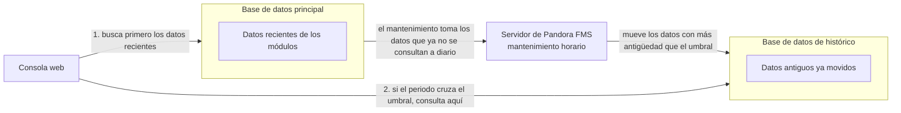

# Base de datos de histórico

Una instalación de Pandora FMS lo apunta todo: el valor de cada módulo, cada evento, cada trap. Con el tiempo esa base de datos se convierte en un archivo enorme, y la parte que se consulta a diario es una franja mínima, los últimos días. La **base de datos de histórico** existe justo para eso: los datos antiguos se van a otra base de datos y la principal respira. La información no se tira ni se encierra en un cajón: sigue disponible, y la consola la consulta de forma transparente cuando pides una gráfica o un informe que se remonta más atrás de lo que la base de datos activa conserva.

## Introducción: qué es y cuándo usarlo

La base de datos de histórico es una segunda base de datos, con el mismo motor y el mismo esquema que la principal, a la que el servidor transfiere los datos antiguos de los módulos. El objetivo es doble: aligerar la base de datos activa, que es la que soporta la escritura constante y las consultas del día a día, y conservar series temporales largas sin que ocupen el mismo sitio que los datos recientes. Lo que se gana es margen: una instalación con mucho volumen puede seguir guardando meses de datos sin que la base de datos activa se degrade. Lo que se paga es una pieza más que administrar, con su propio servidor de base de datos, su copia de seguridad y su mantenimiento.

Conviene cuando hay un volumen alto de series temporales y se quiere un histórico largo sin sacrificar la respuesta de la base de datos principal. La base de datos de histórico conserva el dato tal cual, solo que en otro sitio: no resume ni pierde resolución, y por eso sirve también para volver a mirar el minuto exacto en que algo pasó.

Tampoco es una copia de seguridad, y conviene no confundirlas. La base de datos de histórico no protege contra un borrado accidental ni contra la caída del servidor: es una base de datos de producción más, viva, con su ciclo de purgado. Para eso está el respaldo, que se trata en [6.8 (Backup y restore)](6.8-backup-y-restore.md).

La base de datos de histórico es **opcional** y viene desactivada de fábrica. No es un requisito de instalación ni una palanca de rendimiento que se active sin pensar: es una pieza que se monta cuando el volumen la justifica. Activarla en una instalación pequeña añade trabajo a cambio de poco. La decisión razonable es activarla cuando la base de datos activa empieza a quedarse corta y la retención que se necesita supera con creces lo que conviene tener en la base de datos principal.

Si quieres situar el histórico dentro del conjunto de la plataforma antes de bajar al detalle, [1.2 (Introducción y arquitectura)](../parte-1/1.2-introduccion-y-arquitectura.md) describe los componentes y las topologías, y [10.1 (Esquema de la base de datos)](../parte-10/10.1-esquema-de-la-base-de-datos.md) enseña el esquema real, con los nombres de tabla que aquí no se usan.

## Cómo encaja en la arquitectura

La base de datos de histórico es del mismo motor que la principal, MySQL 8 o Percona Server for MySQL 8. No es un almacén distinto con otro formato: es la misma estructura, con las mismas tablas de datos, en otro servidor. Por eso el servidor puede mover filas de un sitio a otro sin conversiones raras, y por eso la consola puede cambiar de origen sin que la consulta se entere.

El movimiento lo ejecuta el **mantenimiento periódico del servidor**, no la consola web. La consola se limita a configurar la conexión y los umbrales; quien transfiere los datos es la herramienta de mantenimiento de la base de datos, que corre cada hora por cron. Esto tiene una consecuencia práctica que a veces se pasa por alto: configurar el histórico no mueve nada al instante. Los datos empiezan a viajar en la siguiente pasada del mantenimiento.

La consola, por su parte, mantiene su propia conexión a la base de datos de histórico y decide en cada consulta de qué base de datos tirar. Cuando pides una gráfica o un informe, la consola mira la antigüedad del periodo solicitado y, si cruza el umbral configurado, cambia de base de datos. Es la **consulta transparente**: tú no eliges la base de datos, la elige la consola por ti. El detalle de ese mecanismo está en [Consulta desde la consola](#consulta-desde-la-consola).



El histórico convive con el resto de la arquitectura sin pedir permiso. En un **Command Center** tiene su propia pantalla en el Metasetup, como se explica en [Operación en entornos complejos](#operacion-en-entornos-complejos); en una topología de **alta disponibilidad** forma parte del entramado que coordina el mantenimiento, como se ve en [6.9 (Alta disponibilidad)](6.9-alta-disponibilidad-ha.md). Y aunque la costumbre y la documentación antigua lo presenten como obligatorio, lo cierto es que el código no exige que el histórico viva en un servidor distinto al de la base de datos principal: es una **recomendación**, y una buena, porque separar el disco y la CPU de las dos bases evita que el mantenimiento de una ahogue a la otra.

## Requisitos y preparación del servidor de histórico

Antes de tocar la consola hay que tener a punto el servidor que va a alojar la segunda base de datos. Los requisitos son los mismos que los de cualquier base de datos de Pandora FMS, con la salvedad de que aquí no hace falta instalar el producto: basta con el motor y una base de datos dedicada.

| Requisito | Detalle |
|---|---|
| Motor de base de datos | MySQL 8 o Percona Server for MySQL 8, el mismo que la base de datos principal. La tabla de requisitos completa está en [1.1 (Instalación)](../parte-1/1.1-instalacion.md) |
| Base de datos dedicada | Una base de datos propia para el histórico, distinta de la principal, con su usuario y su contraseña |
| Privilegios | El usuario necesita privilegios sobre esa base de datos, incluidos los de crear y modificar estructura, porque en la primera conexión se instala el esquema |
| Conectividad | Acceso desde el servidor de Pandora FMS y desde la consola web hasta el host y el puerto del motor. El puerto por defecto es `3306` |
| Servidor distinto | Alojar el histórico en un servidor separado del de la base de datos principal es **recomendado**, no exigido. Separa disco y CPU, y evita que el mantenimiento de una base de datos penalice a la otra |
| Conexión segura (SSL) | Opcional desde la versión 782. Se configura con el interruptor **Habilitar SSL** y los campos de clave, certificado, CA, ruta de la CA y verificación del certificado del servidor |

El administrador del motor prepara la base de datos y el usuario. En la línea de comandos del servidor MySQL que va a alojar el histórico, un juego de sentencias como este deja el terreno listo:

```sql
CREATE USER '<pfms_user_name>' IDENTIFIED BY '<pfms_user_password>';

ALTER USER '<pfms_user_name>'
  IDENTIFIED WITH mysql_native_password BY '<pfms_user_password>';

CREATE DATABASE <historical_database_name>;

GRANT ALL PRIVILEGES
  ON `<historical_database_name>`.*
  TO '<pfms_user_name>'@'<pfms_server_ip_address>';

FLUSH PRIVILEGES;
```

El nombre de la base de datos, el usuario y la contraseña son los que después se escriben en la pantalla de la consola. El esquema no se crea a mano: lo instala la propia consola en la primera conexión, como se cuenta en el apartado siguiente.

Sobre el **SSL**, conviene tener claro qué es cada campo. **Clave SSL del servidor** es la ruta al fichero PEM con la clave del servidor MySQL; **Certificado SSL del servidor**, la del certificado de esa clave; **Certificado SSL de la CA**, la lista de certificados emitidos por una autoridad de certificación; **Ruta del certificado SSL de la CA**, el directorio que aloja esos certificados, también en formato PEM. Con **Verificar certificado SSL del servidor** activado, la conexión comprueba el CN del certificado y, si no coincide, no conecta. Es la opción recomendada cuando el motor expone una conexión TLS, y la explicación de la configuración segura de la base de datos principal, que comparte criterios, está en [9.5 (Cifrado de la base de datos)](../parte-9/9.5-cifrado-de-la-base-de-datos.md).


## Activación y conexión desde la consola

La pantalla vive en **Ajustes → Configuración del sistema → Base de datos histórica**. Todo empieza con un interruptor general, **Habilitar base de datos histórica**, y un formulario de conexión que aparece al activarlo.

Los campos de conexión son los de cualquier cliente MySQL: **Host**, **Puerto**, **Nombre de la base de datos**, **Usuario de la base de datos** y **Contraseña de la base de datos**. El puerto viene con `3306`, el estándar. La contraseña se guarda cifrada, como el resto de credenciales del producto. Debajo está el bloque SSL descrito en el apartado anterior.


Al guardar, la consola hace dos comprobaciones que conviene conocer porque explican la mitad de los sustos:

- Si la base de datos de histórico que has escrito es **la misma** que la activa (mismo host, mismo puerto, mismo nombre), la consola rechaza el guardado con un aviso claro: la base de datos activa y la histórica no pueden ser la misma. Es un error de configuración, no un fallo.
- Si la base de datos de destino no existe, no responde o el usuario no tiene permisos, la creación de la estructura falla y el interruptor **Habilitar base de datos histórica** queda desactivado. La consola no deja activado un histórico al que no puede escribir.

Cuando la conexión va bien, la primera vez se **instala el esquema** en la base de datos de destino. A partir de ahí, la consola compara la versión del esquema del histórico con la de la base de datos activa y ofrece dos acciones según el estado: **Instalar esquema de base de datos**, si aún no existe, y **Actualizar el esquema de la base de datos**, que programa la puesta al día cuando el histórico se ha quedado atrás respecto a la base de datos principal. Las dos acciones son la misma maquinaria que mantiene al día el esquema de la base de datos principal, aplicada sobre la conexión de histórico.

Los indicadores de estado de la pestaña **Conexión** no son decorativos: se pueden pulsar para forzar una comprobación. Si dudas de si la base de datos responde, pulsar el indicador de conexión lanza una comprobación en el momento, sin esperar al siguiente ciclo. El indicador de esquema instalado es el que dispara la instalación cuando falta, y el de esquema actualizado el que programa la actualización cuando hay desfase.

La pantalla se organiza en cinco pestañas, cada una con su cometido:

| Pestaña | Qué configura |
|---|---|
| **Conexión** | El interruptor general, los datos de conexión, el bloque SSL y el estado del mantenimiento y del esquema |
| **De activo a histórico** | Qué datos salen de la base de datos activa y con qué antigüedad, el tamaño de bloque, la pausa y las opciones avanzadas |
| **Histórico de datos** | La retención de los datos ya movidos y el particionado automático de las tablas grandes |
| **Acontecimientos históricos** | El traslado de eventos y su retención en el histórico |
| **Trampas históricas** | El traslado de traps y su retención en el histórico. No aparece en el Command Center |

El inventario completo de opciones, con su valor por defecto y su efecto, vive en [9.2 (Referencia completa de configuración de la consola)](../parte-9/9.2-referencia-completa-de-configuracion-de-la-consola.md#31-historico-de-base-de-datos). Aquí se cuenta qué hace cada cosa y cómo se opera.

## Qué se mueve y cuándo

Lo primero que mueve el histórico son las **series numéricas** de los módulos. A partir de un umbral de antigüedad, por defecto **15 días**, el dato deja de estar en la base de datos activa y pasa a la histórica. El umbral se ajusta en **Antigüedad de los datos a mantener en la base de datos activa** y no puede alcanzar el límite de purgado de la base de datos principal: si la base de datos activa borra a los 45 días, el histórico no tiene sentido configurado a 45, porque llegaría tarde a recoger lo que ya se ha purgado.

Las **series de texto** son otra historia. Por defecto **no se transfieren**: se quedan en la base de datos activa y se purgan con ella. Solo salen hacia el histórico si se activan las **opciones avanzadas**, que habilitan el campo **Antigüedad de los datos en cadena a mantener en la base de datos activa**, con **0 días** por defecto: las cadenas no esperan en la base de datos activa y empiezan a viajar al histórico en cuanto se activan. Es una decisión con consecuencias, porque las cadenas de texto ocupan mucho más que un número y, si se activan, hay que configurar su purgado en el histórico o crecerá sin freno. Ese punto se trata en [Retención y purgado](#retencion-y-purgado).

Los **eventos** y los **traps** son opcionales y viajan por interruptores propios: **Habilitar eventos de histórico** y **Habilitar traps de histórico**. Cada uno tiene su umbral de antigüedad en la base de datos activa. El de eventos, **Antigüedad de eventos para permanecer en la base de datos activa**, tiene por defecto **6 días**, un día por debajo del purgado de eventos de la base de datos principal (**7**). El de traps, en su pestaña, es de **6 días** por defecto. Los eventos, además, se consultan solo al generar informes, nunca en la vista de eventos en vivo, así que llevarlos al histórico engorda la segunda base de datos sin acelerar la pantalla que más se mira: incluir eventos **aumenta de forma notable** el ritmo de crecimiento del histórico, y es una decisión de espacio, no de rendimiento.

Hay un caso aparte que explica más de una sorpresa: los **módulos de intervalo corto**. Los que se ejecutan con un intervalo inferior a 300 segundos viven en la base de datos activa un máximo de **una semana**, y ese plazo es fijo, está grabado en el código y no se configura desde la consola. Pasada la semana, sus datos se mueven al histórico. La razón es de sentido común: un módulo que mide cada pocos segundos genera muchísimo volumen, y dejarlo en la base de datos activa durante meses es la forma más rápida de tumbarla. Este comportamiento convive con el umbral general de 15 días, que se aplica a los módulos de intervalo normal.

La transferencia no se hace de golpe. El mantenimiento envía los datos en **bloques** cuyo tamaño fija **Tamaño del bloque de transferencia (Step)**, **1500** filas por defecto, y espera **Retraso entre transferencias (segundos)**, **1** segundo por defecto, entre un bloque y el siguiente. La idea es no comerse la base de datos activa mientras se vacía: bloques pequeños y pausas generosas molestan menos, a cambio de tardar más en completar el traslado. Si el mantenimiento da problemas, la propia ayuda del campo recomienda bajar el tamaño del bloque. Sobre los valores recomendados se vuelve en [Referencia de opciones y dimensionado](#referencia-de-opciones-y-dimensionado).


Todo este trasiego lo hace el mantenimiento periódico. Si quieres entender qué módulos generan qué volumen antes de decidir los umbrales, [2.1 (Monitorización con EndPoints)](../parte-2/2.1-monitorizacion-con-endpoints.md) cubre los intervalos de módulo, y [10.1 (Esquema de la base de datos)](../parte-10/10.1-esquema-de-la-base-de-datos.md) muestra el detalle de qué se mueve a nivel de tabla.

## Retención y purgado

La base de datos de histórico tiene su **propio ciclo de purgado**, con sus propios límites. No hereda los de la base de datos principal: que la base de datos activa guarde 45 días de datos numéricos no significa nada para el histórico, que decide por su cuenta cuánto conserva. Los límites por defecto son **180 días** para los datos numéricos, **180** para las cadenas de texto, **180** para los eventos y **180** para los traps. Se ajustan en las pestañas de datos, eventos y traps del histórico.


Mientras tanto, la base de datos principal purga a la vez y por su cuenta, con límites mucho más cortos: **45 días** de datos numéricos, **7** de cadenas, **7** de eventos y **7** de traps. El orden importa. En cada pasada, el mantenimiento **primero purga** de la base de datos activa lo que supera su límite de retención y **después mueve** al histórico lo que supera el umbral de traslado. Por eso conviene que el umbral de traslado quede siempre por debajo del límite de purgado: si la base de datos activa borra antes de que el histórico recoja, el dato se pierde. Y si el histórico no está disponible, la base de datos activa sigue purgando igual: no hay cola de espera. Por eso el estado del histórico, que se ve en la pestaña **Conexión**, merece un vistazo de vez en cuando.

El aviso serio es el de las **series de texto**. Si se activan las opciones avanzadas para transferirlas, hay que configurar también su retención en el histórico. Si no se hace, las cadenas se acumulan en la segunda base de datos indefinidamente y terminan ocupando un espacio que nadie había previsto. La documentación antigua proponía resolverlo con una consulta SQL directa sobre la base de datos; aquí la recomendación es hacerlo desde la propia pantalla, que es para lo que está, y dejar el detalle de tablas y columnas para [10.1 (Esquema de la base de datos)](../parte-10/10.1-esquema-de-la-base-de-datos.md).

## Particionado automático de tablas grandes

Con el histórico lleno de series, las tablas más grandes se vuelven lentas de consultar y pesadas de purgar. El **particionado automático de tablas grandes** reparte esas tablas en **particiones mensuales**, de forma que una consulta de una gráfica o un informe toca solo los trozos del periodo que le interesa y el purgado trabaja sobre conjuntos de filas más pequeños en lugar de sobre la tabla entera.

El interruptor está en la pestaña **Histórico de datos**, bajo el nombre **Partición automática de grandes tablas.**, y viene desactivado por defecto. Cuando se activa, el mantenimiento crea las particiones que falten y añade una nueva al empezar cada mes. Cubre **tres familias de datos**: las series numéricas, las series de texto y los traps. El resto de la base de datos no se particiona. El detalle del esquema y de los nombres de tabla implicados está en [10.1 (Esquema de la base de datos)](../parte-10/10.1-esquema-de-la-base-de-datos.md) y en [10.2 (Referencia de tablas)](../parte-10/10.2-referencia-de-tablas.md).

Existe además el **particionado manual**, para quien prefiere controlar el proceso o no quiere depender del automatismo. La operación se hace con un `ALTER TABLE` sobre la tabla de series, declarando particiones por rango sobre la marca temporal, con una partición final que recoge todo lo que supere el último límite:

```sql
ALTER TABLE <tabla_de_series>
  PARTITION BY RANGE (<marca_temporal>) (
    PARTITION <mes_1> VALUES LESS THAN (UNIX_TIMESTAMP('<inicio_del_mes_2>')),
    PARTITION <mes_2> VALUES LESS THAN (UNIX_TIMESTAMP('<inicio_del_mes_3>')),
    /* ... un tramo por mes ... */
    PARTITION pActual VALUES LESS THAN (MAXVALUE)
  );
```

Cada mes hay que reorganizar la partición abierta para cerrar el mes que acaba y abrir el siguiente, con un `REORGANIZE PARTITION` equivalente. Dos avisos de la experiencia: la operación necesita **espacio libre de sobra** en el disco, porque MySQL reescribe la tabla mientras la parte, y puede tardar **horas** en tablas grandes; en un caso real, partir una tabla con decenas de millones de filas llevó alrededor de hora y media. La forma de seguir el avance es mirar los ficheros de partición que va creando el motor en el directorio de datos. El particionado manual se apoya en las mismas ideas de optimización que se cuentan en [6.7 (Optimización de la base de datos)](6.7-optimizacion-de-la-base-de-datos.md).

## Estado, mantenimiento y diagnóstico

La pestaña **Conexión** es el cuadro de mandos del histórico, y merece la pena leerla en orden. Primero, la **disponibilidad de la conexión**: un indicador verde con «La conexión con la base de datos histórica está disponible» o un rojo con el error concreto. Segundo, el **esquema instalado**: si existe, o si falta y hay que instalar. Tercero, el **esquema al día**: si la versión del histórico coincide con la de la base de datos activa o se ha quedado atrás. Y por último, la **versión de esquema actual** del histórico, para compararla de un vistazo con la de la base de datos principal.


El estado del mantenimiento de cada base de datos, la activa y la histórica, se sigue desde la página de **Rendimiento** de la consola, en su bloque de mantenimiento. Cada fila dice cuándo se ejecutó el mantenimiento por última vez y muestra un aviso si ha pasado demasiado tiempo. En la práctica, la referencia es de **12 horas**: si el mantenimiento no ha corrido en ese plazo, el indicador se pone en estado problemático. Como el mantenimiento está programado cada hora, doce horas sin ejecutarse significan que algo va mal.

A eso se suman los **avisos del supervisor de la consola**, que aparecen en el sistema de notificaciones y cubren tres casos:

- **Base de datos histórica no disponible.** El histórico está activado pero la consola no consigue conectar con la configuración actual.
- **Problema de mantenimiento de la base de datos histórica.** El mantenimiento no pasa por la base de datos en **48 horas**. Es el umbral del supervisor, más laxo que el indicador de la pantalla, y avisa de un abandono sostenido.
- **Error de coincidencia de la base de datos histórica MR.** El histórico no usa el mismo esquema que la base de datos principal, algo que puede producir anomalías al guardar datos.

Cuando hay que comprobar a mano que el mantenimiento funciona, se lanza la herramienta desde la línea de comandos:

```bash
/usr/bin/pandora_db /etc/pandora/pandora_server.conf
```

Una ejecución correcta no debería reportar errores. El proceso deja su rastro en el fichero de errores del servidor, que por defecto es `/var/log/pandora/pandora_server.error` y se configura en el propio fichero del servidor.

Si aun así algo no cuadra, el diagnóstico general del producto está en [9.13 (Troubleshooting)](../parte-9/9.13-troubleshooting-con-pandora.md) y las preguntas frecuentes de servidor y base de datos, en [12.2 (Servidor y base de datos)](../parte-12/12.2-servidor-y-base-de-datos.md) y [12.8 (Entornos grandes)](../parte-12/12.8-entornos-grandes.md).

## Consulta desde la consola

La gracia del histórico es que no hay que acordarse de él. Cuando pides una gráfica o un informe con datos antiguos, la consola **busca primero en la base de datos principal** y, en cuanto el periodo solicitado cruza el umbral de antigüedad configurado, **cambia a la base de datos de histórico** y sigue tirando de allí. La consulta se reparte entre las dos bases sin que el usuario lo note, y el resultado aparece como una serie continua. Ese umbral es el mismo de 15 días por defecto que decide qué se mueve, de modo que lo que ya no está en la base de datos activa se busca donde sí está.

Los informes se benefician igual de la transparencia, como se describe en [5.2 (Informes)](../parte-5/5.2-informes.md), y las vistas de negocio y servicios, en [5.3 (Monitorización de negocio y servicios)](../parte-5/5.3-monitorizacion-de-negocio-y-servicios.md).

Conviene saber también **qué no cubre** el histórico. La **vista de eventos en vivo no consulta la base de datos de histórico**: los eventos movidos solo alimentan la generación de informes. Si trasladas eventos, ganas histórico para informes, pero no verás los eventos antiguos en la pantalla de eventos. Algo parecido ocurre con los traps, cuyo tratamiento se documenta en [2.7 (Monitorización de traps SNMP)](../parte-2/2.7-monitorizacion-de-traps-snmp.md). Y hay datos que nunca viajan al histórico: la configuración, los agentes, las alertas y todo lo que no sea una serie temporal se quedan en la base de datos principal.

## Operación en entornos complejos

En un **Command Center**, el histórico tiene su propia pantalla en **Setup → Metasetup → Historical database**: es la misma configuración que la de una consola, aplicada a la base de datos del propio Command Center, y cada instancia conserva además la suya en su consola. Un detalle práctico: los datos de conexión se pueden dejar escritos aunque el servidor todavía no esté levantado, y el **movimiento de datos solo empieza cuando la conexión tiene éxito**. Ahora bien, si al guardar la conexión no responde, la consola **desactiva el interruptor** del histórico: hay que volver a activarlo cuando el destino esté disponible. La pestaña de traps no aparece en el Command Center.


El Command Center en conjunto, con sus nodos y su modelo de gestión, se desarrolla en [6.3 (Command Center)](6.3-command-center.md). Aquí basta con retener que el histórico del Command Center se configura en su propio Metasetup.

En **alta disponibilidad**, el histórico forma parte de la topología y el mantenimiento se coordina entre nodos para no pisarse. El escenario completo, con sus precauciones, está en [6.9 (Alta disponibilidad)](6.9-alta-disponibilidad-ha.md).

En una **migración de nodos** hay un paso que se olvida con facilidad: repuntar la conexión del histórico al nuevo servidor. La base de datos principal se mueve con su procedimiento, pero la de histórico tiene su propia configuración de conexión y hay que actualizarla para que el nodo siga encontrándola.

Y en la **copia de seguridad** conviene tenerlo claro: la copia de la base de datos principal **no incluye** la base de datos de histórico. Son dos bases distintas en dos servidores distintos, y cada una necesita su propio respaldo. El procedimiento de copia y restauración de Pandora FMS se documenta en [6.8 (Backup y restore)](6.8-backup-y-restore.md).

## Referencia de opciones y dimensionado

Este capítulo no repite el inventario de opciones ni la tabla de dimensionado, y lo hace a propósito. El listado completo de cada campo de la pantalla, con su valor por defecto y su efecto, está en [9.2 (Referencia completa de configuración de la consola)](../parte-9/9.2-referencia-completa-de-configuracion-de-la-consola.md#31-historico-de-base-de-datos). El cálculo de cuánto va a crecer la base de datos según agentes y módulos, y cómo repartir el almacenamiento, está en [9.14 (Análisis de volumetría y diseños para alta capacidad)](../parte-9/9.14-analisis-de-volumetria-y-disenos-para-alta-capacidad.md). Aquí queda solo el criterio de operación.

Sobre **cuántos días mantener en la base de datos activa**, la respuesta corta es los menos que permitan trabajar cómodo con los datos del día a día. El valor por defecto, 15 días, es un buen punto de partida: da margen para mirar el mes en curso sin arrastrar un volumen innecesario. Bajarlo demasiado obliga a la consola a saltar al histórico antes de tiempo; subirlo demasiado engorda la base de datos que más se escribe.

Sobre el **tamaño de bloque y la pausa**, el código trae **1500** filas y **1** segundo por defecto, pero la recomendación de operación es más conservadora: **1000** filas de bloque y **2** segundos de pausa. Bloques más pequeños y pausas más largas reparten mejor la carga y evitan que el traslado compita con el trabajo normal de la base de datos activa. En instalaciones con disco rápido se puede subir el bloque; en instalaciones justas, bajarlo es la primera palanca cuando el mantenimiento va apurado.

Y sobre la **retención del histórico**, la decisión la marca cuánto atrás necesitas consultar de verdad. Los 180 días por defecto cubren medio año, que es más de lo que exige la mayoría de los informes. Alargarlo tiene un coste directo en espacio y en tiempo de purgado; acortarlo libera sitio. Si activas las series de texto, recuerda que su retención hay que configurarla explícitamente o crecerán sin control, como se advierte en [Retención y purgado](#retencion-y-purgado). Para afinar el número con el crecimiento real de la base de datos, la referencia es [9.14 (Análisis de volumetría y diseños para alta capacidad)](../parte-9/9.14-analisis-de-volumetria-y-disenos-para-alta-capacidad.md), y para el resto de técnicas de optimización, [6.7 (Optimización de la base de datos)](6.7-optimizacion-de-la-base-de-datos.md).
