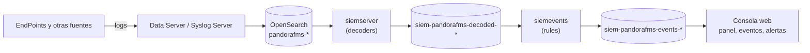

# SIEM

Un *log* suelto no dice gran cosa. Un «Failed password for invalid user oracle»
en un servidor SSH es ruido; cuarenta en dos minutos desde la misma dirección
son un ataque de fuerza bruta, y conviene enterarse antes de que el cuarenta y
uno acierte. Esa es la diferencia entre guardar *logs* y tener un **SIEM**
(*Security Information and Event Management*): el SIEM lee lo que ya has
recogido, lo entiende, lo correlaciona y te avisa cuando algo huele mal.

Un SIEM junta dos oficios. La **gestión de información de seguridad** (SIM)
recoge y normaliza los datos; la **gestión de eventos de seguridad** (SEM) los
correlaciona y convierte en eventos. Los datos pueden venir de un *log*
corriente (el de acceso de un Apache), del *log* de una herramienta de seguridad
(un cortafuegos, un IDS, un *honeypot*, un EDR) o de eventos ya enriquecidos por
otro SIEM.

Pandora SIEM no monta otra tubería para eso. Reutiliza la
[recolección de logs](../parte-2/2.19-recoleccion-y-monitorizacion-de-logs.md) y
el mismo OpenSearch donde ya viven, y acepta los ficheros de *decoders* y
*rules* de Wazuh® tal cual. Dentro de esta parte, la arquitectura general está
en [Arquitectura de seguridad](7.1-arquitectura-de-seguridad-de-pandora.md), la
vigilancia del día a día en
[Monitorización de seguridad](7.7-monitorizacion-de-seguridad.md) y la respuesta
automatizada en [SOAR](7.3-soar.md).

!!! info "Evento SIEM, evento de Pandora FMS y alerta no son lo mismo"
    Un **evento SIEM** es un documento que el SIEM guarda en OpenSearch cuando
    una *rule* se cumple; se consulta en **Operation → SIEM**. Un **evento de
    Pandora FMS** es el de la
    [consola de eventos](../parte-5/5.4-consola-de-eventos-centralizada.md),
    que vive en la base de datos. Y una **alerta** es lo que dispara acciones
    (correo, Slack, un *script*). Una alerta SIEM puede crear un evento de
    Pandora FMS, pero son tres cosas distintas, cada una con su vista.

Para aprovechar todas las funciones del SIEM, se recomienda tener los EndPoints
en la versión **783 o superior**.

## Cómo funciona

El SIEM trabaja en dos pasos, y cada paso lo hace un servidor distinto:

1. **Normalización.** El servidor `siemserver` lee los *logs* que ha guardado
   la recolección, les aplica los ***decoders*** y escribe *logs*
   normalizados, con sus campos ya separados (usuario, IP de origen, puerto,
   acción…). Estos *logs* normalizados son temporales.
2. **Generación de eventos.** El servidor `siemevents` evalúa las ***rules***
   sobre los *logs* normalizados. Cuando una se cumple, escribe un **evento
   SIEM** con la información de la *rule* y del *log* que la disparó.

La cadena completa:



Todo acaba en OpenSearch, en índices **diarios** por instancia:

| Índice | Contenido | Retención por defecto |
|---|---|---|
| `pandorafms-<identificador>-<fecha>` | *Logs* en bruto de la recolección | La de la recolección de *logs* |
| `siem-pandorafms-decoded-<identificador>-<fecha>` | *Logs* normalizados por los *decoders* | 2 días |
| `siem-pandorafms-events-<identificador>-<fecha>` | Eventos SIEM | 180 días |

El `<identificador>` es el identificador único del servidor de Pandora FMS. Cada
tipo de índice tiene su propia retención (ver
[Activación en la consola web](#activacion-en-la-consola-web)).

El `siemserver` depende de la recolección de *logs*: si el colector está
apagado, no hace nada, porque no tiene materia prima. Tampoco mira hacia
atrás sin límite: en cada pasada solo recoge los *logs* que llegaron dentro de
la ventana `siem_max_timeframe` (30 días por defecto) y que aún no ha procesado.

!!! warning "Lo que se queda fuera de la ventana no se analiza nunca"
    Si el `siemserver` está parado más tiempo que `siem_max_timeframe`, los
    *logs* que llegaron en ese hueco ya no entran en la ventana y no se
    normalizan. Y si la retención de los decodificados es más larga que esa
    ventana, guardas días que nadie va a consultar.

Con varios servidores, el **master** reparte el trabajo: detecta cuántos
`siemserver` hay activos y, si el número cambia, los para, los sincroniza y los
vuelve a arrancar.

## Requisitos previos

| Requisito | Detalle |
|---|---|
| Licencia Pandora SIEM | Instalada en el servidor. Sin ella, la pestaña de configuración avisa de que la licencia no permite activar el SIEM y el servidor no arranca `siemserver`. |
| OpenSearch | Instalado y accesible desde el servidor y la consola, con usuario y contraseña si tiene autenticación básica. Es el mismo motor que usa la [recolección de logs](../parte-2/2.19-recoleccion-y-monitorizacion-de-logs.md). |
| Colector de *logs* activo | Sin él no llegan *logs* que analizar. El formulario del SIEM avisa si está apagado. |
| Funciones experimentales | **Show experimental features** activado en la configuración general. Sin él no aparece ni el menú ni la pestaña del SIEM. |
| `siemserver` y `siemevents` | Activados en `pandora_server.conf` de los servidores que vayan a procesar. |
| EndPoints | Versión 783 o superior (recomendado). |
| Puertos | El de OpenSearch (por defecto `9200`) y los de la recolección de *logs* (`514` si usas el Syslog Server). |
| Permisos | Administrador para configurar el SIEM y gestionar *decoders* y *rules* (ver [Acceso y permisos](#acceso-y-permisos)). |

## Activación en la consola web

### Mostrar las funciones experimentales

El SIEM está detrás de un interruptor que no tiene nada que ver con el SIEM.
Mientras **Show experimental features** esté apagado, no aparece el menú
**Operation → SIEM** ni la pestaña de configuración, y no hay forma de
encontrarlos.

Ve a **Management → Settings → System Settings → General Setup**, pestaña
**Features**, activa **Show experimental features** y pulsa **Update**.

{ .captura }

### Formulario del SIEM

Con el interruptor encendido aparece **Management → Settings → System Settings
→ SIEM**. Activa **Activate SIEM**, rellena la conexión con OpenSearch y pulsa
**Update**. Junto al interruptor, un indicador comprueba la conexión
(**OpenSearch is running** cuando responde).

{ .captura }

| Campo | Por defecto | Qué hace |
|---|---|---|
| **Activate SIEM** | Apagado | Activa el SIEM en la consola. Sin él, las vistas muestran «SIEM disabled» con un botón para venir aquí. |
| **OpenSearch IP** | (vacío) | Dirección del servidor de OpenSearch donde se guardan los decodificados y los eventos. |
| **Use https** | Apagado | Conecta con OpenSearch por HTTPS. |
| **OpenSearch Port** | `9200` | Puerto de OpenSearch. |
| **Number of logs viewed** | `50` | Cuántos *logs* carga cada vez la vista de búsqueda sobre OpenSearch. |
| **Days for index deletion (decoded)** | `2` | Días que se conservan los *logs* normalizados. `0` desactiva la purga. Debe ser menor o igual que `siem_max_timeframe`. |
| **Days for index deletion (events)** | `180` | Días que se conservan los eventos SIEM. `0` los conserva para siempre. |
| **User** / **Password** | (vacío) | Credenciales de OpenSearch, si usa autenticación básica. |
| **Index configuration** | Plegado | Ajustes avanzados de los índices (tabla siguiente). |

Los ajustes avanzados de **Index configuration**:

| Campo | Por defecto | Qué hace |
|---|---|---|
| **Indexing size** | `8000` | Se usa como `ignore_above` del texto del *log* en OpenSearch: los textos más largos no se indexan como palabra clave. |
| **Number of shards** | `1` | Fragmentos primarios de cada índice. Solo se fija al crear el índice. |
| **Number of replicas** | `0` | Réplicas de cada fragmento. |
| **Auto expand replicas** | `0-1` | Ajusta las réplicas al número de nodos de datos del clúster (por ejemplo, `0-5` o `0-all`). |

!!! warning "Índices sin réplica"
    Con **Number of replicas** a `0`, un reinicio de un nodo de OpenSearch deja
    los datos sin servicio un rato, y una corrupción puede perderlos. Toca estos
    ajustes solo si conoces OpenSearch: una configuración equivocada puede
    desestabilizar el sistema.

!!! info "Qué hace Update y qué no hace"
    Al pulsar **Update**, la consola crea en OpenSearch las plantillas de los
    índices `siem-pandorafms-decoded-*` y `siem-pandorafms-events-*`. Los
    cambios de plantilla se aplican **al siguiente índice**, es decir, al del
    día siguiente. Lo que **no** hace es arrancar los servidores: eso se
    activa en el servidor (siguiente apartado).

!!! warning "Con el colector de logs apagado, el SIEM no tiene qué analizar"
    Si el colector de *logs* está desactivado, el formulario muestra un aviso
    y el `siemserver` no procesa nada. Actívalo primero, como se explica en
    [Recolección y monitorización de logs](../parte-2/2.19-recoleccion-y-monitorizacion-de-logs.md).

Con [Command Center](../parte-6/6.3-command-center.md), el SIEM se configura y
se consulta en cada nodo: la consola del Command Center no tiene apartado SIEM.

## Activación en el servidor

Los dos servidores del SIEM vienen apagados. Se activan en
`/etc/pandora/pandora_server.conf` de cada servidor que vaya a procesar:

```text
siemserver 1
siemserver_threads 4
siemserver_threshold 5
siemevents 1
siemevents_threads 2
siemevents_threshold 5
siem_max_timeframe 2592000
siem_decoders /usr/share/pandora_server/util/siem/decoders
siem_events_rules /usr/share/pandora_server/util/siem/rules
siem_max_hits_logs -1
```

| Token | Por defecto | Qué hace |
|---|---|---|
| `siemserver` | `0` | Activa el servidor de normalización. |
| `siemserver_threads` | `4` | Hilos del servidor de normalización. |
| `siemserver_threshold` | `5` | Segundos entre pasadas del servidor de normalización. |
| `siemevents` | `0` | Activa el servidor de eventos. |
| `siemevents_threads` | `2` | Hilos del servidor de eventos. |
| `siemevents_threshold` | `5` | Segundos entre pasadas del servidor de eventos. |
| `siem_max_timeframe` | `2592000` | Ventana, en segundos (30 días), de *logs* que se analizan. |
| `siem_decoders` | `/usr/share/pandora_server/util/siem/decoders` | Carpeta de los ficheros XML de *decoders*. |
| `siem_events_rules` | `/usr/share/pandora_server/util/siem/rules` | Carpeta de los ficheros XML de *rules*. |
| `siem_max_hits_logs` | `-1` | Máximo de *logs* por petición del servidor de eventos. `-1` es sin límite. |

Los cambios surten efecto al reiniciar el servidor:

```bash
systemctl restart pandora_server
```

Al arrancar, el servidor **master** carga los XML de *decoders* y *rules* en la
base de datos; el resto de servidores los leen de ahí. La referencia completa
de tokens está en
[Referencia de configuración del servidor](../parte-9/9.3-referencia-completa-de-configuracion-del-servidor.md).

!!! warning "`siem_rules` no existe"
    El token de las *rules* es `siem_events_rules`. Si encuentras
    `siem_rules` en documentación antigua, no lo uses: el servidor no lo
    reconoce y seguirá leyendo la carpeta por defecto.

## Recolección de logs para el SIEM

El puente entre la [recolección de logs](../parte-2/2.19-recoleccion-y-monitorizacion-de-logs.md)
y el SIEM es un solo token: `module_source_type`. Es el **tipo** del *log*, y es
lo que miran los *decoders* para decidir si un *log* les toca. Si no lo
indicas, el *log* se queda con `syslog`.

Los tipos que declaran los *decoders* incluidos:

| Tipo | Estado de fábrica | Para qué |
|---|---|---|
| `syslog` | Activo | *Syslog* de sistemas Unix y la mayoría de dispositivos de red (FortiGate incluido). |
| `web-log` | Activo | *Logs* de acceso de servidores web. |
| `ids` | Activo | Sistemas de detección de intrusos. |
| `firewall` | Activo | Cortafuegos con formato propio. |
| `ossec` | Activo | Eventos de MS Windows (canal de eventos). |
| `squid` | En `disabled/` | Proxy Squid. |
| `windows` | En `disabled/` | Formato antiguo de eventos de Windows. |

Los *decoders* deshabilitados están en la subcarpeta `disabled/` de
`siem_decoders` (más de noventa ficheros heredados de Wazuh). El tipo
`host-information`, que aparece en documentación antigua, no lo declara ningún
*decoder*.

!!! warning "El tipo se compara como expresión regular, y no siempre hace falta"
    El `type` de un *decoder* se compara con el tipo del *log* como expresión
    regular y sin distinguir mayúsculas. Y un *decoder* **sin** `<type>` (el de
    CEF, el de JSON y otros) se aplica a cualquier *log*, tenga el tipo que
    tenga. Por eso un tipo inventado solo se normaliza si hay un *decoder* de
    ese tipo o uno sin tipo que lo recoja. Ojo con los de FortiGate: declaran
    `syslog`, así que esos *logs* tienen que llegar como `syslog`, no como
    `firewall`.

En la consola, al añadir un módulo de *logs* desde la vista del agente,
**Source type** es un campo de texto libre: nadie te avisa si escribes un tipo
que no existe.

!!! note "Entradas de log multilínea"
    Si la recolección envía una entrada con el marcador `{{\n}}`, el servidor la
    decodifica antes de indexarla: el SIEM recibe **un único evento** con sus
    saltos de línea y aplica los *decoders* y las *rules* al bloque completo, no
    a cada línea. El mecanismo se explica en [Entradas de log
    multilínea](../parte-2/2.19-recoleccion-y-monitorizacion-de-logs.md#entradas-de-log-multilinea).

### EndPoint Linux: un fichero de log

El *log* de acceso de un Apache, entero:

```text
module_begin
module_name apache
module_type log
module_regexp /var/log/httpd/access_log
module_pattern .*
module_source_type web-log
module_end
```

Esos *logs* los normalizan, entre otros, los *decoders* `web-accesslog`,
`web-accesslog-ip` y `web-accesslog-domain`, y pueden acabar en eventos como
**Common web attack**, **XSS (Cross Site Scripting) attempt** o **SQL injection
attempt**.

### EndPoint MS Windows: el registro de eventos

Para los canales **Application**, **System** o **Security**, el nombre del canal
va en `module_source`. Para cualquier otro canal, la ruta completa. Este ejemplo
recoge el canal de seguridad y el de Windows Defender:

```text
module_begin
module_name Windows_LogEvents_Security
module_type log
module_logchannel
module_source Security
module_source_type ossec
module_end

module_begin
module_name Windows_LogchannelEvents_WindowsDefender
module_type log
module_logchannel
module_source Microsoft-Windows-Windows Defender/Operational
module_source_type ossec
module_end
```

Los normaliza el *decoder* `windows_eventchannel`, y pueden generar eventos como
**Windows error event**, **Short-time multiple Windows Defender warning
events** o **Multiple Windows Defender error events**.

### EndPoint MS Windows: un fichero de log con tipo propio

Un fichero de texto en Windows se recoge igual que en Linux. Aquí, el *log* de
una aplicación con un tipo inventado:

```text
module_begin
module_name xserver
module_type log
module_regexp C:\server\logs\xserver.log
module_pattern .*
module_source_type xserver
module_end
```

Con `xserver` como tipo, ese *log* solo lo normalizará un *decoder* que declare
`<type>xserver</type>` (o uno sin tipo). Si no lo escribes tú, el SIEM lo
guardará y no hará nada con él.

El detalle de cada directiva de los módulos de *logs* está en
[Recolección y monitorización de logs](../parte-2/2.19-recoleccion-y-monitorizacion-de-logs.md)
y en la
[referencia de configuración del EndPoint](../parte-9/9.1-referencia-completa-de-configuracion-del-endpoint.md).

## Acceso y permisos

El menú **Operation → SIEM** aparece a quien sea administrador o tenga permiso
**PM** o **ER**, y cada entrada tiene su propio filtro:

- **Dashboard** y **Events**: permiso **ER**. Validar eventos exige además
  **EW**.
- **Alerts** (la lista de alertas SIEM en operación): permiso **LM** o
  administrador.
- **Decoders** y **Rules**: solo administradores.
- **Search** (búsqueda sobre los *logs* decodificados): permiso **PM**.
- **Index Interface** y **Opensearch interface**: solo administradores.

La gestión de alertas, en **Management → Alerts → SIEM Alerts**, pide permiso
**LW** o ser administrador, y también depende de las funciones experimentales.

{ .captura }

## Panel y eventos

### Panel

**Operation → SIEM → Dashboard** resume el estado de un vistazo: el total de
eventos por severidad, la evolución de los diez niveles con más eventos, la
evolución de alertas de los diez agentes con más actividad, las diez
direcciones IP de origen (SRCIP) más frecuentes, las diez técnicas
MITRE ATT&CK® más vistas, los diez agentes con más eventos y una tabla con los
últimos eventos. Por defecto muestra las últimas 24 horas.

{ .captura }

Esa misma información se puede llevar a los [dashboards](../parte-5/5.1-dashboards.md)
con los *widgets* del SIEM (ver [Informes y paneles](#informes-y-paneles)).

### Lista de eventos

**Operation → SIEM → Events** es la tabla completa: severidad, descripción,
estado, agente, nivel, *decoders* que normalizaron el *log*, ID de la *rule*,
tipo y fecha. Desde aquí se exportan los eventos con **Export to CSV** y se
validan con **Validate events** (o uno a uno con el icono de cada fila).

{ .captura }

Un evento nace como **New** y pasa a **Validated** cuando alguien lo valida. Por
defecto la tabla enseña los nuevos de las últimas 24 horas.

### Filtros

El botón **Filters** abre un panel con tres pestañas:

- **General**: búsqueda libre (en la descripción, el alias del agente, el
  *decoder* y el tipo), ID del evento, grupo (con **Group recursion** para
  incluir los hijos), grupo SIEM, descripción, fecha, **Event grouping**
  (agrupa por descripción, agente, *rule* y *decoder*), severidad, nivel, ID de
  *rule*, tipo, técnica MITRE, agente y estado.
- **Decoder**: el *decoder* y los campos dinámicos que extrajo, con los
  operadores **is like** (expresión regular) e **is equal to** (coincidencia
  exacta).
- **Exclusion filters**: agentes y *rules* que no quieres ver.

Los filtros se guardan con **Save filter** y se recuperan con **Load filter**.

{ .captura }

!!! warning "Agrupar cuesta"
    **Event grouping** agrupa sobre OpenSearch y, con muchos eventos, puede
    penalizar el rendimiento de la consulta.

### Detalle de un evento

La lupa de cada fila abre el detalle, con pestañas que solo aparecen cuando hay
algo que enseñar:

- **General**: lo básico del evento (ID, descripción, agente, grupo, nivel,
  severidad, estado, *decoders*, *rule*, texto del *log*, tipo, origen,
  programa y fechas). Desde aquí se valida con **Validate event**.
- **Dynamic fields**: los campos que extrajeron los *decoders* (`srcip`,
  `srcuser`, `srcport`…). Salen del *decoder*.
- **MITRE ATT&CK**: las técnicas asociadas, con enlace a su ficha. Salen de la
  *rule*.
- **SIEM groups**: los grupos de la *rule*, que incluyen las referencias de
  cumplimiento normativo (PCI DSS, GDPR, HIPAA, NIST 800-53…). Salen de la
  *rule*.
- **ITSM tickets**: los tickets asociados, solo si la integración con ITSM está
  activa.
- **Responses**: acciones sobre el evento. **Ping to host** lanza un ping a una
  de las direcciones del evento; con ITSM activo, además, **Create a ticket in
  Pandora ITSM** y **Add a ticket to the event**.

{ .captura }

{ .captura }

{ .captura }

{ .captura }

{ .captura }

## Decoders

Un *decoder* sabe leer un tipo de *log*: lo reconoce y separa sus partes en
campos con nombre. Pandora FMS trae cientos (la mayoría heredados de Wazuh), y
puedes añadir los tuyos.

### Gestión

Hay dos caminos, y conviene saber cuál usas en cada caso:

1. **Ficheros XML** en la carpeta `siem_decoders`. El master los carga en la
   base de datos al arrancar. En la consola aparecen como **Server managed** y
   solo se pueden habilitar o deshabilitar: ni se editan ni se borran desde
   ahí.
2. **Consola**: **Operation → SIEM → Decoders**. **New decoder** crea uno desde
   un formulario, **Upload XML** sube un fichero con uno o varios, y cada fila
   tiene ver, editar, borrar y deshabilitar. Los que creas aquí viven en la
   base de datos, no dependen de ningún fichero y sí se editan.

{ .captura }

Las columnas de la lista son **Server**, **Name**, **Parent**, **Program Name**,
**Type**, **Last check**, **Server managed** y **Op.** El estado
habilitado/deshabilitado se filtra con **Filters** (**Enabled**), y **Enable/Disable
selected items** cambia varios a la vez.

El formulario de **New decoder** cubre lo esencial: **Name**, **Parent**,
**Program name**, **Type**, **Discard**, uno o varios **Prematch** y **Regex**
(cada uno con su tipo de expresión, **OS Regex** o **PCRE2**, y su **Offset**) y
**Order**. Para `var`, `json_null_field`, `fts` o `plugin_decoder`, escribe el
XML y súbelo con **Upload XML**.

{ .captura }

!!! info "Qué pasa con los decoders al reiniciar"
    En cada arranque, el master borra los *decoders* de fichero y los vuelve a
    cargar. Consecuencias: los que no se puedan leer desaparecen (aunque
    funcionaran antes), y **los que hayas deshabilitado desde la consola
    vuelven a estar habilitados**. Si quieres apagar uno de fichero para
    siempre, sácalo de la carpeta (por ejemplo, a `disabled/`). Los creados
    desde la consola no se tocan.

### Sintaxis

Un fichero de *decoders* puede contener tantos como quieras. La sintaxis
completa:

```xml
<var name="VarName">VarValue</var>

<decoder name="DecoderName" discard="yes|no">
    <parent>DecoderName</parent>
    <program_name type="pcre2">REGEXP</program_name>
    <type>EventType</type>
    <prematch type="pcre2">REGEXP</prematch>
    <prematch offset="after_parent">REGEXP</prematch>
    <prematch offset="after_prematch">REGEXP</prematch>
    <regex type="pcre2">REGEXP</regex>
    <regex offset="after_parent">REGEXP</regex>
    <regex offset="after_regex">REGEXP</regex>
    <order>Field1, Field2.Sub1, Field2.Sub2</order>
    <json_null_field>string|discard</json_null_field>
    <fts>Field1, Field2</fts>
    <plugin_decoder offset="after_parent">JSON_Decoder|KVP_Decoder</plugin_decoder>
</decoder>
```

| Elemento | Qué hace |
|---|---|
| `var` | Define una variable que se usa después en el XML como `$VarName`. |
| `decoder` | El *decoder*. `name` es su nombre: varios pueden compartirlo, y entonces se evalúan todos. `discard` (`yes` o `no`) descarta de la evaluación los *logs* que coinciden con él; los *decoders* con `discard="yes"` se evalúan antes que el resto, salvo que tengan padre. |
| `parent` | *Decoder* padre, para construir jerarquías. El hijo solo se evalúa si el padre coincide. |
| `program_name` | Nombre del programa que debe aparecer en la cabecera del *log* o en su `source_id`. Con `type="pcre2"` usa PCRE2; si no, OS Regex. |
| `type` | Tipo de *log* al que se aplica. Se compara con el tipo del *log* como expresión regular, sin distinguir mayúsculas. Sin `type`, el *decoder* vale para cualquier tipo. |
| `prematch` | Si el contenido del *log* coincide, se genera un *log* normalizado. Admite `type` y `offset`. |
| `regex` | Los grupos que capture esta expresión son la información normalizada. Admite `type` y `offset`. |
| `order` | Nombres de los campos donde se guardan, por orden, los grupos capturados por `regex`. |
| `json_null_field` | Qué hacer con los grupos vacíos: guardarlos como cadena vacía (`string`) o descartarlos (`discard`). |
| `fts` | Campos que identifican una combinación «vista por primera vez» (*first time seen*). Lo usa la condición `if_fts` de las *rules*. |
| `plugin_decoder` | Delega el análisis en un *plugin*: `JSON_Decoder` (*logs* en JSON) o `KVP_Decoder` (pares `clave=valor`). Admite `offset`. |

`program_name`, con PCRE2:

```xml
<program_name type="pcre2">^myapp$</program_name>
```

`fts`, tal como lo usa el *decoder* incluido de arpwatch: un *log* con esa
combinación de agente, IP y datos extra es «nuevo» si no se ha visto antes. En
`fts`, `name` se refiere al nombre del agente y `location`, al tipo del *log*.

```xml
<fts>name, srcip, extra_data</fts>
```

`plugin_decoder`, tal como lo usan los *decoders* de FortiGate (pares
`clave=valor`) y el de ESET (JSON a partir del final del padre):

```xml
<decoder name="fortigate-firewall-v6-fields">
  <parent>fortigate-firewall-v6</parent>
  <plugin_decoder>KVP_Decoder</plugin_decoder>
</decoder>
```

```xml
<plugin_decoder offset="after_parent">JSON_Decoder</plugin_decoder>
```

!!! warning "`ftscomment` se acepta y se ignora"
    Algunos XML heredados de Wazuh traen `<ftscomment>`. El servidor no lo lee:
    puedes dejarlo, pero no hace nada.

### offset

`offset` decide desde dónde se evalúa una expresión y quita del texto, para las
comprobaciones siguientes, lo que ya ha coincidido. Valores: `after_parent`,
`after_prematch` y `after_regex`.

```xml
<decoder name="my_decoder">
  <prematch type="pcre2">^\d\d\d\d/\d\d/\d\d \d\d:\d\d:\d\d </prematch>
  <regex type="pcre2" offset="after_prematch">(\w):(\d+)</regex>
  <order>srcip,srcport</order>
</decoder>
```

El `prematch` comprueba que el *log* empiece por una fecha, la `regex` se
evalúa sobre lo que queda **después** de esa fecha, y los dos grupos acaban en
`srcip` y `srcport`. Quitar la fecha simplifica los grupos de captura.

### Decoders para formatos genéricos

Además de los *decoders* de producto, hay dos de formato que conviene conocer
porque son la puerta de entrada de cualquier fuente que no hable el formato de
Wazuh. Ninguno declara `<type>`, así que se aplican a cualquier *log*.

- **CEF** (`0002-pfms_cef_decoder.xml`): reconoce los *logs* en formato
  *Common Event Format* y separa su cabecera en campos.

  ```xml
  <decoder name="cef">
    <prematch type="pcre2">^CEF:</prematch>
    <regex offset="after_prematch" type="pcre2">^(\d+)\|([^|]*)\|([^|]*)\|([^|]*)\|([^|]*)\|([^|]*)\|([^|]*)\|(.*)$</regex>
    <order>cef_version, cef_device_vendor, cef_device_product, cef_device_version, cef_signature_id, cef_name, cef_severity, cef_extension</order>
  </decoder>
  ```

- **JSON** (`0006-json_decoders.xml`): pasa los *logs* en JSON por el *plugin*
  `JSON_Decoder`, que convierte cada clave en un campo.

Estos dos normalizan, pero no generan eventos por sí solos: para eso hace falta
una *rule* que mire sus campos (por ejemplo, con `decoded_as` y `field`).

## Rules

Una *rule* dice cuándo un *log* normalizado se convierte en evento. Pandora FMS
trae miles (otra vez, la mayoría de Wazuh), y puedes añadir las tuyas.

### Gestión

Las *rules* se gestionan igual que los *decoders*: ficheros XML en la carpeta
`siem_events_rules`, que el master carga al arrancar (**Server managed**, solo
se habilitan o deshabilitan), o la consola, en **Operation → SIEM → Rules**, con
**New rule**, **Upload XML**, editar, borrar y **Enable/Disable selected
items**.

{ .captura }

Las columnas son **ID Rule**, **Server**, **Description**, **Level**,
**Frequency**, **Decoded as**, **Category**, **Program Name**, **Info**, **Last
check**, **Server managed**, **Active** y **Op.**

Hay dos diferencias con los *decoders*:

- Las *rules* tienen **ID**, así que **conservan el estado deshabilitado** entre
  reinicios.
- Distinguen **Active** de **Enabled**. *Active* lo decide el servidor: la *rule*
  se pudo leer del XML en el último arranque. *Enabled* lo decides tú. **Para
  que una *rule* se evalúe tiene que estar activa y habilitada.**

El formulario de **New rule** recoge ID, descripción, nivel, **Overwrite**,
**Decoded as**, **Category**, **Program name**, condiciones **Regex** (con
**Negate**) y **Field**, **Frequency**, **Timeframe**, **Ignore**, **If matched
SID**, **If matched group**, **If SID**, **If group**, **If level**, **Same ID**,
**Different ID**, **Same field** y **Different field**. Para `time`, `weekday`,
`info`, `mitre`, `group`, `maxsize` o `if_fts`, escribe el XML y súbelo con
**Upload XML**.

{ .captura }

!!! info "Una rule de la consola gana a la de fichero con el mismo ID"
    Si creas desde la consola una *rule* con el mismo ID que una de fichero, en
    el siguiente arranque el master respeta la tuya y descarta la del fichero.
    Sirve para sustituir una *rule* incluida sin tocar sus ficheros.

!!! warning "El orden de los ID importa"
    Las *rules* se evalúan en **orden numérico ascendente**. Si una depende del
    resultado de otra (con `if_sid`, por ejemplo), la de la que depende tiene
    que tener un **ID menor**. Si no, cuando la dependiente pregunta, la otra
    todavía no se ha evaluado. Ver [Orden de evaluación](#orden-de-evaluacion).

### Clasificación

Cada *rule* tiene un nivel de `0` a `15`:

| Nivel | Título | Descripción |
|---|---|---|
| 0 | Ignorado | No genera evento. Sirve para evitar falsos positivos y para agrupar *rules*: estas se evalúan antes que las demás. |
| 1 | Sin clasificar | Genera un evento informativo. Lo usan sobre todo *rules* de agrupación que no deben destacar. |
| 2 | Notificación de sistema de baja prioridad | Mensajes de estado o notificaciones del sistema, sin relevancia de seguridad. |
| 3 | Eventos correctos o autorizados | Inicios de sesión correctos, tráfico permitido por el cortafuegos y similares. |
| 4 | Error de sistema de baja prioridad | Configuraciones erróneas o dispositivos y aplicaciones sin usar. Sin relevancia de seguridad; suelen venir de instalaciones por defecto o pruebas. |
| 5 | Error generado por el usuario | Contraseñas olvidadas, acciones denegadas. Por sí solos, sin relevancia de seguridad. |
| 6 | Ataque de baja relevancia | Gusanos o virus sin efecto en el sistema, eventos frecuentes de IDS y errores frecuentes. |
| 7 | Coincidencia de «palabras malas» | Palabras como «error» o «bad». La mayoría sin clasificar; pueden tener cierta relevancia. |
| 8 | Visto por primera vez | La primera vez que salta un evento de IDS o que un usuario inicia sesión. También acciones sensibles, como activar un *sniffer*. |
| 9 | Error de origen no válido | Intentos de entrar con un usuario desconocido o desde un origen no válido, y errores con la cuenta de administración (*root*). Relevante si se repite. |
| 10 | Múltiples errores generados por el usuario | Varias contraseñas erróneas, varios inicios de sesión fallidos. Puede ser un ataque o alguien que ha olvidado la clave. |
| 11 | Aviso de integridad | Binarios modificados o *rootkits* detectados. Puede indicar un ataque con éxito. También eventos de IDS que se ignorarán por repetición. |
| 12 | Evento de alta importancia | Errores o avisos del sistema, del *kernel*… Pueden indicar un ataque contra una aplicación concreta. |
| 13 | Error inusual de alta importancia | Casi siempre coincide con un patrón de ataque común. |
| 14 | Evento de seguridad de alta importancia | Suele salir por correlación e indica un ataque. |
| 15 | Ataque grave | Sin posibilidad de falso positivo. Requiere atención inmediata. |

El nivel decide la **severidad** con que se ve el evento en la consola:

| Severidad | Niveles |
|---|---|
| **Informational** | 0 a 6 |
| **Normal** | 7 y 8 |
| **Warning** | 9 a 11 |
| **Critical** | 12 a 15 |

### Sintaxis

```xml
<var name="VarName">VarValue</var>

<group name="GROUP1,GROUP2,">
    <rule id="N" level="N" frequency="N" timeframe="N" ignore="N" overwrite="yes|no" maxsize="N">
        <if_matched_sid>N</if_matched_sid>
        <if_matched_group>GROUP</if_matched_group>
        <same_id />
        <different_id />
        <same_field>Field1</same_field>
        <same_field>Field2.Sub1</same_field>
        <different_field>Field1</different_field>
        <different_field>Field2.Sub1</different_field>
        <description>TEXT</description>
        <match type="pcre2">REGEXP</match>
        <match negate="yes|no">REGEXP</match>
        <regex type="pcre2">REGEXP</regex>
        <regex negate="yes|no">REGEXP</regex>
        <decoded_as>DecoderName</decoded_as>
        <category>EventType</category>
        <field name="Field1">REGEXP</field>
        <field name="Field2.Sub1" negate="yes|no">REGEXP</field>
        <program_name negate="yes|no">REGEXP</program_name>
        <time>TIME-RANGE</time>
        <weekday>DAYS</weekday>
        <if_sid>PARENT1, PARENT2</if_sid>
        <if_group>GROUP</if_group>
        <if_level>N</if_level>
        <if_fts />
        <info type="text|link|cve">TEXT|LINK|CVE</info>
        <group>GROUP1,GROUP2,</group>
        <mitre>
            <id>MITRE_ID</id>
            <id>MITRE_ID</id>
        </mitre>
    </rule>
</group>
```

Atributos de `rule`:

| Atributo | Qué hace |
|---|---|
| `id` | Identificador. Debe ser único, salvo que se sobrescriba otra *rule*. |
| `level` | Nivel del evento (`0` a `15`). Con `0` no se genera evento, aunque la *rule* sigue contando para las que dependen de ella. |
| `frequency` | Veces que tiene que darse la coincidencia para generar el evento. Se cuenta por agente, no sobre todos los *logs*. |
| `timeframe` | Ventana, en segundos, en la que deben darse esas coincidencias. |
| `ignore` | Segundos tras los que la *rule* reinicia sus contadores de `frequency`. |
| `overwrite` | Con `yes`, sobrescribe la configuración de la *rule* con el mismo ID. Con `overwrite="yes"` y `level="0"`, la *rule* se evalúa antes que ninguna y, si coincide, descarta el *log* para todas las demás. |
| `maxsize` | La *rule* solo se cumple si el *log* es más largo que este número de caracteres. Sirve para detectar mensajes anómalos por tamaño. |
| `noalert` | Se acepta por compatibilidad con Wazuh y no tiene efecto: la *rule* genera su evento igual. |

Elementos:

| Elemento | La *rule* se cumple si… |
|---|---|
| `var` | (Define una variable, como en los *decoders*.) |
| `group` | (Agrupa *rules*; el nombre del grupo se usa también como condición en otras *rules*.) |
| `if_matched_sid` | La *rule* con ese ID ha coincidido las veces de `frequency` dentro de `timeframe`. |
| `if_matched_group` | Lo mismo que `if_matched_sid`, pero para un grupo. |
| `same_id` / `different_id` | Las coincidencias tienen el mismo ID / distinto ID. |
| `same_field` / `different_field` | Las coincidencias tienen el mismo valor / distinto valor en ese campo. |
| `description` | (Texto del evento. Admite marcadores con los campos del *log*, ver el aviso de abajo.) |
| `match` / `regex` | El contenido del *log* coincide con la expresión. `type="pcre2"` usa PCRE2 (por defecto, OS Regex) y `negate="yes"` niega la coincidencia. |
| `decoded_as` | El *log* lo normalizó el *decoder* indicado. |
| `category` | El tipo del *decoder* coincide. |
| `field` | El campo indicado coincide con la expresión. Admite `negate`. |
| `program_name` | El origen del *log* coincide. Admite `negate`. |
| `time` | El evento se produce en ese rango horario. |
| `weekday` | El evento se produce esos días: `monday` a `sunday`, `weekdays` o `weekends`. |
| `if_sid` | Se cumple cualquiera de las *rules* padre de la lista. |
| `if_group` | El *log* cumple alguna otra *rule* del grupo indicado. |
| `if_level` | Se ha cumplido otra *rule* de ese mismo nivel. |
| `if_fts` | La combinación de campos del `fts` del *decoder* no se había visto antes (*first time seen*). |
| `info` | (Información adicional del evento. `type` es `text`, `link` o `cve`.) |
| `group` | (Lista de grupos de la *rule*; salen en la pestaña **SIEM groups**.) |
| `mitre` | (Lista de técnicas MITRE ATT&CK®, una por `<id>`.) |

!!! warning "Marcadores `$(Campo)`: solo en description y solo con nombres simples"
    En `description` puedes usar los campos del *log* normalizado, como
    `$(srcuser)` o `$(object_target)`. Dos límites: el nombre solo admite
    letras, números y guion bajo, así que un campo anidado como
    `$(Field2.Sub1)` sale literal; y en `info` no se sustituye nada.

### Caso de estudio: SELinux y PHP

Esta *rule*, incluida en Pandora FMS, genera un evento cuando SELinux impide
que PHP abra una conexión a un puerto que no es de los habituales en un
servidor web:

```xml
<rule id="100201" level="6">
    <decoded_as>setroubleshoot_program</decoded_as>
    <match>/usr/sbin/php-fpm</match>
    <field name="object_target" type="pcre2">^(?!.*\b(9200|3306|80|443)$).*$</field>
    <field name="object_target" type="pcre2">^(?!.*(directory|file) (conf|data_in|cron.lock)).*$</field>
    <description>SELinux prevented /usr/sbin/php-fpm execution on: $(action) access on the $(object_target)</description>
    <mitre>
        <id>T1071.002</id>
    </mitre>
    <group>exec,threat,PHP</group>
</rule>
```

Las conexiones a los puertos `9200`, `3306`, `80` y `443` no generan evento.
Tampoco los accesos a ficheros o directorios de configuración, `data_in` y
`cron.lock`. Y la descripción usa dos campos que extrajo el *decoder*.

Los *decoders* que la alimentan:

```xml
<decoder name="setroubleshoot">
    <program_name>^setroubleshoot$</program_name>
</decoder>

<decoder name="setroubleshoot_program">
    <parent>setroubleshoot</parent>
    <prematch type="pcre2">(SELinux is preventing|SELinux está negando a)</prematch>
    <regex type="pcre2">(\S+) (?:from|de) (\S+) (?:access on the|el acceso a) (.+?)\. (?:For complete SELinux messages run: sealert -l|Si quiere los mensajes de SELinux completos, ejecute sealert -l) (\S+)$</regex>
    <order>binary,action,object_target,sealert_id</order>
</decoder>

<decoder name="setroubleshoot_program">
    <parent>setroubleshoot</parent>
    <prematch type="pcre2">failed to retrieve rpm info for path</prematch>
    <regex type="pcre2">failed to retrieve rpm info for path (\S+)</regex>
    <order>path</order>
</decoder>
```

Fíjate en que hay dos *decoders* con el mismo nombre: se evalúan los dos, y
cada uno reconoce un mensaje distinto de `setroubleshoot`.

### Orden de evaluación

Ahora el caso contrario: una cadena de *rules* que no funciona, y por qué. Las
*rules* de este ejemplo detectan inicios de sesión fallidos en un cortafuegos
FortiGate. Son ilustrativas: las que incluye hoy Pandora FMS para FortiGate
están numeradas de otra forma.

```xml
<rule id="81641" level="1">
    <decoded_as>fortigate-firewall-v6</decoded_as>
    <description>Fortigate v6 messages grouped.</description>
</rule>
```

La 81641 coincide con el *log* decodificado y empieza la cadena.

```xml
<rule id="81603" level="0">
    <if_sid>81600,81601,81602,81641</if_sid>
    <description>Fortigate messages grouped.</description>
</rule>
```

La 81603 depende de varias, entre ellas la 81641. Pero 81641 es **mayor** que
81603: cuando se evalúa la 81603, la 81641 todavía no se ha evaluado, así que
**la 81603 no se cumple nunca**.

```xml
<rule id="81614" level="4">
    <if_sid>81603</if_sid>
    <match>ssl-login-fail</match>
    <description>Fortigate: SSL VPN user failed login attempt.</description>
    <group>authentication_failed,gdpr_IV_32.2,gdpr_IV_35.7.d,gpg13_7.1,hipaa_164.312.b,invalid_login,nist_800_53_AC.7,nist_800_53_AU.14,pci_dss_10.2.4,pci_dss_10.2.5,tsc_CC6.1,tsc_CC6.8,tsc_CC7.2,tsc_CC7.3,</group>
</rule>
```

La 81614 depende de la 81603. Su ID es mayor, así que se evalúa después, como
debe. Y una *rule* propia, la 100700, depende a su vez de la 81614.

El resultado: la 100700 no se cumple nunca. No es culpa suya ni de la 81614: la
cadena se rompió en la 81603, que no llegó a cumplirse por el orden de los ID.
La solución es renumerar para que cada *rule* tenga un ID mayor que todas
aquellas de las que depende.

## Expresiones regulares

*Decoders* y *rules* admiten dos motores: **OS Regex**, el de por defecto, y
**PCRE2**, que se activa con `type="pcre2"`. La regla práctica: usa OS Regex
para lo sencillo, que es más rápido de escribir, y pasa a PCRE2 en cuanto
necesites alternancias dentro de un grupo, búsquedas hacia delante o hacia
atrás, o cuantificadores no voraces.

### OS Regex

Es un motor sencillo, escrito en C, pensado para cubrir las expresiones más
comunes.

| Expresión | Coincide con |
|---|---|
| `\w` | `A-Z`, `a-z`, `0-9`, `-`, `@` y `_` |
| `\d` | `0-9` |
| `\s` | Espacio ASCII (código 32) |
| `\t` | Tabulación |
| `\p` | ``()*+,-.:;<=>?[]!"'#$%&|{}`` |
| `\W` | Cualquier cosa que no sea `\w` |
| `\D` | Cualquier cosa que no sea `\d` |
| `\S` | Cualquier cosa que no sea `\s` |
| `\.` | Cualquier carácter |

| Modificador | Comportamiento |
|---|---|
| `+` | Una o más veces |
| `*` | Cero o más veces |

| Carácter especial | Comportamiento |
|---|---|
| `^` | Comienzo del texto |
| `$` | Final del texto |
| `|` | «O» lógico entre varios patrones |

Para usar literalmente estos caracteres, se escapan con `\`:

| Carácter | `$` | `(` | `)` | `\` | `|` | `<` |
|---|---|---|---|---|---|---|
| Escapado | `\$` | `\(` | `\)` | `\\` | `\|` | `\<` |

!!! warning "Las limitaciones de OS Regex"
    - `*` y `+` solo se aplican a expresiones con barra invertida: `\d+` vale,
      `0+` no.
    - No hay alternancia dentro de un grupo: `(foo|bar)` no está permitido.
    - No hay retroceso complejo: `\p*\d*\s*\w*:` no coincide con unos dos
      puntos solos, porque `\p*` se los come.
    - `.` coincide con un punto literal, y `\.` con cualquier carácter (al
      revés de lo habitual).
    - `\s` solo coincide con el espacio ASCII (32), no con tabulaciones ni
      otros espacios.
    - No hay forma de buscar literalmente un acento circunflejo, un asterisco
      o un signo más (aunque `\p` coincide con el asterisco y el más, entre
      otros).

### PCRE2

*Perl Compatible Regular Expressions* (PCRE2) añade patrones recursivos,
búsquedas hacia delante y hacia atrás, grupos sin captura, cuantificadores no
voraces y clases de caracteres extendidas, entre otras cosas. La referencia
completa está en la
[documentación de sintaxis de PCRE2](https://www.pcre.org/current/doc/html/pcre2syntax.html).

| Expresión | Coincide con |
|---|---|
| `.` | Cualquier carácter excepto el salto de línea |
| `\d` | Cualquier dígito decimal (`[0-9]`) |
| `\D` | Cualquier carácter que no sea un dígito decimal (`[^0-9]`) |
| `\h` | Cualquier espacio en blanco horizontal |
| `\H` | Cualquier carácter que no sea espacio en blanco horizontal |
| `\s` | Cualquier espacio en blanco (`[\t\r\n\f]`) |
| `\S` | Cualquier carácter que no sea espacio en blanco (`[^\t\r\n\f]`) |
| `\w` | Cualquier carácter de «palabra» |
| `\W` | Cualquier carácter que no sea de «palabra» |

| Modificador | Comportamiento |
|---|---|
| `?` | 0 o 1, voraz |
| `?+` | 0 o 1, posesivo |
| `??` | 0 o 1, perezoso |
| `*` | 0 o más, voraz |
| `*+` | 0 o más, posesivo |
| `*?` | 0 o más, perezoso |
| `+` | 1 o más, voraz |
| `++` | 1 o más, posesivo |
| `+?` | 1 o más, perezoso |
| `{n}` | Exactamente n |
| `{n,m}` | Al menos n y no más de m, voraz |
| `{n,m}+` | Al menos n y no más de m, posesivo |
| `{n,m}?` | Al menos n y no más de m, perezoso |
| `{n,}` | n o más, voraz |
| `{n,}+` | n o más, posesivo |
| `{n,}?` | n o más, perezoso |

| Escape | Carácter |
|---|---|
| `\f` | Avance de página (hexadecimal `0C`) |
| `\n` | Nueva línea (hexadecimal `0A`) |
| `\r` | Retorno de carro (hexadecimal `0D`) |
| `\t` | Tabulación (hexadecimal `09`) |
| `\0dd` | Carácter con código octal `0dd` |
| `\o{ddd..}` | Carácter con código octal `ddd..` |
| `\xhh` | Carácter con código hexadecimal `hh` |
| `\x{hhh..}` | Carácter con código hexadecimal `hhh..` |

## Alertas SIEM

Los eventos SIEM no disparan las alertas de módulo ni las de eventos de la
[Parte 5](../parte-5/5.5-alertas-y-notificaciones.md): tienen las suyas. Se
gestionan en **Management → Alerts → SIEM Alerts** (administrador o permiso
**LW**) y reutilizan las mismas **acciones** que el resto de alertas: correo,
Slack, Teams, Telegram, un comando…

{ .captura }

**Create** abre un asistente de cinco pasos. La alerta se guarda al pasar el
primero, y se puede volver atrás con **Back**:

1. **Configure**: **Alert name**, **Group**, **Description** y **Severity**. La
   severidad es la prioridad de la alerta de Pandora FMS (la que llevan el
   evento y las macros que genere), no la del evento SIEM.
2. **Conditions**: plantilla de partida (**Load from template**), calendario
   (**Use special days list** y la vista **Simple** o **Detailed** por días y
   horas), número mínimo y máximo de alertas (**From** / **To**), umbral de
   tiempo (**Threshold**) y **Disable event** para no generar evento de Pandora
   FMS al dispararse.
3. **Filters**: qué eventos SIEM cuentan. **Free search**, **Group** (con
   **Group recursion**), **SIEM group**, **Event description**, **Severity**,
   **Level**, **ID Rule**, **Type**, **Mitre**, **Agent**, **Decoder**, y las
   exclusiones **Excluded agents** y **Exclude Rules**.
4. **Fields**: los campos **Field 1** a **Field 10** que reciben las acciones,
   en modo **Basic** o **Advanced**, o cargados de una plantilla.
5. **Triggering**: resumen de la condición de disparo y las acciones. Cada
   acción se añade con **Add**, con su propio rango **From** / **To** y su
   **Threshold**. **Finish** termina.

{ .captura }

{ .captura }

En los campos y en las acciones, además de las macros habituales, hay cuatro
propias del SIEM:

| Macro | Valor |
|---|---|
| `_event_description_` | Descripción del evento SIEM. |
| `_siem_event_level_` | Nivel (`0` a `15`) del evento SIEM. |
| `_event_text_severity_` | Severidad del evento, en texto. |
| `_group_contact_` | Contacto del grupo del evento. |

En **Operation → SIEM → Alerts**, la lista de operación enseña cuántas veces ha
coincidido cada alerta (**Matched**) y cuántas se ha disparado (**Triggered**),
y permite ponerla en espera, habilitarla o deshabilitarla, ejecutar su acción a
mano y validarla. El motor de alertas y las acciones se explican en
[Alertas y notificaciones](../parte-5/5.5-alertas-y-notificaciones.md).

## Informes y paneles

Para los [informes](../parte-5/5.2-informes.md) hay tres elementos, en el grupo
**SIEM** del editor de informes:

| Elemento | Qué muestra |
|---|---|
| **Events list** | La lista de eventos SIEM de las últimas horas (24 por defecto), con un filtro propio. |
| **Events graph** | Una gráfica de eventos por grupos y agentes, agrupada por el campo que elijas, en modo simple o de evolución. |
| **Statistics** | Estadísticas de eventos SIEM por grupos y agentes. |

Para los [dashboards](../parte-5/5.1-dashboards.md) hay tres *widgets*:

| *Widget* | Qué muestra |
|---|---|
| **SIEM metrics** | Cifras del motor: *logs* procesados, *logs* por segundo (última hora y último día), eventos procesados, eventos por segundo (8 horas y último día), *decoders* activos y *rules* activas. |
| **SIEM statistics** | Estadísticas de eventos de las últimas horas (24 por defecto). |
| **SIEM Top N Events** | Los N eventos más frecuentes (10 por defecto), en modo simple (tarta, barras o tabla) o de evolución (líneas, áreas o barras apiladas). |

{ .captura }

Un *widget* sirve para vigilar en tiempo real; un informe, para contar lo que
pasó (y mandarlo por correo cada lunes).

## Operación y solución de problemas

Cuando no llegan eventos, lo más rápido es recorrer la cadena en orden, de la
licencia al reloj. Casi siempre se rompe en los tres primeros pasos.

1. **Licencia y funciones experimentales.** Sin licencia de Pandora SIEM no hay
   servidor; sin **Show experimental features** no hay menú.
2. **SIEM activado y OpenSearch alcanzable.** **Activate SIEM** encendido y el
   indicador del formulario en **OpenSearch is running**.
3. **Colector de *logs* activo.** Sin él no hay nada que analizar. Comprueba
   también que los *logs* llegan al visor de *logs* de la
   [recolección](../parte-2/2.19-recoleccion-y-monitorizacion-de-logs.md).
4. **`siemserver` y `siemevents` arrancados.** Con sus tokens a `1` y el
   servidor reiniciado. Los errores van a `/var/log/pandora/pandora_server.log`.
5. **Tipo del *log*.** Los *decoders* con `<type>` solo se aplican si su
   expresión casa con el `module_source_type` del *log*. Si ninguno casa y
   tampoco lo recoge uno sin `<type>`, el *log* se guarda pero no se
   normaliza. Si el problema está en OpenSearch, mira también la plantilla del
   colector (`pandorafms*`): la mantiene el propio `siemserver`, que le añade
   los campos `processed` y `metadata` y el *pipeline* `add_queue_timestamp`.
6. ***Decoder* o *rule* apagados.** Un *decoder* deshabilitado, o una *rule*
   que no está **Active** (no se pudo leer) o no está **Enabled**.
7. **Retención y ventana.** Un `siem_max_timeframe` más corto que el hueco que
   estuvo parado el servidor, o un índice ya purgado.
8. **Reloj.** Los índices son diarios y `frequency` y `timeframe` se miden en
   segundos. Un servidor con la hora desfasada altera la correlación.

!!! tip "Prueba con un log que sepas que tiene que saltar"
    Un intento de SSH con un usuario que no existe genera, en cuanto se
    normaliza, un evento **sshd: Attempt to login using a non-existent user**
    (*rule* 5710, nivel 5) con sus técnicas MITRE ATT&CK®. Si ese evento
    aparece en **Operation → SIEM → Events**, la cadena funciona y el problema
    está en tu *decoder* o tu *rule*.

Para vigilar el propio SIEM, el *widget* **SIEM metrics** es el termómetro: si
los *logs* procesados no crecen, el `siemserver` está parado o no le llega
nada; si crecen los *logs* y no los eventos, mira las *rules*.
