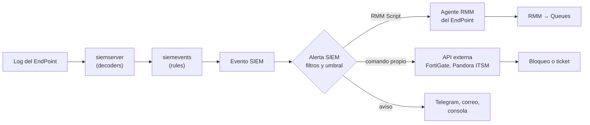

# SOAR

Detectar un ataque a las tres de la madrugada sirve de poco si nadie lo lee
hasta las nueve. El [SIEM](7.2-siem.md) ya convierte cuarenta intentos de
contraseña fallidos en un evento que dice «fuerza bruta desde 198.51.100.77»;
lo que falta es que alguien haga algo con él, y que ese alguien no tenga que
estar despierto. Eso es **SOAR** (*Security Orchestration, Automation and
Response*): **orquestar** las herramientas que ya tienes, **automatizar** las
tareas repetitivas de respuesta y **responder** a un incidente en segundos, no
cuando alguien abra el correo.

Dentro de esta parte, el SIEM detecta y este capítulo responde. La parte
técnica de las alertas (comandos, acciones, plantillas, escalado y macros) está
en [Alertas y notificaciones](../parte-5/5.5-alertas-y-notificaciones.md); aquí
se cuenta cómo se encadenan para responder a un incidente de seguridad, con tres
ejemplos completos probados de principio a fin.

!!! warning "En Pandora FMS no hay un «módulo SOAR»"
    No busques un menú SOAR: no existe, ni en la consola ni en el código. SOAR,
    en Pandora FMS, es una cadena de piezas que ya están ahí: un **evento SIEM**
    dispara una **alerta SIEM**, y la alerta ejecuta **acciones** (un *script*
    del RMM en el EndPoint atacado, un comando contra la API de un cortafuegos,
    un ticket en Pandora ITSM, un aviso por Telegram). Lo bueno es que no hay
    nada nuevo que instalar; lo malo, que el *playbook* lo diseñas tú.

## Para qué sirve

Con una respuesta automática bien montada puedes:

- **Contener**: bloquear la IP de un ataque de fuerza bruta en el propio
  EndPoint o en el cortafuegos perimetral, con caducidad para que el bloqueo no
  se quede para siempre.
- **Remediar en el EndPoint**: parar un servicio, matar un proceso o recoger
  evidencias con un *script* del RMM.
- **Registrar y seguir**: abrir un ticket en Pandora ITSM con el contexto del
  evento, para que el incidente tenga dueño y no se quede en un correo leído.
- **Avisar a quien toca**: Telegram, correo, Microsoft Teams o una notificación
  en la consola, según la gravedad y el horario.

Y conviene saber desde el principio lo que **no** hace, porque cambia el diseño:

- No hay editor visual de *playbooks* ni un paso de aprobación humana dentro de
  la alerta. La decisión de qué se automatiza y qué no la tomas al configurar.
- Las alertas SIEM **no tienen recuperación**. Si una acción bloquea una IP,
  nada la desbloquea cuando el ataque termina: la vuelta atrás se diseña en la
  propia acción (un bloqueo con caducidad).
- Los campos que extrae el *decoder* (`srcip`, `srcuser`, `dstport`…) **no
  llegan a la acción como macro**. Hay una forma limpia de pasarlos, que se
  explica en [Los datos del evento en la respuesta](#los-datos-del-evento-en-la-respuesta).

## Cómo funciona

La cadena completa, del *log* a la respuesta:



Tres detalles del recorrido importan para diseñar la respuesta:

1. **Las alertas SIEM se evalúan con cada evento SIEM**, en el momento en que el
   servidor lo genera, no con un temporizador. Si el evento cumple los filtros
   de la alerta y no se ha superado su máximo de disparos, las acciones se
   ejecutan en ese mismo instante.
2. **El evento se asocia a un agente de Pandora FMS por su nombre.** El servidor
   busca el agente cuyo nombre coincide con el del evento. Ese agente es el
   «dónde» de la respuesta: las macros de agente (`_agent_`, `_address_`) salen
   de él y la acción **RMM Script** se dirige a su agente RMM.
3. **Cada acción se ejecuta en un sitio distinto.** Los comandos de alerta
   corren en el **servidor de Pandora FMS**; la acción **RMM Script** no ejecuta
   nada en el servidor, sino que **encola** el *script* para el agente RMM del
   EndPoint, que lo recoge y lo ejecuta allí.

## Requisitos previos

Cada flujo necesita solo las filas de las acciones que use:

| Requisito | Detalle |
|---|---|
| Pandora SIEM funcionando | Licencia de Pandora SIEM, el SIEM activado en la consola web y en el servidor, y las *rules* que generan los eventos que interesan. Ver [SIEM](7.2-siem.md). |
| Funciones experimentales | El menú de las alertas SIEM solo aparece con **Show experimental features** activado, como el resto del SIEM. |
| Permisos | **LW**, **LM** o **AD** para gestionar alertas SIEM; **LM** para crear acciones. Ver [Alertas SIEM](../parte-5/5.5-alertas-y-notificaciones.md#alertas-siem). |
| Para **RMM Script** | Licencia de **Pandora RMM**; el **servidor RMM activado** en el servidor de Pandora FMS (`rmmserver 1`; por defecto vale `0`); el agente RMM activado en el EndPoint, con el **mismo nombre** que su agente de Pandora FMS; y el *script* dado de alta en **RMM → Scripts**. |
| Para un ticket en **Pandora ITSM** | La integración activada en **Settings → System Settings → ITSM** (URL de la API y *token*) y el *token* de la API de Pandora ITSM para el comando que crea el ticket. |
| Para **Pandora Telegram** | El *token* del bot en la configuración general de la consola (lo usa la macro `_telegramtoken_`) y el ID del chat de destino. |
| Para bloquear en **FortiGate** | Salida HTTPS desde el servidor de Pandora FMS hasta la FortiGate y un *token* de su API REST, guardado en un fichero del servidor. |

El servidor RMM se activa en `/etc/pandora/pandora_server.conf`; el directorio
de trabajo por defecto ya existe en una instalación normal:

```ini
rmmserver 1
rmmdir /var/spool/pandora/rmm_server
```

Y el agente RMM, en el `pandora_agent.conf` del EndPoint (Linux, MS Windows o
el EndPoint Go), apuntando al servidor de Pandora FMS:

```ini
rmm_enabled 1
rmm_server 192.168.50.10
rmm_port 41123
```

Después, reinicia los dos servicios.

## Las piezas

### Detección: rules y eventos SIEM

La respuesta empieza en la *rule*. Si la *rule* es ruidosa, la respuesta
automática multiplica el ruido: antes de automatizar nada, comprueba en
**Operation → SIEM → Events** que el evento salta cuando debe y solo cuando
debe. Nivel, grupos, técnicas MITRE y *decoder* se explican en
[Rules](7.2-siem.md#rules).

Para la respuesta hay un truco que conviene aprender pronto: una ***rule* hija**
de la que ya detecta el ataque, con el dato que necesitas dentro de la
descripción. Los marcadores `$(Campo)` de la descripción se sustituyen por el
valor del campo decodificado, así que una descripción como
`sshd: brute force from $(srcip)` llega a la alerta como
`sshd: brute force from 198.51.100.77`. Es la vía para pasar la IP a la acción.

### Decisión: alertas SIEM

La alerta SIEM es el «si pasa esto, haz aquello». Sus filtros son los mismos de
la vista de eventos SIEM (búsqueda libre, grupo, grupo SIEM, descripción,
gravedad, nivel, ID de la *rule*, tipo, MITRE, *decoder* y agente, más las
exclusiones de agentes y *rules*), y sus condiciones fijan el horario, el umbral
y el mínimo y el máximo de disparos. Todo el detalle está en
[Alertas SIEM](../parte-5/5.5-alertas-y-notificaciones.md#alertas-siem).

Para responder, el filtro más útil es **ID Rule**: una *rule* concreta, una
respuesta concreta.

!!! info "El umbral y el máximo cuentan por alerta, no por IP"
    El tiempo de umbral y el número máximo de disparos son de la alerta entera.
    Si una alerta de bloqueo tiene un máximo de 1 en 24 horas, bloquea al primer
    atacante del día y deja pasar al segundo. En las alertas de contención usa
    un umbral corto (5 minutos) y un máximo alto (10, por ejemplo); en las de
    aviso, al revés, para no inundar el canal.

### Acciones de respuesta

Los comandos de alerta más útiles como respuesta, agrupados por lo que hacen:

| Propósito | Comandos | Notas |
|---|---|---|
| Avisar | eMail, Pandora Telegram, Pandora MS Teams, Pandora Slack, Pandora Google chat, Console notification, Generate Notification | El mensaje lleva los datos del evento con [las macros](#los-datos-del-evento-en-la-respuesta). |
| Registrar | Monitoring Event, Internal Audit | **Monitoring Event** crea un evento de Pandora FMS a partir del evento SIEM. |
| Abrir un ticket | Comando propio contra la API de Pandora ITSM | Ver el [ejemplo 2](#ejemplo-2-ataque-web-con-exito-ticket-en-pandora-itsm). |
| Actuar en el EndPoint | RMM Script | Necesita el servidor RMM activado. |
| Actuar en el EndPoint | Remote agent control | Envía una orden por UDP al EndPoint (puerto 41122), que debe tener el servidor UDP activado. |
| Actuar fuera de Pandora FMS | Comandos propios | Un *script* o un programa del servidor, con macros en sus campos. Ver el [ejemplo 3](#ejemplo-3-bloqueo-en-el-cortafuegos-perimetral-fortigate). |

Un **comando propio** es el que creas en **Management → Alerts → Commands**: una
línea de órdenes del servidor con los campos `_field1_` a `_field10_`, que la
acción rellena. Es la pieza más flexible de todas: con ella se abren los
tickets en Pandora ITSM y se llama a cualquier API externa, como en los ejemplos
[2](#ejemplo-2-ataque-web-con-exito-ticket-en-pandora-itsm) y
[3](#ejemplo-3-bloqueo-en-el-cortafuegos-perimetral-fortigate).

### Los datos del evento en la respuesta

La acción recibe los datos del evento en forma de macros. Las propias de las
alertas SIEM son estas:

| Macro | Qué contiene |
|---|---|
| `_event_description_` | La descripción del evento, con los marcadores `$(Campo)` de la *rule* ya sustituidos. |
| `_siem_event_level_` | El nivel de la *rule* que disparó el evento (de 0 a 15). |
| `_event_text_severity_` | La gravedad del evento en texto, por ejemplo *Informational*. |
| `_eventTimestamp_` | La fecha del evento en UTC, como `2026-11-12T08:38:43Z`. |
| `_logSource_` | El origen del *log*, por ejemplo `/var/log/httpd/access_log`. |
| `_logTimestamp_` | La fecha del *log*, en la hora local del servidor (`2026-11-12 09:38:43`). |
| `_group_contact_` | El contacto del grupo del evento, tal como está en la ficha del grupo. |

Además, como el evento se asocia a un agente, funcionan las macros de agente
(`_agent_`, `_address_`, `_id_agent_`…) y `_data_`, que lleva el texto del *log*
original. El resto de macros de alerta está en
[Macros de alerta](../parte-5/5.5-alertas-y-notificaciones.md#macros-de-alerta).

!!! info "Los campos decodificados no son macros: usa la descripción"
    No hay `_srcip_` ni nada parecido. Para que la acción reciba la IP de
    origen, crea una *rule* hija con `$(srcip)` en la descripción, como se
    explica en [Detección](#deteccion-rules-y-eventos-siem), y haz que el
    *script* saque la IP de `_event_description_`. Los tres ejemplos de este
    capítulo lo hacen así.

!!! warning "Una macro es texto del atacante: valídalo"
    Las macros se sustituyen tal cual en la línea de órdenes del comando. Un
    *log* puede traer comillas, punto y coma o lo que el atacante quiera
    escribir en él, así que no pases campos libres (`_data_`, un usuario, una URL)
    a un comando sin validarlos. Los *scripts* de los ejemplos solo aceptan una
    dirección IPv4 y descartan todo lo demás.

### Respuesta manual

No todo merece una respuesta automática. Para lo que necesita un humano delante
están la pestaña **Responses** del
[detalle de un evento SIEM](7.2-siem.md#detalle-de-un-evento) (**Ping to host**
y, con la integración de Pandora ITSM activa, **Create a ticket in Pandora
ITSM** y **Add a ticket to the event**) y, si llevaste el evento a la consola de
eventos con **Monitoring Event**, las
[respuestas a eventos](../parte-5/5.4-consola-de-eventos-centralizada.md#respuestas-a-eventos).

## Montar un flujo de respuesta

Los tres ejemplos siguen el mismo procedimiento, que conviene hacer siempre en
este orden:

1. **Elige la *rule*** y comprueba en **Operation → SIEM → Events** que el
   evento llega, con los datos que necesitas en la descripción.
2. **Prepara la acción**: el *script* del RMM, el comando propio o el comando
   de aviso, y la acción que lo usa en **Management → Alerts → Actions**.
3. **Crea la alerta SIEM** en **Management → Alerts → SIEM Alerts**, con
   filtros estrechos (mejor por **ID Rule**), el umbral y el máximo de disparos.
4. **Prueba con un *log* de prueba** que sepas que dispara la *rule*, antes de
   esperar al ataque de verdad.
5. **Comprueba el resultado**: la alerta disparada, la cola del RMM, el ticket o
   el bloqueo, y `pandora_server.log` si algo no aparece.

## Ejemplos

Los tres ejemplos se probaron en el laboratorio y van de menos a más alcance:
el primero actúa en el equipo atacado, el segundo deja constancia en Pandora
ITSM y el tercero cierra la puerta para toda la red.

### Ejemplo 1: fuerza bruta SSH, bloqueo en el EndPoint y aviso por Telegram

**Objetivo:** cuando un servidor sufre un ataque de fuerza bruta por SSH,
bloquear durante una hora la IP de origen en el cortafuegos del propio servidor
y avisar al SOC por Telegram.

**1. La *rule* que lleva la IP.** La *rule* 5712 ya detecta la fuerza bruta,
pero su descripción no incluye la IP. Crea una *rule* hija que dispare cuando lo
haga la 5712 y que la ponga en la descripción. Usa un ID que no exista; en el
ejemplo, `100100`:

```xml
<group name="local,sshd,">
  <rule id="100100" level="12">
    <if_sid>5712</if_sid>
    <description>sshd: brute force from $(srcip)</description>
    <mitre>
      <id>T1110</id>
    </mitre>
  </rule>
</group>
```

Créala desde **Operation → SIEM → Rules** o súbela como fichero, como se explica
en [Rules](7.2-siem.md#rules). Con ella, el evento llega como
`sshd: brute force from 198.51.100.77`.

**2. El *script* del RMM.** En **RMM → Scripts**, crea un *script* para Linux
con una entrada de tipo `string` (en el ejemplo, **Event description**, con la
macro `_event_text_`). Esa macro es la que la acción rellenará con la
descripción del evento:

{ .captura }

En la pestaña **Script**, los parámetros son `_event_text_`, el intérprete
`bash`, la extensión `sh` y este código, que saca la primera IPv4 de la
descripción y la bloquea durante una hora con `firewalld` (o con `iptables`, si
no hay `firewalld`):

```bash
#!/bin/bash
# Blocks, in the local firewall, the IPv4 address found in the SIEM event description.
DESC="$*"
IP=$(printf '%s\n' "$DESC" | grep -oE '([0-9]{1,3}\.){3}[0-9]{1,3}' | head -n1)
if [ -z "$IP" ]; then
    echo "No IPv4 address found in: $DESC"
    exit 1
fi
if command -v firewall-cmd >/dev/null 2>&1; then
    firewall-cmd --add-rich-rule="rule family=ipv4 source address=$IP reject" --timeout=1h
else
    iptables -I INPUT -s "$IP" -j DROP
fi
echo "Blocked $IP"
```

{ .captura }

En la pestaña **Precondition**, activa la precondición con los mismos
parámetros y este código, que se niega a bloquear direcciones internas. Si la
precondición sale con un código distinto de 0, la ejecución termina con error y
el *script* no llega a ejecutarse:

```bash
#!/bin/bash
# Never block internal or loopback addresses.
IP=$(printf '%s\n' "$*" | grep -oE '([0-9]{1,3}\.){3}[0-9]{1,3}' | head -n1)
case "$IP" in
    10.*|192.168.*|127.*) echo "Refusing to block internal address $IP"; exit 1 ;;
esac
exit 0
```

!!! warning "La regla de `iptables` no caduca"
    `firewall-cmd --timeout=1h` añade una regla temporal que desaparece sola a
    la hora. La alternativa con `iptables` no caduca: la IP queda bloqueada
    hasta que alguien la quite o se reinicie el equipo. Si tus servidores no
    usan `firewalld`, programa la limpieza aparte o usa `ipset` con tiempo de
    expiración.

**3. Las acciones.** En **Management → Alerts → Actions**, crea una acción con
el comando **RMM Script**. En **Script** elige el *script* recién creado; en
**Fields** aparece su entrada, **Event description**, y en ella va
`_event_description_`:

{ .captura }

Crea otra acción con el comando **Pandora Telegram**: en **Chat ID**, el ID del
chat del SOC, y en **Message**, algo como:

```text
[SIEM] _event_text_severity_ on _agent_: _event_description_. The source IP has been blocked for 1 hour.
```

**4. La alerta SIEM.** En **Management → Alerts → SIEM Alerts**, crea la alerta.
En **Conditions**, un tiempo de umbral de 5 minutos y un máximo de 10 disparos;
en **Filters**, solo **ID Rule** con `100100`:

{ .captura }

En **Triggering**, añade las dos acciones:

{ .captura }

**5. Comprobar el resultado.** Cuando la alerta dispara, la tarea aparece en
**RMM → Queues**, con el agente, el *script*, el estado y la salida del
*script* cuando el agente RMM la devuelve:

{ .captura }

En la cola, la tarea aparece como `Alert fired at ""`, porque las alertas SIEM
no van asociadas a un módulo. Si la tarea no aparece, busca en `pandora_server.log` los
mensajes que empiezan por `RMM alert action` (ver
[Operación y solución de problemas](#operacion-y-solucion-de-problemas)).

### Ejemplo 2: ataque web con éxito, ticket en Pandora ITSM

**Objetivo:** cuando un ataque web recibe una respuesta 200 (la *rule* 31106,
*A web attack returned code 200 (success)*), abrir un ticket en Pandora ITSM con
el contexto del evento y avisar por correo al contacto del grupo. Aquí no se
bloquea nada: un ataque que ha tenido éxito necesita que alguien lo investigue,
y el ticket es la forma de que tenga dueño.

**1. La integración con Pandora ITSM.** En **Management → Settings → System
Settings → ITSM**, activa
**Enable Pandora ITSM**, escribe la URL de la API (`…/api/v2`) y el *token*, y
pulsa **Test** antes de guardar con **Update**:

{ .captura }

**2. El comando propio.** El ticket se crea con un comando propio que llama a
la API de Pandora ITSM con `pandora_api_requests`, el programa para llamadas a
API que trae el servidor de Pandora FMS. En **Management → Alerts → Commands**, crea el comando con
esta línea:

```bash
/usr/share/pandora_server/util/plugin/pandora_api_requests --url '_field1_' --method 'post' --headers '_field2_' --data '_field3_' --ssl 'false' -md 'requests'
```

Y tres campos: **ITSM API URL**, **Headers** y **Ticket JSON**:

{ .captura }

**3. La acción.** Crea una acción con ese comando. En el primer campo, la URL de
la API de la integración terminada en `/incidence`. Con el Pandora ITSM que
viene integrado en la consola, por ejemplo:

```text
http://127.0.0.1/pandora_console/itsm/api/v2/incidence
```

En el segundo, las cabeceras, separadas por punto y coma:

```text
Authorization: Bearer <token de la API de Pandora ITSM>; Content-Type: application/json
```

Y en el tercero, el cuerpo del ticket en JSON. `idGroup` e `idIncidenceType` son
los ID del grupo y del tipo de ticket en tu Pandora ITSM; `priority` admite
`MAINTENANCE`, `INFORMATIVE`, `LOW`, `MEDIUM`, `SERIOUS` y `VERY_SERIOUS`:

```json
{"title": "[SIEM] _event_text_severity_ on _agent_: _event_description_", "description": "SIEM event level _siem_event_level_ at _eventTimestamp_. Log source: _logSource_. Group contact: _group_contact_.", "idGroup": 4, "priority": "SERIOUS", "status": "NEW", "idIncidenceType": 1}
```

!!! warning "El JSON no se escapa"
    Las macros se insertan tal cual en el JSON. Una comilla doble dentro de la
    descripción lo rompe y Pandora ITSM rechaza el ticket. Por eso el ejemplo no
    usa `_data_` (el *log* original, que puede traer de todo) y se limita a
    macros de contenido controlado. Y por eso también el *token* queda a la
    vista de quien pueda editar acciones: dale a ese *token* los permisos
    justos.

Crea otra acción con el comando **eMail**: en el destinatario,
`_group_contact_`, y en el texto, la descripción, el nivel y el origen del *log*.
El contacto sale de la ficha del grupo del agente, así que cada grupo avisa a su
gente.

**4. La alerta SIEM.** Crea la alerta con **ID Rule** `31106` en **Filters**,
un tiempo de umbral de una hora y un máximo de 5 disparos en **Conditions**, y
las dos acciones en **Triggering**.

**5. Comprobar el resultado.** Con la integración activa, el ticket aparece en
**Operation → ITSM → Tickets list**:

{ .captura }

Y en su detalle, la descripción con los datos del evento:

{ .captura }

### Ejemplo 3: bloqueo en el cortafuegos perimetral FortiGate

**Objetivo:** el ejemplo 1 protege el servidor atacado; este protege a todos.
Con la misma *rule* `100100`, la IP de origen se bloquea durante una hora en la
FortiGate perimetral, de modo que el atacante no puede probar suerte con el
servidor de al lado.

La FortiGate tiene un *endpoint* de su API REST para esto:
`POST /api/v2/monitor/user/banned/add_users`, con la lista de IP en
`ip_addresses` y la duración en segundos en `expiry` (`0`, sin caducidad). Como
la IP hay que sacarla de la descripción del evento, lo hace un comando propio que llama a un *script* del servidor.

**1. El *script*.** Crea en el servidor de Pandora FMS un *script* propio (en el
ejemplo, `/usr/share/pandora_server/util/fortigate_ban_ip.sh`) que reciba tres
argumentos (la dirección de la FortiGate, la duración del bloqueo en segundos y
el texto del evento) y que:

- saque del texto la primera dirección IPv4 y termine con error si no la
  encuentra;
- llame a `POST /api/v2/monitor/user/banned/add_users` en la FortiGate con
  `ip_addresses` y `expiry`, autenticándose con un *token* de su API REST;
- lea ese *token* de un fichero del servidor que solo pueda leer el usuario
  `pandora` (permisos `600`), para que no quede escrito en ninguna acción de la
  consola;
- compruebe el certificado de la FortiGate en lugar de desactivar la
  verificación.

El *token* se genera en la FortiGate al crear un administrador de API REST.
Prueba el *script* a mano desde el servidor, con el usuario `pandora`, antes de
enlazarlo con la alerta.

**2. El comando y la acción.** En **Management → Alerts → Commands**, crea el
comando con esta línea y tres campos (**FortiGate address**, **Ban time
(seconds)**, con `3600` por defecto, y **Event text**, con
`_event_description_` por defecto):

```bash
/usr/share/pandora_server/util/fortigate_ban_ip.sh '_field1_' '_field2_' '_field3_'
```

{ .captura }

Después crea la acción con ese comando: en el primer campo, la dirección de la
FortiGate; los otros dos se quedan con sus valores por defecto.

**3. La alerta SIEM.** Igual que en el ejemplo 1: **ID Rule** `100100`, umbral
de 5 minutos, máximo de 10 disparos y la acción de la FortiGate en
**Triggering**. Puede ser una alerta aparte o una acción más de la del
ejemplo 1.

**4. Comprobar el resultado.** Cuando la alerta dispara, la IP aparece en la
lista de IP bloqueadas de la FortiGate (en la CLI, `diagnose user banned-ip
list`) y desaparece sola al caducar. Si no aparece, ejecuta el *script* a mano
con los mismos argumentos y revisa lo que devuelve.

## Automatizar sin perder el control

Una respuesta automática mal filtrada es un atacante más, solo que con
credenciales. Unas cuantas costumbres evitan casi todos los sustos:

- **Empieza avisando.** Monta primero la alerta con un aviso o un ticket,
  déjala unos días y mira qué habría bloqueado. Cuando la *rule* esté afinada,
  añade la acción de contención.
- **Excluye lo que no se toca**: tus redes internas en la precondición del
  *script*, y los agentes y *rules* que no deben disparar respuesta en los
  filtros de exclusión de la alerta.
- **Pon caducidad a todo bloqueo.** Las alertas SIEM no tienen recuperación;
  la vuelta atrás es la caducidad del propio bloqueo (`--timeout` en
  `firewalld`, `expiry` en la FortiGate).
- **Ajusta umbral y máximo a cada tipo de alerta**: corto y alto en las de
  contención, largo y bajo en las de aviso.
- **Valida la entrada de los *scripts***: que solo acepten lo que esperan (una
  IPv4) y salgan con error en todo lo demás.
- **Usa las herramientas del RMM**: la precondición para descartar lo que no
  se debe tocar y la postcondición para comprobar que el cambio se ha hecho.
  **Notify before executing** no avisa a nadie: hace que el agente RMM informe
  de éxito antes de ejecutar, y solo sirve para los *scripts* que pueden parar
  al propio agente (un reinicio, por ejemplo).
- **Pausa sin borrar**: el estado **standby** de una alerta la detiene sin
  perder su configuración. Ver
  [Estados de una alerta](../parte-5/5.5-alertas-y-notificaciones.md#estados-de-una-alerta-activa-deshabilitada-y-standby).
- **Saca los *tokens* de las acciones** cuando puedas, como en el ejemplo 3: en
  un fichero del servidor, con permisos `600`.

## Operación y solución de problemas

Cuando la respuesta no llega, hay tres sitios donde mirar: la lista de alertas
SIEM (**Operation → SIEM → Alerts**, que dice si la alerta ha disparado), la
cola del RMM (**RMM → Queues**) y `/var/log/pandora/pandora_server.log`. Los
fallos más habituales:

| Síntoma | Causa y solución |
|---|---|
| `RMM alert action can't queue script, RMM agent not found` | No hay agente RMM con el mismo nombre que el agente del evento. Revisa el nombre del agente RMM del EndPoint. |
| `RMM alert action can't queue script, RMM script not found` | El *script* de la acción se ha borrado. Vuelve a elegirlo en la acción. |
| El ticket no se crea y no hay error | La integración con Pandora ITSM no está activa, o el JSON del comando está roto (una comilla en una macro). |
| La alerta no dispara | Los filtros no casan con el evento, la *rule* no llega a generarlo, las funciones experimentales están desactivadas o la alerta ya alcanzó su máximo de disparos en el umbral. |
| Una macro llega vacía | El dato no viene en el evento, o es un campo decodificado sin marcador `$(Campo)` en la descripción de la *rule*. |

!!! tip "Prueba con un log que sepas que tiene que saltar"
    No esperes a un ataque para saber si la cadena funciona. Genera un *log* que
    dispare la *rule* (unos cuantos intentos de SSH fallidos contra un servidor
    de pruebas bastan para la 5712), mira el evento en **Operation → SIEM →
    Events** y sigue el rastro hasta la cola del RMM, el ticket o el bloqueo.
