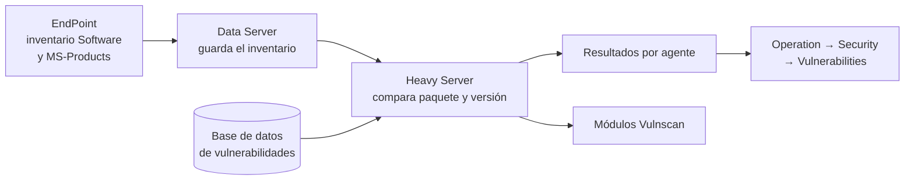

# Análisis de vulnerabilidades

Un servidor con un `openssl` de hace tres años no da ningún aviso. Arranca,
responde, pasa los chequeos de disponibilidad en verde y sigue así hasta el día
en que alguien usa ese paquete como puerta de entrada. El problema no es que no
se sepa que esa versión es vulnerable: está publicado, con su identificador y su
gravedad. El problema es que nadie ha cruzado esa lista con lo que hay instalado
en cada máquina.

Eso es lo que hace el análisis de vulnerabilidades de Pandora FMS. El EndPoint ya
envía el inventario de software de su equipo (nombre y versión de cada paquete);
el servidor lo compara con una base de datos de vulnerabilidades conocidas (los
**CVE**) y devuelve, por equipo y para toda la instalación, qué paquetes son
vulnerables, con qué gravedad y cuánto riesgo acumula cada sistema. En MS
Windows, además, revisa los productos de Microsoft y los parches (KB) que les
faltan, y permite instalarlos con el RMM.

Forma parte del menú **Security**, junto al [hardening](7.5-hardening.md) y la
[integridad de ficheros (FIM)](7.6-fim.md). El [SIEM](7.2-siem.md) vigila lo que
pasa; esto vigila lo que hay.

!!! info "No escanea la red ni ataca al equipo"
    El análisis no lanza pruebas de intrusión ni sondea puertos: trabaja solo con
    el inventario que el EndPoint ya envía. No genera tráfico contra el equipo
    analizado y no necesita credenciales nuevas. A cambio, solo ve lo que el
    inventario declara: un programa que el inventario no recoge no se analiza.

Con él obtienes:

- **La lista de paquetes vulnerables de cada equipo**, con el CVE que les
  afecta, su gravedad, su puntuación y la fecha de detección.
- **Un indicador de riesgo** por equipo y otro para el conjunto, de 0 a 10, que
  dice dónde mirar primero.
- **En MS Windows**, las vulnerabilidades de los productos de Microsoft según
  los KB que faltan, la lista de KB instalados y la opción de instalar los
  pendientes con el RMM.
- **Módulos de monitorización** con el número de vulnerabilidades de cada
  equipo, para alertar cuando sube, y elementos de informe y de *dashboard*.

## CVE y CVSS

Para leer la vista hacen falta dos siglas.

Un **CVE** (*Common Vulnerabilities and Exposures*) es el identificador único de
una vulnerabilidad concreta, con el formato `CVE-año-número` (por ejemplo,
`CVE-2024-6387`). Cada CVE trae una descripción, referencias a avisos de
fabricantes y bases de datos como la NVD del NIST, y su fecha de publicación. Es
el nombre común que usan fabricantes, investigadores y administradores para
hablar de lo mismo.

**CVSS** (*Common Vulnerability Scoring System*) es la forma estándar de medir
lo grave que es. Da una **puntuación** de 0 a 10 y un **vector** que describe
cómo se explota. La consola filtra y agrupa por estas métricas del vector:

| Métrica | Valores | Qué indica |
|---|---|---|
| **Attack Vector** | Network, Adjacent Network, Local, Physical | Desde dónde se puede explotar: desde cualquier red, desde la red local, con una sesión en el equipo o con acceso físico. |
| **Attack Complexity** | Low, High | Si el ataque se puede repetir sin condiciones especiales (*Low*) o depende de circunstancias que el atacante no controla (*High*). |
| **Privileges Required** | None, Low, High | Qué privilegios necesita el atacante en el sistema antes de empezar. |
| **User Interaction** | None, Required | Si hace falta que un usuario haga algo (abrir un fichero, pulsar un enlace). |
| Confidencialidad, integridad, disponibilidad | None, Low, High | Qué se pierde si el ataque sale bien. |

La **gravedad** sale de la puntuación, con la escala de CVSS:

| Puntuación CVSS | Gravedad |
|---|---|
| 0,0 | None |
| 0,1-3,9 | Low |
| 4,0-6,9 | Medium |
| 7,0-8,9 | High |
| 9,0-10,0 | Critical |

Si un CVE no trae puntuación, la gravedad se calcula a partir del impacto en
confidencialidad, integridad y disponibilidad.

## Cómo funciona



1. El EndPoint envía el inventario de software (módulo de inventario
   **Software**) y, en MS Windows, el de productos de Microsoft y KB (módulo
   **MS-Products**).
2. El **Data Server** guarda el inventario y, si el análisis está activo para
   ese agente, lo marca para analizar.
3. El **Heavy Server** recoge los inventarios marcados, compara cada paquete y
   su versión con la base de datos de vulnerabilidades (teniendo en cuenta el
   sistema operativo del agente) y guarda el resultado.
4. La consola muestra los resultados y el servidor actualiza los módulos
   **Vulnscan** del agente.

Lo que importa para entender lo que ves:

- **El análisis se repite cada vez que llega el inventario**, no con un
  temporizador propio. El inventario de los EndPoints se envía, por defecto,
  cada 7 días, así que los resultados se refrescan una vez por semana. Si
  actualizas un paquete, la vulnerabilidad desaparece de la vista con el
  siguiente envío de inventario.
- **Cada análisis sustituye al anterior** para ese agente: la vista enseña el
  estado actual, no un histórico.
- **En MS Windows hay dos análisis.** El de **Software** compara los programas
  instalados con la base de datos, que identifica el software por su nombre de
  paquete, como los de las distribuciones Linux (`openssl`, `firefox`): un
  programa de Windows se analiza cuando su nombre coincide con el de un paquete
  de la base de datos. El de **MS-Products** cruza los productos de Microsoft con
  los boletines de seguridad de Microsoft (MSRC) y cuenta como pendientes los KB
  que faltan, sin contar los que ya están instalados ni los que un KB posterior
  reemplaza. En MS Windows, por tanto, la mayor parte de los resultados viene de
  **MS-Products**: activa los dos inventarios.
- **El riesgo es la media de la puntuación CVSS** de las vulnerabilidades del
  equipo o del filtro, con un máximo de 10. Por debajo de 5 es **Low risk**,
  entre 5 y 7,5 **Medium risk** y por encima de 7,5 **High risk**. Es una media,
  no una suma: un equipo con tres vulnerabilidades críticas puede salir con más
  riesgo que otro con cuarenta de gravedad baja.

## Requisitos previos

| Requisito | Detalle |
|---|---|
| Versión Enterprise | El análisis de vulnerabilidades, su vista y sus ajustes son de la versión Enterprise. |
| Data Server y Heavy Server | Activos en `pandora_server.conf` (`dataserver 1` y `heavyserver 1`; los dos vienen activados). |
| EndPoint | Linux o MS Windows, versión **774 o superior**. Para cambiar el ajuste del análisis en un agente concreto, además, con la **configuración remota** activada. |
| Inventario de software | Activado en el EndPoint: el plugin `inventory` con `software` en Linux; `software_installed.vbs` en MS Windows y, para los productos de Microsoft, `ms_products.exe`. Vienen comentados. |
| Base de datos de vulnerabilidades | Instalada con el servidor en `/usr/lib/perl5/PandoraFMS/Vulnerabilities`. |
| Permisos | **AR** sobre el grupo del agente para ver la vista. **AW** para instalar KB. |
| Para instalar KB | Licencia de **Pandora RMM** y el agente RMM en el equipo, con el mismo nombre que su agente de Pandora FMS. Ver [Ejecución remota de scripts y comandos](../parte-3/3.4-ejecucion-remota-de-scripts-y-comandos.md). |

## La base de datos de vulnerabilidades

Pandora FMS no consulta servicios externos al analizar: la base de datos viaja
con el servidor. Se construye a partir de dos fuentes:

- **CVE-Search**, que reúne los datos de la NVD del NIST, de MITRE y de Red Hat.
- **Los repositorios de los fabricantes**: Canonical, Red Hat, Debian, Arch
  Linux, NVD y Microsoft Security Updates.

Se guarda en `/usr/lib/perl5/PandoraFMS/Vulnerabilities`, repartida en ficheros
por paquete, por CVE y por producto de Microsoft. El Heavy Server los vuelve a
leer en cada análisis, de modo que **actualizar la base de datos no exige
reiniciar el servidor**: el siguiente inventario que llegue ya se compara con
los datos nuevos.

Los paquetes se descargan de
<https://packages.pandorafms.com/09fee0f1c66c203ff8a2feffbb619f18/>:

| Paquete | Contenido |
|---|---|
| `package_edge.vdb` | Vulnerabilidades de los últimos 2 años. Es el más ligero. |
| `package_lite.vdb` | Vulnerabilidades de los últimos 5 años. **Es el que trae instalado la versión 805.** |
| `package_full.vdb` | La base de datos completa. |
| `BUILDS/package_build_AAAAMMDD.vdb` | Incrementales: cada uno completa los ficheros respecto al anterior. Se aplican en orden cronológico. |

Para actualizarla: los `.vdb` son ficheros ZIP. Se descomprimen sobre el
directorio de la base de datos, sobrescribiendo lo que haya, con un usuario con
permisos sobre él:

```bash
unzip -q -o "package_lite.vdb" -d "/usr/lib/perl5/PandoraFMS/Vulnerabilities"
```

Cambia el nombre del fichero por el paquete que hayas descargado
(`package_edge.vdb`, `package_full.vdb`). Con los incrementales, uno por uno y
del más antiguo al más reciente:

```bash
unzip -q -o "package_build_AAAAMMDD.vdb" -d "/usr/lib/perl5/PandoraFMS/Vulnerabilities"
```

Si tienes varios servidores de Pandora FMS, actualízala en todos los que
ejecuten el Heavy Server: cada uno analiza con su propia copia.

Para saber cuántos CVE conoce la base de datos instalada, cuenta sus ficheros de
CVE:

```bash
ls /usr/lib/perl5/PandoraFMS/Vulnerabilities/CVE | wc -l
```

## Activar el análisis

Hacen falta tres cosas: el interruptor general, que el agente no lo tenga
desactivado y que el EndPoint envíe el inventario de software.

### En la configuración general

En **Management → Settings → System Settings → General Setup**, pestaña
**Features**, el interruptor **Enable agent vulnerability scanning** activa el
análisis para todos los agentes que usan el ajuste global. Viene activado.


### En cada agente

En la edición del agente, pestaña **Security**, el campo **Vulnerability
scanning** decide qué hace ese agente:

- **Use global settings** (por defecto): sigue al interruptor general.
- **Enabled**: se analiza aunque el interruptor general esté apagado.
- **Disabled**: no se analiza nunca.


| Ajuste del agente | General activado | General desactivado |
|---|---|---|
| **Use global settings** | Se analiza | No se analiza |
| **Enabled** | Se analiza | Se analiza |
| **Disabled** | No se analiza | No se analiza |

Este ajuste solo se guarda si el agente tiene la **configuración remota**
activada y un EndPoint **774 o superior**. En la misma pestaña están el
hardening y el FIM.

### Inventario de software en el EndPoint

El análisis trabaja con el inventario, así que sin él no hay resultados. En el
fichero de configuración del EndPoint (o desde la consola, si tiene la
configuración remota activada):

En **Linux**, el plugin de inventario con, al menos, `software`. El primer
número es el intervalo en días:

```text
module_plugin inventory 7 software
```

La línea que trae comentada el fichero de configuración incluye el resto del
inventario (`cpu ram video nic hd cdrom software init_services filesystem users
route`); vale cualquiera de las dos mientras lleve `software`.

En **MS Windows**, quita el comentario de estos dos bloques. El primero envía el
software instalado y el segundo los productos de Microsoft y sus KB:

```text
module_begin
module_plugin cscript.exe //B //t:20 "%PROGRAMFILES%\Pandora_Agent\util\software_installed.vbs"
module_absoluteinterval 7d
module_end

module_begin
module_plugin "%PROGRAMFILES%\Pandora_Agent\util\ms_products.exe"
module_absoluteinterval 7d
module_end
```

Reinicia el servicio del EndPoint. Los resultados aparecen cuando llega el
primer inventario. El inventario completo se explica en
[Inventario](../parte-3/3.1-inventario.md).

## Consultar los resultados

### La vista general

**Operation → Security → Vulnerabilities** reúne los resultados de todos los
agentes que puedes ver (los de los grupos en los que tienes **AR**). Tiene
cuatro pestañas: **Summary**, **Software vulnerabilities**, **Microsoft products
vulnerabilities** y **Windows installed KBs**.

El menú de filtros es común a las cuatro y tiene dos pestañas:

- **Global**: **Group** (con **Recursion** para incluir los subgrupos) y
  **Agent search**, que busca en el alias del agente.
- **Vulnerabilities**: **Search** (busca en el nombre del paquete, el CVE y la
  versión), **Severity**, **Attack Complexity**, **Privileges Required**, **User
  Interaction** y **Attack Vector**.


### Summary

La foto de conjunto, pensada para decidir por dónde empezar:

- **System risk**: la puntuación de riesgo del filtro, su nivel (**Low**,
  **Medium** o **High risk**), cuántos agentes y vulnerabilidades la forman y la
  fecha del último análisis.
- **Severity**: cuántas vulnerabilidades tienen un impacto nulo (*None*), bajo
  (*Low*) o alto (*High*) en confidencialidad, integridad y disponibilidad.
- **Attack Complexity** y **Vulnerabilities by package**: el reparto por
  complejidad del ataque y por paquete.
- **Total summary**: cuántas vulnerabilidades de software, vulnerabilidades de
  productos de Microsoft y KB instalados hay en el filtro.
- Tablas de **Privileges Required**, **User Interaction** y **Attack Vector**,
  con el número de vulnerabilidades de cada valor.
- **Top vulnerabilities Agents**: los agentes con más vulnerabilidades, con su
  número y su riesgo.
- **Top vulnerabilities Packages**: los paquetes y CVE que más se repiten en la
  instalación.


Las dos tablas finales responden a dos preguntas distintas. La de agentes dice
qué equipo atender primero; la de paquetes, qué actualización arregla más cosas
de una vez.


### Software vulnerabilities

Una fila por vulnerabilidad: **Agent**, **Name** (el paquete), **Version** (la
instalada), **CVE**, **Severity**, **Score**, **Detection Time** y **Details**.


El icono del ojo de **Details** abre la ficha de la vulnerabilidad: paquete,
versión, CVE, puntuación CVSS, gravedad y el vector desglosado (**Attack
Vector**, **Attack Complexity**, **Privileges Required**, **User interaction**,
**Scope** y el impacto en confidencialidad, integridad y disponibilidad).


### Microsoft products vulnerabilities y Windows installed KBs

Solo tienen datos los EndPoints de MS Windows que envían el inventario
**MS-Products**.

**Microsoft products vulnerabilities** lista las vulnerabilidades por boletín:
**MSRC Document**, **Product**, **KB** (el parche que la corrige, con enlace a
su página de Microsoft), **Title**, **CVE**, **Severity**, **Score**,
**Detection Time** y **Details**. Solo aparecen los KB pendientes: los
instalados y los reemplazados por uno posterior no cuentan.


**Windows installed KBs** lista los KB que el equipo tiene instalados, con su
descripción y los agentes que los tienen.


### Vista de un agente

En la vista del agente, la pestaña **Vulnerabilities** tiene las mismas cuatro
pestañas filtradas para ese equipo. Aparece cuando el análisis está activo para
el agente y ya hay resultados.


En la vista principal del agente, el panel **Security** tiene un indicador
**Vulnerability** con el color de su riesgo: verde hasta 5, amarillo hasta 7,5
y rojo por encima.


## Aplicar parches de Microsoft

Los KB pendientes se pueden instalar con el RMM sin salir de la vista:

- **Install KB**: el icono de descarga junto al número de KB, en cada fila de
  **Microsoft products vulnerabilities**, instala ese KB en ese equipo.
- **Apply pending KB patches**: el botón de la parte inferior de la pestaña
  **Windows installed KBs** instala todos los KB pendientes de una vez. En la
  vista general abarca **todos los equipos que puedes ver** (los de tus grupos
  con **AR**) que tengan agente RMM; en la pestaña **Vulnerabilities** de un
  agente, solo los de ese equipo.

Las dos lanzan una ejecución única de la regla del RMM **Install Windows patch
from KB (online)** en el agente RMM del equipo y se siguen en **RMM → Queues**.
Necesitan el permiso **AW**, la licencia de Pandora RMM y un agente RMM con el
mismo nombre que el agente de Pandora FMS; si el equipo no tiene agente RMM,
**Install KB** no aparece. La regla instala en el equipo el módulo de PowerShell
`PSWindowsUpdate` y descarga el KB de Microsoft Update, así que el equipo
necesita salida a internet.

La instalación cambia el inventario del equipo, pero la vista no lo refleja
hasta que llega el siguiente inventario **MS-Products**. El RMM, sus colas y
sus reglas se explican en
[Ejecución remota de scripts y comandos](../parte-3/3.4-ejecucion-remota-de-scripts-y-comandos.md),
y la estrategia de parcheado, en [Parcheado de sistemas](../parte-3/3.5-parcheado-de-sistemas.md).

!!! warning "Planifica la instalación"
    Muchos KB de Microsoft no se completan hasta reiniciar el equipo. Para
    parchear un servidor concreto, usa **Install KB** en su fila o la pestaña
    **Vulnerabilities** de su agente, y hazlo dentro de una ventana de
    mantenimiento: lanzar **Apply pending KB patches** desde la vista general,
    que abarca todos los equipos que ves, sobre los servidores de producción a
    media mañana es la forma más rápida de convertir un informe de seguridad en
    una incidencia de disponibilidad.

## Alertas, informes y dashboards

Cada análisis crea o actualiza tres módulos en el agente, en el grupo de módulos
**Security**:

| Módulo | Qué mide |
|---|---|
| **Vulnscan - Number of vulnerabilities** | Vulnerabilidades de software encontradas. |
| **Vulnscan - Number of MS vulnerabilities** | Vulnerabilidades de productos de Microsoft (solo MS Windows con **MS-Products**). |
| **Vulnscan - Number of pending KBs** | KB pendientes (solo MS Windows con **MS-Products**). |

Son módulos normales, así que admiten umbrales y alertas: un umbral sobre
**Vulnscan - Number of vulnerabilities** avisa cuando aparece algo nuevo tras un
inventario. Cómo se configuran las alertas, en
[Alertas y notificaciones](../parte-5/5.5-alertas-y-notificaciones.md).

Los [informes](../parte-5/5.2-informes.md) tienen un grupo de elementos
**Vulnerabilities**: **Severity graph bar**, **Attack complexity doughnut
chart**, **By packages in pie chart**, **Detailed security report**,
**Vulnerabilities of agent**, **Top-N agents with more risk**, **Top-N common
vulnerabilities** y **Top N agents pending Microsoft patches**. En los
[dashboards](../parte-5/5.1-dashboards.md), el widget **Top N agents pending
Microsoft patches**.

## Operación y solución de problemas

| Síntoma | Qué mirar |
|---|---|
| El agente no tiene la pestaña **Vulnerabilities** | El análisis está desactivado para el agente (**Disabled**, o **Use global settings** con el interruptor general apagado) o todavía no hay resultados. |
| No hay resultados tras activar el análisis | El inventario de software está comentado en el EndPoint, todavía no ha llegado el siguiente envío de inventario o el Heavy Server está desactivado. |
| El campo **Vulnerability scanning** del agente no guarda el cambio | El agente necesita la configuración remota activada y un EndPoint 774 o superior. |
| Un equipo MS Windows tiene pocas vulnerabilidades de software o ninguna | Es lo esperado: la base de datos identifica el software por nombre de paquete y muchos programas de Windows se registran con otro nombre. Sus resultados vienen de **MS-Products**. |
| Las pestañas de Microsoft salen vacías | El EndPoint de MS Windows no envía **MS-Products**: falta el bloque de `ms_products.exe`. |
| No aparece el icono de **Install KB** | El equipo no tiene agente RMM con el mismo nombre que su agente de Pandora FMS, o tu usuario no tiene **AW**. |
| Una vulnerabilidad corregida sigue en la vista | La vista cambia con el siguiente inventario; si el inventario va cada 7 días, la corrección tarda hasta entonces en verse. |

Para comprobar a mano si una versión concreta de un paquete tiene
vulnerabilidades conocidas, sin esperar al siguiente inventario, usa
`pandora_manage` en el servidor. Recibe el nombre del paquete y la versión tal
como aparecen en el inventario y, de forma opcional, el sistema operativo tal
como lo informa el agente, para aplicar el mismo filtro por sistema operativo
que el análisis:

```bash
pandora_manage /etc/pandora/pandora_server.conf --check_vulnerabilities <software> <versión> [<sistema_operativo>]
```

Devuelve una lista JSON con una entrada por CVE que afecta a esa versión, con
los mismos datos que muestra la consola (gravedad, puntuación, vector CVSS,
descripción y referencias). Una lista vacía (`[]`) significa que la base de
datos no conoce vulnerabilidades para esa versión. Por ejemplo, para `openssl`
3.0.7 (salida recortada a una entrada y a sus campos principales):

```bash
pandora_manage /etc/pandora/pandora_server.conf --check_vulnerabilities openssl 3.0.7
```

```json
[
  {
    "product": "openssl",
    "version": "3.0.7",
    "cve": "CVE-2024-5535",
    "severity": "critical",
    "score": 9.1,
    "vector": "CVSS:3.1/AV:N/AC:L/PR:N/UI:N/S:U/C:H/I:N/A:H",
    …
  },
  …
]
```

Para seguir un análisis en el servidor, sube el nivel de registro a
`verbosity 10` en `pandora_server.conf`. En `pandora_server.log` aparecen el
inicio y el final de cada análisis y cada vulnerabilidad encontrada:

```text
Started Software vulnerabilities scan for agent [nombre-del-agente]
Found vulnerability CVE-2024-6387 on agent [nombre-del-agente] for product: openssh-server
Finished Software vulnerabilities scan for agent [nombre-del-agente]
```

Vuelve a dejar el nivel de registro como estaba al terminar: con `verbosity 10`
el registro crece deprisa.
