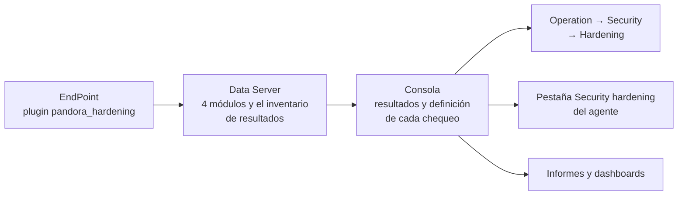

# Hardening

Un servidor recién instalado trae de serie la cuenta de invitado, contraseñas
de seis caracteres que nunca caducan y una docena de servicios que nadie ha
pedido. Funciona, que es lo único que se le exige el primer día. El problema
llega después, cuando esa configuración por defecto se queda tal cual durante
años y alguien de fuera la conoce mejor que quien la administra.

El *hardening* (fortalecimiento o bastionado del sistema) consiste en cerrar
esas puertas: quitar lo que sobra, endurecer lo que queda y comprobar que sigue
así. Esto último es lo que se olvida, porque una configuración segura se
degrada sola: una actualización que cambia un valor, un técnico con prisa, un
servicio que se activa «solo para probar». Por eso no es una tarea que se hace
una vez, sino una auditoría que se repite.

Pandora FMS hace esa auditoría desde el EndPoint. Comprueba cada sistema contra
las recomendaciones de los **CIS Benchmarks** (las guías de configuración
segura del *Center for Internet Security*), lo puntúa y guarda la evolución
para que veas si mejora o empeora. El [análisis de vulnerabilidades](7.4-analisis-de-vulnerabilidades.md)
te dice qué paquetes instalados tienen fallos conocidos; el *hardening* te dice
cómo está configurado lo que tienes. Son dos preguntas distintas y conviene
hacerse las dos.

!!! info "Audita, no corrige"
    La auditoría solo mide: no cambia ninguna configuración del sistema. Te dice
    qué chequeos fallan y por qué importan; la corrección la decides y la
    aplicas tú.

Con ella obtienes:

- **Una puntuación por sistema**, de 0 a 100, con el porcentaje de chequeos
  que aprueba.
- **El resultado de cada chequeo**, con su descripción, su justificación y sus
  referencias en los marcos de cumplimiento (CIS, PCI DSS, NIST, ISO 27001…).
- **La evolución en el tiempo**, por sistema y para toda la instalación.
- **Módulos de monitorización** con la puntuación y el número de chequeos, para
  alertar cuando baja, además de elementos de informe y un *widget* de
  *dashboard*.

## Cómo funciona



1. El *plugin* `pandora_hardening` se ejecuta en el EndPoint y lanza los
   chequeos que corresponden a su sistema operativo.
2. Envía el resultado con los datos del EndPoint: cuatro módulos con los
   totales y la puntuación, y un inventario con el resultado de cada chequeo.
3. La consola cruza ese inventario con la definición de cada chequeo (título,
   descripción, justificación y referencias) y lo muestra en las vistas,
   informes y *widgets*.

Lo que conviene saber para entender lo que ves:

- **La auditoría la hace el EndPoint**, con sus propios comandos y en local. El
  servidor no se conecta al sistema ni necesita credenciales.
- **Se repite cada 7 días** (`module_absoluteinterval 7d`). Si corriges algo, el
  cambio aparece en la siguiente auditoría.
- **Cada chequeo termina en uno de tres estados:** **Passed** (aprobado),
  **Failed** (fallido) o **Skipped** (no aplicable: es de otra versión del
  sistema operativo o busca un componente que no está instalado).
- **La puntuación es aprobados / (aprobados + fallidos) × 100.** Los no
  aplicables no cuentan: un servidor sin servidor web no aprueba ni suspende
  los chequeos de Apache.
- **Cada sistema operativo tiene sus chequeos.** Un MS Windows de escritorio
  puede pasar de mil resultados y una distribución Linux mínima quedarse en
  unas decenas aplicables. Compara la evolución de cada sistema consigo mismo
  antes que la puntuación de dos sistemas distintos.

## Requisitos previos

| Requisito | Detalle |
|---|---|
| Versión Enterprise | La auditoría de *hardening*, sus vistas y sus informes forman parte de la versión Enterprise. |
| EndPoint | Linux o MS Windows, versión **774 o posterior**. El *plugin* `pandora_hardening` se instala con el EndPoint (`/usr/share/pandora_agent/plugins/` en Linux, `%PROGRAMFILES%\Pandora_Agent\util\` en MS Windows). |
| Configuración remota | Activada en el EndPoint para activar la auditoría desde la consola. Sin ella, se activa en el fichero de configuración del EndPoint. |
| Permisos | **AR** sobre el grupo del agente para ver los resultados. Para activarla desde la consola, permiso de edición del agente. |

## Activar la auditoría

### Desde la consola

En la edición del agente, pestaña **Security**, activa **Enable security
hardening monitoring** y pulsa **Update**. La consola añade el bloque del
*plugin* a la configuración remota del EndPoint, que lo recoge en su siguiente
intervalo y lanza la primera auditoría.


El interruptor solo se puede usar si el agente tiene la configuración remota
activada y un EndPoint 774 o posterior; si no, aparece deshabilitado y un aviso
te dice cuál de las dos cosas falta. En la misma pestaña están el ajuste del
[análisis de vulnerabilidades](7.4-analisis-de-vulnerabilidades.md) y el
[FIM](7.6-fim.md).

### En el fichero de configuración del EndPoint

El fichero de configuración del EndPoint trae el bloque comentado. Descoméntalo
o añádelo:

En **Linux**:

```text
module_begin
module_plugin /usr/share/pandora_agent/plugins/pandora_hardening -t 150
module_absoluteinterval 7d
module_end
```

En **MS Windows**:

```text
module_begin
module_plugin "%PROGRAMFILES%\Pandora_Agent\util\pandora_hardening.exe" -t 150
module_absoluteinterval 7d
module_end
```

- `-t` es el tiempo máximo, en segundos, de cada comando que lanza la
  auditoría. Sin él, son 60 segundos.
- `module_absoluteinterval 7d` hace que la auditoría se ejecute una vez cada 7
  días, aunque el EndPoint envíe datos cada pocos minutos.

!!! info "Cada cuánto auditar"
    Siete días es un buen equilibrio. Puedes alargarlo hasta 30, pero no lo
    acortes: una auditoría diaria no te dice nada nuevo y llena la base de datos
    de resultados repetidos.

Para activarla en muchos equipos a la vez, añade el bloque a una
[política de monitorización](../parte-2/2.10-politicas-de-monitorizacion.md) y
aplícala al grupo. En MS Windows, el instalador del EndPoint también ofrece la
casilla **Enable Hardening monitoring**, que deja el bloque activado desde la
instalación.

### Políticas personalizadas

El *plugin* lleva integrado su conjunto de políticas, ficheros YAML con la
definición de cada chequeo. Para adaptarlas (desactivar un chequeo que no
aplica en tu organización o cambiar un valor esperado):

1. Descarga las políticas por defecto del
   [Marketplace de Pandora FMS](https://marketplace.pandorafms.com/entries/hardening-default-policies)
   y descomprímelas.
2. Edita los ficheros `.yml` que necesites.
3. Copia el directorio completo, con sus subdirectorios, a una ruta que pueda
   leer el EndPoint de cada sistema.
4. Añade `--policy-dir` y esa ruta a la línea del *plugin*:

```text
module_plugin /usr/share/pandora_agent/plugins/pandora_hardening -t 150 --policy-dir /ruta/a/las/politicas
```

El *plugin* lee todos los ficheros `.yml` de ese directorio. Si la ruta no
existe o no es un directorio, no hace la auditoría.

## Categorías de los chequeos

La consola agrupa los chequeos en categorías con los nombres de los **CIS
Controls**, el catálogo de controles de seguridad del CIS:

- **Inventory and Control of Enterprise Assets**
- **Inventory and Control of Software Assets**
- **Data Protection**
- **Secure Configuration of Enterprise Assets and Software**
- **Account Management**
- **Access Control Management**
- **Continuous Vulnerability Management**
- **Audit Log Management**
- **Email and Web Browser Protections**

Cada sistema muestra solo las categorías en las que tiene chequeos, y las
vistas, los filtros y los informes de *hardening* usan estas mismas
categorías.

## Consultar los resultados

### Vista de un agente

En la vista principal del agente, el panel **Security** resume su seguridad:
**SecurityMon** (el peor estado de los módulos del grupo **Security**),
**Hardening** (su puntuación) y, si están activos, **Vulnerability** y
**FIM**.


El detalle está en la pestaña **Security hardening** de la vista del agente.
Su bloque **Summary** reúne:

- **Total resume and last audit scan:** chequeos fallidos y aprobados, la
  puntuación y la fecha de la última auditoría.
- **Data categories** y **Total Checks:** el reparto por categorías y entre
  aprobados y fallidos.
- **Time line:** la evolución de aprobados y fallidos en cada auditoría.


- **Summary of categories:** por cada categoría, los aprobados, los fallidos y
  el porcentaje de aprobados. Es el sitio para decidir por dónde empezar.


Debajo, **Results for audit on** lista los chequeos de la última auditoría:
fecha, identificador, título, categoría y estado. Sus **Filters** acotan por
categoría y por estado (**Passed**, **Fail** o **Skipped**), y **Export to
CSV** descarga la lista. **History data** muestra los resultados de las
auditorías anteriores entre las fechas que elijas.


El ojo de **Details** abre la ficha del chequeo: su identificador, el título,
la descripción, la justificación (**Rationale**) y las referencias en los
marcos de cumplimiento (**Compliance**), como la sección del CIS Benchmark.


### Vista general

**Operation → Security → Hardening** reúne a todos los agentes que auditan y
que puedes ver. Tiene tres bloques, cada uno con sus propios **Filters**:

- **Historical summary:** el número de agentes y su puntuación media
  (**Total agents and scoring**), la media por grupo (**AVG Score by group**) y
  la evolución de aprobados y fallidos (**Time line**). Se filtra por grupo y
  fechas.


- **Category summary:** para la categoría que elijas en sus filtros, el reparto
  de chequeos (**Vulnerabilities**) y los fallidos de cada agente (**Checks
  failed by agent**).
- **Failure summary:** los chequeos que más fallan en la instalación, con el
  número de agentes en los que fallan (**Nº occurrences**), la puntuación de
  cada agente y el reparto de fallidos por categoría (**Data category
  failed**).


Las dos tablas de **Failure summary** responden a preguntas distintas. La de
chequeos te dice qué corrección arregla más sistemas a la vez; la de agentes,
qué sistema está peor.

### Agent security

**Operation → Security → Agent security** pone a cada agente en una fila con su
estado de seguridad: **SecMon**, **Hardening score** y **Vulnerability risk**.
Se filtra por grupo, por alias y por puntuación de *hardening* (**All**, o por
debajo de un porcentaje, de **< 90%** a **< 10%**), además de por **Secmon** y
**Vulnerability**.


## Corregir y volver a auditar

La auditoría te da la lista de lo que falla; el trabajo de corregirlo es tuyo.
Un ciclo razonable:

1. Empieza por **Summary of categories** en el agente o por **Failure summary**
   en la vista general, para elegir qué atacar primero.
2. Abre **Details** del chequeo. El título ya dice el valor esperado (por
   ejemplo, *Ensure 'Minimum password length' is set to '14 or more
   character(s)'*); la descripción y la justificación explican por qué, y la
   referencia del CIS Benchmark te lleva al procedimiento completo de
   corrección.
3. Aplica el cambio en el sistema, o en todos a la vez con una política de grupo
   o tu herramienta de gestión de configuración.
4. Espera a la siguiente auditoría: el chequeo pasa a **Passed** y la
   puntuación sube en **Time line**.

Si un chequeo no tiene sentido en tu organización, adapta la política (ver
[Políticas personalizadas](#politicas-personalizadas)) en lugar de convivir con
un fallo permanente que acaba por no leer nadie.

!!! warning "Prueba antes de corregir en producción"
    Los chequeos aplican la recomendación general del CIS, no las necesidades de
    tu servicio. Desactivar un protocolo antiguo o endurecer la política de
    contraseñas puede dejar fuera a una aplicación que dependía de ello. Prueba
    cada cambio en un sistema de pruebas y aplícalo en una ventana de
    mantenimiento: lo único peor que una auditoría en rojo es un servidor en
    verde que ya no da servicio.

## Alertas, informes y dashboards

Cada auditoría crea o actualiza cuatro módulos en el agente, en el grupo de
módulos **Security**:

| Módulo | Qué mide |
|---|---|
| **Hardening - Passed checks** | Chequeos aprobados. |
| **Hardening - Failed checks** | Chequeos fallidos. |
| **Hardening - Not applied checks** | Chequeos no aplicables a ese sistema. |
| **Hardening - Score** | Porcentaje de chequeos aprobados, de 0 a 100. |

Son módulos normales y admiten umbrales y alertas. Con umbrales en
**Hardening - Score** (por ejemplo, **Critical** de 0 a 50 y **Warning** de 50
a 70) el módulo cambia de estado cuando la puntuación baja, y una alerta te
avisa de que alguien ha deshecho el trabajo. Cómo configurarlas, en
[Alertas y notificaciones](../parte-5/5.5-alertas-y-notificaciones.md).

Los [informes](../parte-5/5.2-informes.md) tienen el grupo de elementos
**Security hardening**:

| Elemento | Qué muestra |
|---|---|
| **Top-N agents with the worst score** | Los agentes con peor puntuación, filtrados por grupo. |
| **Top-N most frequent failed checks** | Los chequeos que fallan en más agentes. |
| **Top-N checks failed by category** | Las categorías con más chequeos fallidos. |
| **Vulnerabilities by category** | Aprobados, fallidos y, si quieres, no aplicables de una categoría. |
| **List of checks** | La lista detallada de los últimos chequeos de un agente, por categoría y estado. |
| **Scoring by date** | La última puntuación de cada agente dentro del periodo del informe. |
| **Evolution** | La evolución diaria de la media de aprobados y fallidos. |

En los [dashboards](../parte-5/5.1-dashboards.md), el *widget* **Security
Hardening** muestra cualquiera de esos siete tipos, elegido en su opción
**Data type**.

## Operación y solución de problemas

| Síntoma | Qué comprobar |
|---|---|
| El interruptor **Enable security hardening monitoring** está deshabilitado | El agente no tiene la configuración remota activada o su EndPoint es anterior a la 774. El aviso junto al interruptor indica cuál. |
| No llegan datos tras activarla | El EndPoint aún no ha recogido la configuración (espera a su siguiente intervalo) o el bloque sigue comentado en su fichero de configuración. |
| Muchos chequeos en **Skipped** | Es lo esperado: son chequeos de otra versión del sistema o de componentes que no están instalados, y no cuentan en la puntuación. |
| La auditoría corta comandos | Sube el valor de `-t` en la línea del *plugin*. |
| La puntuación no cambia tras corregir | La vista cambia con la siguiente auditoría, cada 7 días. |
| El *plugin* con `--policy-dir` no envía resultados | La ruta no existe o no es un directorio accesible para el EndPoint. |

Para ver qué ha hecho el *plugin* en un EndPoint Linux, ejecútalo a mano como
`root` y revisa su salida, que es la misma que recibe el servidor:

```bash
/usr/share/pandora_agent/plugins/pandora_hardening -t 150
```
