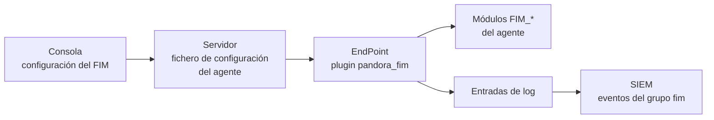

# FIM

Quien entra en un sistema sin permiso no suele dejar una nota. Deja una línea
nueva en `/etc/passwd`, un usuario más en `sudoers`, una entrada en `hosts` que
manda el tráfico de la actualización a otra parte o un `svchost.exe` que ya no
es el que instaló Microsoft. Son cambios pequeños en ficheros que casi nadie
abre, y precisamente por eso funcionan: el servidor sigue arrancando, los
servicios responden y la monitorización de siempre lo pinta todo de verde.

El **FIM** (*File Integrity Monitoring*, monitorización de la integridad de
ficheros) vigila esos ficheros y te avisa cuando alguien los crea, los cambia o
los borra. No te dice si el cambio es bueno o malo, porque eso solo lo sabe
quien administra el sistema; te dice que ha ocurrido, cuándo y en qué fichero.
El [*hardening*](7.5-hardening.md) comprueba que la configuración es segura; el
FIM, que nadie la ha tocado desde entonces.

Pandora FMS lo hace desde el EndPoint, en Linux y en MS Windows. Con él
obtienes:

- **Módulos en cada agente** con el estado de la integridad y el número de
  ficheros nuevos, cambiados y borrados, que admiten alertas como cualquier
  otro módulo.
- **Una vista de conjunto** con el estado de todos los agentes que vigilan
  ficheros.
- **Un evento del [SIEM](7.2-siem.md) por cada fichero afectado**, con la ruta
  y lo que ha cambiado: tamaño, permisos, propietario o contenido.

## Cómo funciona



1. Configuras el FIM en la consola, en el agente o en una política. La consola
   guarda esa configuración en el servidor, en un fichero propio de cada
   agente.
2. En cada intervalo, el EndPoint comprueba si su configuración del FIM ha
   cambiado y, si es así, la descarga.
3. Si el FIM está activado, el EndPoint ejecuta el *plugin* `pandora_fim`, que
   recorre los ficheros y directorios de la lista y los compara con lo que vio
   la vez anterior.
4. El *plugin* envía los módulos del FIM y una entrada de *log* por cada
   fichero nuevo, cambiado o borrado. El SIEM convierte esas entradas en
   eventos.

Lo que conviene saber para entender lo que ves:

- **De cada fichero compara** su existencia, su tamaño, sus permisos y su
  propietario, y su contenido (con un *hash*).
- **La comprobación se repite en cada intervalo del EndPoint.** Lo que se cambia
  y se deshace entre dos comprobaciones no se ve.
- **Un fichero se da por borrado** cuando lleva más tiempo sin verse que el
  indicado en **FIM Cache time (seconds)**.
- **No hace falta la configuración remota.** El EndPoint descarga la
  configuración del FIM aparte, aunque no tenga activada la configuración
  remota.

## Requisitos previos

| Requisito | Detalle |
|---|---|
| Versión Enterprise | El FIM, su configuración y su vista forman parte de la versión Enterprise. |
| EndPoint | Linux o MS Windows, versión **784 o posterior**. El *plugin* `pandora_fim` se instala con el EndPoint. |
| Permisos | **AR** sobre el grupo del agente para ver los resultados. Para configurarlo, permiso de edición del agente o de la política. |
| SIEM | Para ver el detalle de cada fichero cambiado. Ver [SIEM](7.2-siem.md). |

## Activar el FIM en un agente

En **Management → Resources → Manage agents**, edita el agente y abre la
pestaña **Security**. Activa **Enable FIM**, ajusta los campos y pulsa
**Update**.


| Campo | Por defecto | Qué hace |
|---|---|---|
| **FIM Directory max depth** | `3` | Niveles de subdirectorios que recorre dentro de cada directorio de la lista. |
| **FIM Directory max files** | `14` | Número máximo de ficheros que vigila en cada directorio. |
| **FIM File max size** | `200MB` | Tamaño máximo de los ficheros que vigila dentro de los directorios. Se indica con el valor y la unidad. |
| **FIM Skip extensions** | `md,txt,iso,cab` | Extensiones que ignora dentro de los directorios, separadas por comas. |
| **FIM Cache time (seconds)** | `3600` | Segundos que un fichero puede pasar sin verse antes de darse por borrado. |
| **FIM Files** | Según el sistema operativo | Ficheros y directorios que vigila, uno por línea (ver la sección siguiente). |

Los cuatro primeros límites solo afectan a los directorios. Existen para que
un directorio demasiado genérico (`C:\Windows\System32`, por ejemplo) no se
coma los recursos del sistema: mejor vigilar pocos ficheros bien elegidos que
recorrer media unidad en cada intervalo.

El interruptor solo se puede usar con un EndPoint 784 o posterior y si el
agente no recibe el FIM de una política; si no, aparece deshabilitado y un
aviso indica el motivo. La configuración llega al EndPoint en su siguiente
intervalo.

### Ficheros y directorios a vigilar

En **FIM Files** va una ruta por línea. Puede ser un fichero o un directorio, y
admite tres cosas más:

- **Comodines** (`*`, `?` y `[…]`) para rutas que cambian de un sistema a otro.
  Por ejemplo, la carpeta de inicio de todos los usuarios de MS Windows:

    ```text
    C:\Users\*\AppData\Roaming\Microsoft\Windows\Start Menu\Programs\Startup\
    ```

- **Exclusiones**: una línea que empieza por `exclude` descarta una ruta o un
  patrón de lo que vigilan las demás líneas:

    ```text
    /opt/myapp
    exclude /opt/myapp/*.tmp
    ```

- **Comentarios**: las líneas que empiezan por `#` no se tienen en cuenta.
  Sirven para dejar preparada una ruta y activarla cuando haga falta:

    ```text
    #exclude /opt/myapp/*.tmp
    ```

Al activar el FIM, la consola propone una lista según el sistema operativo del
agente. En **Linux**:

```text
/etc/passwd
/etc/shadow
/etc/group
/etc/gshadow
/etc/sudoers
/etc/security/limits.conf
/etc/hosts
/etc/hostname
/etc/resolv.conf
/etc/ssh/sshd_config
/etc/fstab
/etc/crontab
```

En **MS Windows**, los registros del sistema, los binarios que suelen
suplantarse y el fichero `hosts`:

```text
C:\Windows\System32\config\SAM
C:\Windows\System32\config\SYSTEM
C:\Windows\System32\config\SECURITY
C:\Windows\System32\config\SOFTWARE
C:\Windows\System32\config\DEFAULT
C:\Windows\System32\winlogon.exe
C:\Windows\System32\lsass.exe
C:\Windows\System32\services.exe
C:\Windows\System32\smss.exe
C:\Windows\System32\svchost.exe
C:\Windows\System32\csrss.exe
C:\Windows\System32\winload.exe
C:\Windows\System32\ntoskrnl.exe
C:\Windows\System32\drivers\etc\hosts
C:\Windows\explorer.exe
C:\Windows\System32\cmd.exe
C:\Windows\system32\WindowsPowerShell\v1.0\powershell.exe
C:\Windows\System32\wscript.exe
C:\Windows\System32\cscript.exe
C:\Windows\System32\taskmgr.exe
C:\Windows\SysWOW64\kernel32.dll
C:\Windows\SysWOW64\user32.dll
C:\Windows\SysWOW64\advapi32.dll
C:\Windows\SysWOW64\gdi32.dll
C:\Windows\SysWOW64\ntdll.dll
C:\Windows\SysWOW64\ole32.dll
C:\Windows\SysWOW64\shell32.dll
C:\Windows\SysWOW64\ws2_32.dll
C:\Windows\SysWOW64\cmd.exe
C:\Windows\SysWOW64\WindowsPowerShell\v1.0\powershell.exe
C:\Windows\SysWOW64\wscript.exe
C:\Windows\SysWOW64\regsvr32.exe
C:\Windows\SysWOW64\mshta.exe
```

Añade los ficheros de configuración de tus servicios (el servidor web, la base
de datos, las aplicaciones propias) y quita lo que no aplique.

!!! tip "Fuera los directorios que cambian solos"
    Un directorio de ficheros temporales, de *logs* o de cachés cambia en cada
    intervalo, y el FIM te avisará de cada cambio. Exclúyelo con `exclude` o
    con **FIM Skip extensions**: si el aviso salta siempre, el día que
    importa también lo ignorarás.

## Activar el FIM con políticas

Para configurar el FIM en muchos agentes a la vez, usa una
[política de monitorización](../parte-2/2.10-politicas-de-monitorizacion.md).
En **Management → Resources → Manage policies**, edita la política y abre la
pestaña **File Integrity Monitoring**. Tiene los mismos campos que el agente y
dos interruptores:


| Apply FIM from this policy | Enable FIM | Qué pasa en los agentes de la política |
|---|---|---|
| Desactivado | Cualquiera | La política no toca el FIM: cada agente conserva el suyo. |
| Activado | Activado | La política configura el FIM con sus valores y activa los módulos del FIM. |
| Activado | Desactivado | La política desactiva el FIM y sus módulos. |

La tercera combinación sirve para apagar el FIM en un grupo entero de agentes
de una vez. Los cambios llegan a los agentes al aplicar la política.

Mientras un agente recibe el FIM de una política, su pestaña **Security**
muestra los campos bloqueados y el aviso **This agent has a FIM policy**, con
un enlace a la política. Los cambios se hacen en la política.

!!! warning "Políticas para MS Windows"
    La pestaña de la política propone siempre la lista de ficheros de Linux. En
    una política para agentes MS Windows, sustitúyela por la lista de MS
    Windows de la sección anterior.

## Consultar los resultados

### Módulos del agente

Cada agente con el FIM activado tiene cinco módulos:

| Módulo | Qué mide |
|---|---|
| `FIM_status` | Estado de la integridad de los ficheros vigilados. Pasa a crítico cuando el FIM detecta cambios. |
| `FIM_status_last_change` | Fecha y hora del último cambio de estado de `FIM_status`. |
| `FIM_new` | Ficheros nuevos detectados en la última comprobación. |
| `FIM_changed` | Ficheros cambiados en la última comprobación. |
| `FIM_deleted` | Ficheros borrados detectados en la última comprobación. |

Al desactivar el FIM, la consola deshabilita estos módulos; al volver a
activarlo, los habilita de nuevo.

En la vista principal del agente, el panel **Security** muestra **FIM** con el
estado de la integridad. Un clic te lleva a los eventos del SIEM de ese
agente.


### Vista File integrity

**Operation → Security → File integrity** reúne a todos los agentes con el FIM
activado: su grupo, su sistema operativo, el estado (**FIM status**), la fecha
del último cambio (**Last change**) y los ficheros nuevos, cambiados y
borrados. Sus **Filters** acotan por agente y por estado: **Fired** (con
cambios) o **Not fired** (sin ellos).


El nombre de cada agente lleva a su configuración del FIM, y los contadores, a
sus eventos del SIEM.

### Eventos del SIEM

El detalle de cada cambio está en el SIEM. Las reglas del grupo `fim` vienen
de serie y generan un evento de nivel 7 por cada fichero:

| Evento | Cuándo |
|---|---|
| `FIM: New file: <ruta>` | Aparece un fichero nuevo. |
| `FIM: Altered file: <ruta> new size <bytes>` | Cambia el tamaño. |
| `FIM: Altered file: <ruta> new access <propietario>(<permisos>)` | Cambian los permisos o el propietario. |
| `FIM: Altered file: <ruta> (content changed)` | Cambia el contenido. |
| `FIM: Deleted file: <ruta>` | Desaparece un fichero. |

Para verlos todos, en **Operation → SIEM → Events** filtra por **SIEM group**
`fim`.


## Alertas

Los módulos del FIM admiten alertas como cualquier otro. La más directa es una
alerta sobre `FIM_status` cuando pasa a crítico: te avisa en cuanto el FIM
detecta un cambio en el agente. Cómo configurarlas, en
[Alertas y notificaciones](../parte-5/5.5-alertas-y-notificaciones.md).

Si quieres avisos por fichero (por ejemplo, solo cuando cambie `sudoers`), usa
las alertas del [SIEM](7.2-siem.md) sobre los eventos del grupo `fim`.

## Operación y solución de problemas

| Síntoma | Qué comprobar |
|---|---|
| **Enable FIM** está deshabilitado | El EndPoint es anterior a la 784 o el agente recibe el FIM de una política. El aviso junto al interruptor indica cuál. |
| No aparecen los módulos del FIM tras activarlo | El EndPoint aún no ha descargado la configuración: espera a su siguiente intervalo. En Linux, su *log* registra `FIM configuration updated` cuando la recibe. |
| Hay cambios en cada intervalo sin que nadie toque nada | La lista incluye directorios que cambian solos (temporales, *logs*, cachés). Exclúyelos con `exclude` o con **FIM Skip extensions**. |
| El EndPoint consume demasiados recursos | Baja **FIM Directory max depth**, **FIM Directory max files** o **FIM File max size**, o cambia los directorios genéricos por ficheros concretos. |
| Los contadores cambian, pero no hay eventos en el SIEM | El SIEM no está recibiendo los *logs* de ese agente. Ver [SIEM](7.2-siem.md). |
| Los cambios en el agente no se guardan | El agente recibe el FIM de una política: cámbialo en la política. |
