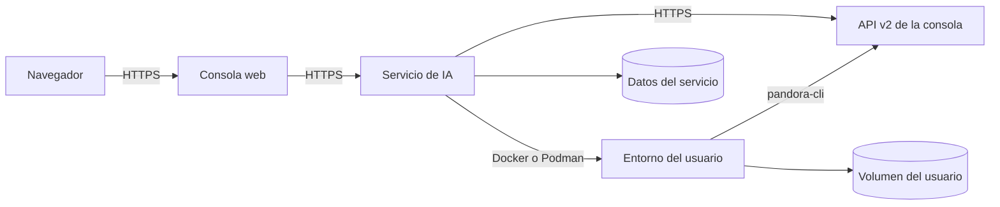

# Introducción e instalación

Pandora AI es un asistente de inteligencia artificial integrado en la consola
web. Cada usuario conversa con él para consultar el estado de la plataforma
(agentes, módulos, eventos, alertas, servidores, inventario y auditoría) y para
ejecutar acciones con los mismos permisos que tendría en la consola. No es un
chat genérico aislado: conoce el producto porque trabaja contra su API a través
de `pandora-cli`, y cada usuario lo hace en un entorno separado.

El asistente no viene activado. El servicio se instala con el servidor de
Pandora FMS, pero no arranca solo y la funcionalidad está apagada en la consola
hasta que un administrador la enciende y la configura. Esta página cubre la
instalación, la configuración y la puesta en marcha; el uso diario se explica en
[Uso del chat](8.2-uso-del-chat.md), las tareas programadas en
[Automatización de tareas](8.3-automatizacion-de-tareas.md), y los permisos y el
modelo de seguridad en [Seguridad](8.4-seguridad.md).

## Arquitectura

El asistente se apoya en cuatro piezas. La consola no habla nunca con el
proveedor de IA: habla con un servicio propio, y ese servicio es el que prepara
un entorno aislado para cada usuario.

| Pieza | Dónde vive | Qué hace |
|---|---|---|
| Consola web | Servidor de Pandora FMS | Interfaz del chat, permisos y configuración |
| Servicio de IA | Servidor de Pandora FMS u otra máquina | Única salida hacia el proveedor y hacia los entornos de usuario |
| Entorno del usuario | Motor Docker o Podman del servicio | Ejecuta el asistente y `pandora-cli` |
| Volumen del usuario | Carpeta de datos del servicio | Guarda las sesiones y los adjuntos |

El entorno de cada usuario es **efímero**: se crea al usar el asistente y se
elimina por inactividad o al parar el servicio. Lo que persiste es su volumen,
de modo que la conversación y los ficheros siguen ahí en el siguiente uso.



El asistente tiene reglas fijas: solo puede escribir en Pandora FMS a través de
[`pandora-cli`](../parte-13/13.5-cli-de-la-api-v2-pandora-cli.md), no accede a la base de datos ni a los ficheros del sistema y solo
puede leer los ficheros que el usuario sube a su sesión. Los detalles están en
[Seguridad](8.4-seguridad.md).

## Requisitos previos

| Requisito | Detalle |
|---|---|
| Versión | Pandora FMS Enterprise 8.0NG.806 o superior |
| Motor de contenedores | Docker o Podman en la máquina del servicio, accesible por el servicio |
| Imagen del asistente | `pandorafms/pandorafms-pi-runner:latest`, disponible en el motor; se descarga sola si hay acceso al registro |
| API de la consola | Alcanzable por HTTPS desde el servicio |
| Lista de acceso a la API | La IP del servicio debe estar en **IP list with API access** |
| Proveedor de IA | Proveedor contratado, su clave y un modelo |
| Disco | Espacio para los datos de cada usuario y para la auditoría |
| Recursos | CPU y memoria para un entorno por usuario activo y hasta cuatro tareas programadas simultáneas |
| Red | Puerto 9080 entre la consola y el servicio; salida al proveedor de IA |
| Permisos | Un administrador de la consola para activar y configurar |

No hay una licencia «Pandora AI» que activar: la funcionalidad se gobierna con
el interruptor **Enable Pandora AI** de la configuración general.

!!! warning "La clave del proveedor se guarda en la base de datos"
    Si la base de datos de la consola no tiene configurada
    `encryption_passphrase`, la clave del proveedor se guarda sin cifrar y la
    propia pantalla de configuración lo avisa. Configura el cifrado antes de
    guardar la clave; el procedimiento está en
    [Cifrado de la base de datos](../parte-9/9.5-cifrado-de-la-base-de-datos.md).

## Instalación

El servicio se instala de dos formas: con el servidor de Pandora FMS o con un
paquete independiente, que sirve para ponerlo en otra máquina. En los dos casos
el binario, las *skills* y el fichero de configuración son los mismos.

### Con el servidor de Pandora FMS

El instalador del servidor copia el servicio y crea su unidad de systemd:

| Elemento | Ruta |
|---|---|
| Binario del servicio | `/usr/bin/pandora_ai_server` |
| CLI que usa el asistente | `/usr/bin/pandora-cli` |
| Configuración | `/opt/pandorafms/pandora_ai/pandora_ai_server.conf` |
| *Skills* del asistente | `/opt/pandorafms/pandora_ai/skills` |
| Datos | `/opt/pandorafms/pandora_ai` |
| Unidad | `/etc/systemd/system/pandora_ai_server.service` |

Si el fichero de configuración ya existe, el instalador no lo pisa: deja el
nuevo como `pandora_ai_server.conf.new` para que se fusionen a mano.

!!! warning "El servicio se instala, pero no arranca"
    El instalador termina diciéndolo: `pandora_ai_server` **no** se inicia solo.
    Hasta que no se arranque, la prueba de conexión de la consola falla y el
    asistente no responde.

```sh
systemctl daemon-reload
systemctl start pandora_ai_server
systemctl status pandora_ai_server
```

### En una máquina aparte

El paquete `pandorafms_ai_server.tar.gz` contiene el binario, `pandora-cli`, las
*skills*, el fichero de configuración y un instalador:

```sh
tar xzf pandorafms_ai_server.tar.gz
cd pandora_ai_server
./pandora_ai_server_installer --install
```

El instalador usa las mismas rutas, admite `--destdir` para instalar en un
directorio distinto y deja la configuración existente intacta (genera `.new`).
La máquina debe tener el motor de contenedores, conectividad HTTPS con la API de
la consola y salida al proveedor de IA. Para desinstalarlo:

```sh
./pandora_ai_server_installer --uninstall
```

La desinstalación borra el binario y la unidad, pero **conserva** la
configuración, las *skills* y los datos.

### Comprobar que el servicio responde

`GET /health` no pide autenticación y distingue un servicio caído de una consola
mal configurada:

```sh
curl -k https://127.0.0.1:9080/health
# {"status":"ok"}
```

Si responde, el servicio está vivo. Si no responde, el problema no está en la
configuración de la consola: mira `journalctl -u pandora_ai_server`.

## Configuración del servicio

El servicio se configura **solo por fichero**: la consola guarda la conexión, el
proveedor y los permisos, pero las rutas, el motor de contenedores, los límites y
la retención viven en `pandora_ai_server.conf`.

| Bloque | Claves | Por defecto | Cuándo cambiarlo |
|---|---|---|---|
| Servidor | `listen_host`, `listen_port` | `127.0.0.1`, `9080` | Consola en otra máquina: escuchar en la IP de red y abrir el puerto solo a la consola |
| TLS | `tls_auto_generate`, `tls_cert`, `tls_key` | `1`, vacío, vacío | Certificado propio: `tls_auto_generate = 0` y las dos rutas |
| API de la consola | `pandora_api_url`, `pandora_api_accept_self_signed`, `pandora_api_cert`, `pandora_api_ca` | `https://127.0.0.1/pandora_console/api/v2/`, `1` | Otra URL, o verificar el certificado de la consola |
| Contenedor | `container_image`, `container_bin`, `container_user`, `cli_bin`, `skills_path`, `container_cpus`, `container_memory_mb` | `pandorafms/pandorafms-pi-runner:latest`, `docker`, `1001:1001`, `/usr/bin/pandora-cli`, `/opt/pandorafms/pandora_ai/skills`, `1`, `2048` | Podman, rutas distintas o más recursos |
| Agente | `agent_prompt` | vacío | Instrucciones extra del cliente: complementan el comportamiento, nunca lo sustituyen |
| Almacenamiento | `storage_path` | `/opt/pandorafms/pandora_ai` | Otro disco o ruta |
| Tareas programadas | `scheduled_max_containers` | `4` | Más concurrencia, con más recursos |
| Diagnóstico | `debug`, `debug_path` | `0`, `/opt/pandorafms/pandora_ai/debug/` | Investigar un fallo; las trazas pueden contener la conversación |
| Tiempos | `request_timeout` | `60` | Modelos lentos |
| Limpieza | `cleanup_interval_seconds`, `container_expiration_seconds`, `session_expiration_seconds`, `audit_expiration_seconds`, `uploaded_files_expiration_seconds` | `3600`, `604800`, `604800`, `2592000`, `2592000` | Otra retención; se detalla en [Auditoría](8.5-auditoria.md) |
| Apagado | `stop_containers_on_shutdown` | `1` | Conservar los entornos al parar; los volúmenes se conservan igual |

Dos avisos que ahorran una tarde de diagnóstico:

- Con `tls_auto_generate = 1` el certificado se genera **en cada arranque**. Si
  la consola no acepta autofirmados, hay que usar un certificado propio; fijar
  el certificado autofirmado en la consola deja de servir tras reiniciar el
  servicio.
- La carpeta de datos (`storage_path`) debe ser escribible por el servicio para
  que cada usuario pueda guardar sus sesiones y sus adjuntos.

Con la consola y el servicio en máquinas distintas, las dos direcciones tienen
que ser alcanzables: consola → servicio y servicio → API de la consola. Abre solo
el puerto del servicio y restringe el origen a la consola.

## Configuración en la consola

La configuración está en **Management → Settings → System Settings → Pandora
AI**, y solo la ve un administrador.

Antes de entrar, activa **Enable Pandora AI** en **General Setup**. Sin ese
interruptor no aparece ni la sección ni el menú del usuario, y el icono del chat
avisa de que la funcionalidad está desactivada.

### Service

La pestaña **Service** conecta la consola con el servicio y elige el proveedor.

{ .captura }

| Campo | Por defecto | Qué hace |
|---|---|---|
| **Service URL** | `https://127.0.0.1` | Dirección del servicio; solo admite HTTPS |
| **Service port** | `9080` | Puerto del servicio |
| **AI provider** | — | Proveedor; la lista la ofrece el propio servicio |
| **API key** | (vacío) | Clave global del proveedor; vacía conserva la actual |
| **Default model** | (vacío) | Modelo por defecto; la lista la ofrece el servicio |

**Test connection** prueba los valores que hay en el formulario, no los
guardados, así que se puede comprobar antes de pulsar **Update**. El estado
también se comprueba al entrar en la página. Si falla, el mensaje recuerda
arrancar el servicio.

La lista de proveedores y modelos la ofrece el servicio. Si añades un proveedor
nuevo, aparece sin necesidad de actualizar la consola.

### Security

La pestaña **Security** decide si la consola acepta el certificado del servicio.

{ .captura }

| Campo | Por defecto | Qué hace |
|---|---|---|
| **Accept self-signed certificates** | Activado | Acepta el certificado del servicio sin verificarlo; las dos rutas siguientes se ignoran |
| **Service certificate (PEM file)** | (vacío) | Certificado del servicio, si se verifica |
| **CA certificate (PEM file)** | (vacío) | CA que firmó el certificado del servicio |

Mientras se aceptan autofirmados, las rutas no se usan. Es lo cómodo en una
prueba y lo razonable si el servicio se instala con su certificado por defecto;
para producción, un certificado propio y la CA son la opción estable.

### Chat

La pestaña **Chat** tiene un único ajuste: **Allow uploading files to the chat**, activado por defecto.

{ .captura }

Los ficheros que sube un usuario se guardan en su espacio y el asistente solo
puede leerlos. Se borran con la misma retención que la auditoría.

### Usuarios y grupos

Las cuatro pestañas restantes deciden quién puede usar el asistente. **Allowed
users** y **Blocked users** trabajan con usuarios; **Allowed groups** y
**Blocked groups**, con grupos y, si se activa, con sus subgrupos.

{ .captura }

{ .captura }

La regla que resuelve casi todas las dudas: **el bloqueo siempre gana**. Un
usuario bloqueado, o que pertenece a un grupo bloqueado, no usa Pandora AI
aunque esté en la lista de permitidos o aunque **All users** esté activo. La
precedencia completa y el efecto de cada lista están en
[Seguridad](8.4-seguridad.md).

## Skills del asistente

Las *skills* son las instrucciones que enseñan al asistente a hacer una tarea de
una forma concreta. El producto instala tres por defecto:

| *Skill* | Para qué |
|---|---|
| `default-pandora-create-agent` | Crear o registrar un agente |
| `default-pandora-create-module` | Crear un módulo en un agente |
| `default-pandora-create-report` | Crear un informe |

Puedes añadir *skills* propias en la carpeta `skills_path` del servicio. Las
*skills* del cliente se conservan al actualizar; las `default-*` se sustituyen
en cada actualización. Si una *skill* propia necesita un nombre distinto de
`default-*`, no hay que hacer nada más: el instalador solo reemplaza las que
empiezan por ese prefijo.

## Puesta en marcha

El orden importa: cada paso comprueba el anterior.

1. Instala el servidor, o el paquete independiente del servicio.
2. Comprueba el motor de contenedores con `docker info` o `podman info`, y que
   la imagen del asistente está disponible.
3. Ajusta `pandora_ai_server.conf`: escucha, URL de la API, rutas y recursos.
4. Arranca el servicio y comprueba `/health` y el log.
5. Pon la consola en HTTPS y añade la IP del servicio a **IP list with API
   access**.
6. Activa **Enable Pandora AI**.
7. Rellena **Service** y pulsa **Test connection** hasta ver el estado en verde.
8. Resuelve los certificados en **Security**.
9. Decide quién puede usarlo en las pestañas de usuarios y grupos.
10. Si quieres adjuntos, actívalos en **Chat**; si quieres tareas programadas,
    créalas como se explica en [Automatización de tareas](8.3-automatizacion-de-tareas.md).
11. Abre el icono del asistente, envía una petición sencilla y comprueba que la
    conversación aparece en [Auditoría](8.5-auditoria.md).

## Operación y mantenimiento

- **Entornos de usuario**: se eliminan por inactividad (una semana por defecto)
  y al parar el servicio si `stop_containers_on_shutdown = 1`. Los datos del
  volumen no se tocan.
- **Limpieza**: una pasada por hora aplica la retención de entornos, sesiones,
  auditoría y adjuntos.
- **Diagnóstico**: con `debug = 1`, cada turno escribe un log con las
  herramientas usadas, los tiempos y los errores, además de una revisión del
  propio modelo cuando el turno usó herramientas, fue lento o falló. Puede
  contener la conversación: trátalo como información sensible.
- **Actualización**: el instalador sustituye el binario, la unidad y las
  *skills* `default-*`. Las *skills* propias del cliente se conservan. Si la
  configuración cambió, aparece un `.new` y hay que fusionarlo a mano.
- **Copia de seguridad**: la carpeta de datos del servicio (sesiones, adjuntos y
  auditoría) y el fichero de configuración. Los entornos no se copian: se
  recrean.
- **Recursos**: cada usuario activo puede tener un entorno con sus límites, y
  las tareas programadas añaden entornos hasta `scheduled_max_containers`.
  Vigila disco y memoria.
- **Command Center**: cada consola habla con su servicio. No hay una vista
  centralizada de la auditoría de varios nodos; si se despliega en un Command
  Center, cada nodo se configura y se audita por separado.

## Solución de problemas

| Síntoma | Causa probable | Qué comprobar |
|---|---|---|
| **Test connection** en rojo | Servicio parado | `systemctl status pandora_ai_server` y `journalctl` |
| | URL o puerto incorrectos | `listen_host` y `listen_port` frente a los valores del formulario |
| | Certificado no aceptado | **Security**: aceptar autofirmados o instalar certificado y CA |
| | Cortafuegos | Puerto 9080 entre consola y servicio |
| La consola responde 401 o 403 | IP del servicio fuera de la lista | **IP list with API access** |
| | Usuario sin permiso | Listas de usuarios y grupos; el bloqueo gana |
| El entorno del usuario no arranca | Docker o Podman no accesible | `docker info` o `podman info` |
| | Imagen no disponible | `docker images` y acceso al registro |
| | Permisos de la carpeta de datos | El servicio debe poder escribir en `storage_path` |
| | Límites de recursos | `container_cpus` y `container_memory_mb` |
| El asistente dice que no puede | `pandora-cli` no disponible | `cli_bin` en la configuración del servicio |
| Las respuestas tardan o fallan | Modelo o proveedor | Clave, modelo por defecto y `request_timeout` |
| No hay notificaciones | Cron de la consola parado o fuente sin configurar | Cron y preferencias de notificación del usuario |
| La auditoría sale vacía | Retención o permisos | Retención y perfil |
| Se llena el disco | Sesiones, adjuntos o auditoría | Retención y tamaño de `storage_path` |

El orden de descarte es siempre el mismo: `/health` descarta el servicio,
**Test connection** descarta la consola, el log del servicio descarta el entorno
del usuario y la auditoría descarta al usuario.
